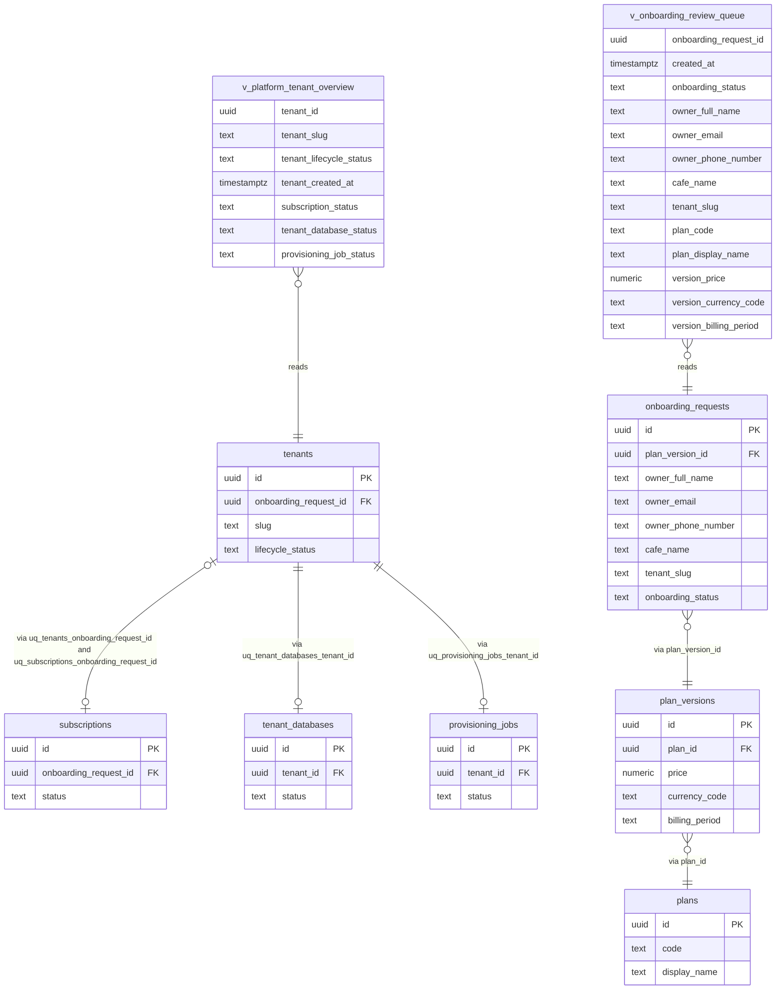

# Database Views Strategy

A short reviewed set of rules so CafeHub read models are designed deliberately: when a database view is the right tool, which read models become views, how views are created and mapped, and when (if ever) a materialized view is allowed. Companion documents: `architecture/database-conventions.md` (naming and migration conventions), `architecture/indexing-and-pagination-strategy.md` (the index inventory the views' consumer queries run against, and the per-list pagination decisions), `architecture/erd-master.md` and `architecture/erd-tenant.md` (the tables views read), `architecture/database-schema-decisions.md`, and `architecture/architecture-decisions.md`. Requirement identifiers cited in this document exist in the PRD and were verified there before use; the PRD text itself stays untracked.

Two kinds of content are distinguished throughout:

- **Stated by this story** — the requirements the story fixes: views are created through migrations with raw SQL and mapped as keyless entities, views never expose secrets, and the materialized-view rule exists.
- **Proposed, pending owner confirmation** — the reading of those requirements into concrete rules, view names, and column lists. Every proposal carries a why and a rejected alternative, and the complete proposal list belongs to this story's review.

This sub-task is documentation only: no entity, migration, DbContext, or view is created in code; no ERD or conventions file is edited. The story that introduces the first read-model work is the one that creates the actual migration and keyless entity described here.

## 1. When a view is the right tool

**Proposed, pending owner confirmation.** A database view is the right tool when at least one of the following holds:

- **A stable, security-reviewed read model.** One screen consumes a fixed projection across sessions and reviewers, so the exposed columns should be a named, diffable object whose column list is reviewed as a security surface exactly once — not spread across copies of a query. Why: the review-relevant guarantee ("these columns and no others, no secrets, no hashes") lives in one schema object whose change is a reviewed migration, instead of in application code that can drift silently.
- **A join chain reused by more than one consumer.** Two or more queries need the same multi-table projection; writing it once keeps the row-identity guarantees (no duplicated rows) declared in one place. Why: duplicated join SQL across handlers drifts — one copy gains a column or relaxes a filter and the read models disagree in ways unit tests with hand-written fakes cannot catch at the database boundary.
- **A cross-module boundary the platform owns.** A platform-level inspection view (for example the Super Admin tenant overview) is not one screen's business logic; it is a platform read model. Why: naming it in the schema makes the Master database — not a WebApi handler — the owner of what platform inspection exposes.

**Rejected alternative (for all three).** In-memory EF Core projections per handler for these cases: the same access path is then written in several places, the security review of what is exposed cannot attach to a schema object, and the drift problem returns. Plain projections remain the right tool for every single use, which is exactly what the wrong-tool list below assigns them.

## 2. When a view is the wrong tool

**Proposed, pending owner confirmation.** Use a plain query or projection instead, when:

- **One-off or single-screen logic.** A query one handler runs once with application logic around it is not a schema object. Why: a view for a single use adds migration surface and review cost for a projection EF Core composes natively at the same quality.
- **Dynamic, per-request parameters.** PostgreSQL plain views take no per-call parameters: every filter stays in the consuming `WHERE`. A case whose shape changes per request (tenant slug, date ranges, arbitrary status sets) is a query, not a view. Why: baking one parameter combination into a view freezes one request shape into schema while every other shape still needs a query — two sources of truth for the same read.
- **Writes.** Views are read-only; every write path is the entity layer. Why: an updatable view or trigger chain would move application write rules into the database where neither the review style nor the zero-viewport (keyless, no change tracking) mapping can see them.
- **Tenant isolation.** The tenant boundary is the validated tenant context and the resolved connection, both fail-closed (`architecture/database-schema-decisions.md`); a view is never the isolation mechanism. Why: a view filters rows; isolation is which database a request reaches at all — expressing that inside schema objects would invent a second, weaker access-control layer the fail-closed context must still carry.
- **Deep supporting logic already written once.** If a first-class query handler already exists for the read, wrap nothing. Why: a view "over" a handler's query re-centers the query's review in SQL, and the pagination contract (cursor style, sorts) belongs to the query as designed in `architecture/indexing-and-pagination-strategy.md`, section 4.

## 3. Candidate views

Both candidates are on the Master database and both are **Proposed, pending owner confirmation**. Candidate views are named with the `v_` prefix, snake_case, per `architecture/database-conventions.md`. The diagram shows the two read models and their source joins with key columns only; every join below is a many-to-one or zero-or-one chain from one row-producing table, so a view can never fan rows out.

### v_platform_tenant_overview (Master)

- **Serves:** the authorized Super Admin's tenant/subscription inspection list — tenant identity with its current subscription state and latest provisioning state (FR-PLT-005).
- **Source tables and join guarantees:** `tenants` is the row producer. `subscriptions` joins through the onboarding-request chain, using `tenants.onboarding_request_id` (`uq_tenants_onboarding_request_id`) to `subscriptions.onboarding_request_id` (`uq_subscriptions_onboarding_request_id`) — both are nullable-FK unique anchors and the ERD's ownership rule allows exactly one of the two anchors to be populated, so the tenant anchor is deliberately **not** used: it stays `NULL` inside the approval window when the tenant row already exists but `subscriptions.tenant_id` is set only after the linking update. `tenant_databases` joins on `uq_tenant_databases_tenant_id` and `provisioning_jobs` on `uq_provisioning_jobs_tenant_id`; each is zero-or-one per tenant, so the view yields exactly one row per tenant and no fan-out. `LEFT JOIN` semantics: a brand-new tenant row may briefly miss any of the three, and the view shows `NULL` rather than hiding the row — showing a tenant whose state is not yet linked is what the inspection needs (FR-ONB-005's sequence: tenant, database reference, and job are created at distinct moments).
- **Columns (the complete explicit list):** `tenant_id`, `tenant_slug`, `tenant_lifecycle_status`, `tenant_created_at`, `subscription_status`, `tenant_database_status`, `provisioning_job_status`.
- **Deliberately excluded:** `tenant_databases.secret_reference` — it is infrastructure metadata for the fail-closed connection resolver (`TenantConnections:<SecretReference>`, PRD sections 10.2 and 11.1), not inspection content; the platform overview needs the statuses, never the reference. No audit columns beyond `tenant_created_at` (needed for the overview's deterministic sort), and no other registry internals.
- **Consumer query shape:** offset paging with an optional total, sort `tenant_created_at DESC, tenant_id ASC` per the Master tenant-overview row of `architecture/indexing-and-pagination-strategy.md`, section 4 — a small administrative list.
- **Supporting indexes:** none of its own. The join keys are the unique constraints named above, already in the indexing document's inventory; the small-list reads need no paging index at MVP scale (measure-first rule there).
- **Why a view.** One named, security-reviewed read model for the platform inspection screen (rule 1a above).
- **Rejected alternative.** Repeating the three joined lookups in handlers: the join chain and its exclusion rules are then copied per consumer and drift exactly where a security check must not.

### v_onboarding_review_queue (Master)

- **Serves:** the approval screen's pending queue (FR-ONB-005 review of paid requests; FR-ONB-002's sequence that payment precedes review).
- **Filter baked into the view:** `WHERE onboarding_status = 'PaidAwaitingReview'` — the queue is a bounded pending subset by definition, so the whole point of naming it is the filter is written once and reviewed once. Applications then never hand-write the pending-only query.
- **Source tables and join guarantees:** `onboarding_requests` is the row producer; `plan_versions` joins on `plan_version_id` and `plans` on the version's `plan_id` (`uq_plan_versions_plan_version` does not matter here — the joins are many-to-one FK lookups). One request always produces one row; no fan-out.
- **Columns (the complete explicit list):** `onboarding_request_id`, `created_at`, `onboarding_status`, `owner_full_name`, `owner_email`, `owner_phone_number`, `cafe_name`, `tenant_slug`, `plan_code`, `plan_display_name`, `version_price`, `version_currency_code`, `version_billing_period`.
- **Payment state, and why no transactions join.** `onboarding_status` is the payment/review state by the confirmed sequence (`AwaitingPayment`, `PaymentFailed`, then `PaidAwaitingReview` after the succeeded payment) — the queue shows payment state as it is recorded in the ERD's state machine. `platform_payment_transactions` is deliberately **not** joined: a request can carry more than one transaction row (a failed attempt followed by a successful one is part of the confirmed sequence), so joining them would duplicate request rows in the queue. The per-request attempt history belongs to the request payment-detail read, keyed by `ix_platform_payment_transactions_onboarding_request_id` in the indexing document.
- **The hash never appears.** The explicit column list structurally excludes `onboarding_requests.owner_password_hash`; no view named here or later ever selects a password-hash column (see rule 6 below). The reviewer sees exactly the applicant identity and chosen offering, never the credential.
- **Consumer query shape:** offset paging with an exact queue total (pending count is small and bounded), sort `created_at ASC, id ASC` per the review-queue row of the indexing document, section 4.
- **Supporting indexes:** the pending subset is served by the proposed partial index `ix_onboarding_requests_review_queue` (`architecture/indexing-and-pagination-strategy.md`, section 2); the FK joins are covered by `ix_onboarding_requests_plan_version_id` and `uq_plan_versions_plan_version`'s leftmost prefix — no view-specific indexes beyond that inventory.
- **Why a view.** The queue's exposed columns (identity, contact, offering, state, and never the hash) are exactly the security-reviewed surface rule 1a and rule 1b exist for.
- **Rejected alternative.** Exposing the full `onboarding_requests` projection and hoping consumers filter — the security surface (which columns, and that no hash leaves the schema) would depend on each consumer's `SELECT` instead of one reviewed object.

### Tenant-side dashboard views — future candidates only

No tenant database view is named in this story. The dashboard work (FR-ANL-001 core metrics, FR-ANL-002 tenant/branch scoping and filtering, FR-ANL-003 leakage signals, FR-ANL-004 labeling) will define its read models — possibly as views, possibly as query projections — through this document's tool test, rules, and checklist. Scope note recorded now: FR-ANL-002's tenant boundary is established by the per-cafe connection and fail-closed context, never by a view (rule 2, isolation); the dashboard views that may arrive there would be about measurement computations over that cafe's own tables and nothing else.

## 4. Rules

**Proposed, pending owner confirmation** (the story states the headings; the concrete reading below is the proposal):

| # | Rule | Why |
|---|---|---|
| 1 | Views are created through migrations with raw SQL, in the owning context's own migration history (`Persistence/Master/Migrations` or `.../Tenant/Migrations`); every migration carries explicit `up` and `down` statements (create/`DROP VIEW`) so the history stays reversible, per the conventions' one-history-per-context and never-edit rules. | `CREATE VIEW` is hand-written SQL by nature; committing it inside a reviewable migration makes the view's definition a first-class reviewed artifact whose deploy/rollback path is explicit, instead of a script applied by hand on some deployment. |
| 2 | Each view is mapped in EF Core as a keyless entity in the owning context (explicit `HasNoKey` plus `ToView` naming), exposed strictly through the context's query surface. | Keyless mapping makes "not a table" structural: no change tracking, no identity, no accidental `SaveChanges` propagation. The explicit `ToView("v_...")` keeps the model's name the schema's real name, matching the conventions' explicit-configuration rule. |
| 3 | Views are read-only in both the database and the application: writes go through the entity layer and its `Result`-returning commands; the keyless mapping has no write path. | A write through a view would bypass the entity layer's validation, invariants, and audit trail — exactly the behavior the schema's constraints exist to guarantee. |
| 4 | No view exposes secrets or connection references: no `secret_reference` column, and none of the connection material (which lives only in configuration, never in rows) can appear in a view because views only read table data. Error and log surfaces are unaffected. | The platform's secret-handling rule (PRD sections 10.2 and 11.1) applies to every read surface; a view that leaked a reference would turn the least-surface decision into an inspection-wide one. |
| 5 | Column lists are explicit: every view names every column it exposes and never uses `SELECT *`. | `SELECT *` imports columns never reviewed (today's or tomorrow's sensitive columns) silently; the explicit list makes the security review and any later column addition immediately visible in review instead of invisible. |
| 6 | No view exposes `onboarding_requests.owner_password_hash` or any other password-hash column (`platform_admins.password_hash`, `tenant_users.password_hash`); the onboarding review queue shows applicant details (name, email, phone, cafe name, plan, and payment state) but never the hash. | The ERD's sensitive-column rules narrow the hash's read surface to the provisioning seed; a view carrying it would re-widen that surface to every view reader. Explicit columns (rule 5) plus this rule keep it structural at review time. |
| 7 | Names: `v_` prefix with snake_case, reserving the short purpose suffix pattern (for example `v_platform_tenant_overview`), consistent with the conventions' identifier rules and prefixes. | The prefix makes object kinds unambiguous in database logs, migration reviews, and tooling; snake_case avoids quoting everywhere per the conventions document. |
| 8 | Changing a view is a new migration: merged migrations are never edited (conventions), so a definition change ships a fresh migration with its own `up` and `down` statements, and the view's history reads as a linear, deployable sequence. | Edited historical migrations would lie about what deployed databases actually ran; a new migration per change keeps the audit trail and the reverse path honest, exactly as for entities. |
| 9 | Indexes: a view declares no indexes of its own; the underlying tables' indexes — the inventory in `architecture/indexing-and-pagination-strategy.md` — serve every consumer's `WHERE`, `JOIN`, and `ORDER BY`. A new view's consumer query is checked against that inventory before it ships, and any needed base-table index is proposed through the indexing document's checklist (its rule: no index without the query it serves). | PostgreSQL index designs live on tables, not plain views; tying view design to the index inventory keeps "no second index for the same query" (the indexing story's `EXPLAIN` rule) true across both artifacts. |

**Rejected alternative for the rule set as a whole.** Ad-hoc read SQL in feature code: every rule above would then be enforced only by habit instead of by a reviewable schema object, and the security surface of "which columns a screen can read" would be unbounded.

## 5. Materialized views

**Rule (stated by the story): not allowed until a measured need exists.** **Proposed, pending owner confirmation** — a materialized view may be proposed only when **all** of the following are true:

1. **A measured slow query.** `EXPLAIN (ANALYZE)` evidence shows the query the materialization would serve is slow in a way structural indexes and the plain view cannot fix — measured against representative data, per the indexing document's measuring rule.
2. **Tolerated staleness.** The product explicitly accepts that the data the report shows lags behind the base tables by whatever window the refresh cadence produces — stated for the specific screen, not in general.
3. **A named refresh strategy and owner.** Who triggers the refresh, when, how failure is monitored, and what refresh costs the running system are stated and owned. Refresh commands are operational SQL work (the PostgreSQL operations story, CFMD-239), not schema changes and not new application infrastructure.

**Why.** A materialized view trades freshness for read speed; each criterion independently blocks the failure modes seen: unmeasured (the speed problem never existed), endlessly fresh-but-materialized (plain view would do), or materialized with no owner (stale evidence presented as live, or a background refresh that silently dies). Not creating them by default also keeps the keyless-entity mapping simple — non-materialized plain views have no refresh semantics at all.

**Rejected alternative.** Defaulting expensive dashboard computations to materialized views (for example "make the dashboard fast by materializing"): premature for a system whose operational tables arrive with later stories and whose load is unmeasured; the plain-view-then-measure path reaches the same decision point with evidence instead of assumption.

## 6. Proposing a new view (checklist)

1. Name the consumer screen or query and the PRD requirement it serves — no consumer, no view; then run the tool test (section 1 must apply, section 2 must not).
2. Write the complete explicit column list; sweep it for secrets, connection references, and password hashes (rules 4 and 6).
3. Confirm every join is many-to-one or zero-or-one from one row-producing table — no fan-out; a view that duplicates rows of its producer is a defect.
4. Match the consumer's `WHERE`/`ORDER BY` against the index inventory in `architecture/indexing-and-pagination-strategy.md`; propose any needed base-table index through that document's checklist, never as part of the view.
5. Draft the owning context's migration `up`/`down` raw SQL and the keyless entity's `v_` name; label the whole proposal **Proposed, pending owner confirmation** in the read-model story's review.

## Decision log

| Topic | Decision | Status |
|---|---|---|
| Tool test | Views for stable security-reviewed read models, reused join chains, and platform-owned boundaries; plain projections for single-use, parameterized, write, or isolation logic | Proposed, pending owner confirmation |
| Candidate views | `v_platform_tenant_overview` and `v_onboarding_review_queue` (Master, explicit column lists, no secret reference, no hash); tenant dashboard views deferred to the dashboard work | Proposed, pending owner confirmation |
| Rules | Migrations with raw SQL (`up`/`down` per context history), keyless `ToView` mapping, read-only, no secrets/connection references, explicit column lists, no password-hash exposure, `v_` naming, changes as new migrations, base-table indexes per the indexing document | Proposed, pending owner confirmation (story-stated headings) |
| Materialized views | Prohibited until a measured slow query, a tolerated staleness window, and a named refresh owner all exist | Proposed, pending owner confirmation |
| Out of scope here | Creating any view, entity, or migration; tenant dashboard read models; PostgreSQL operations commands (Story CFMD-239) | tracked separately |
