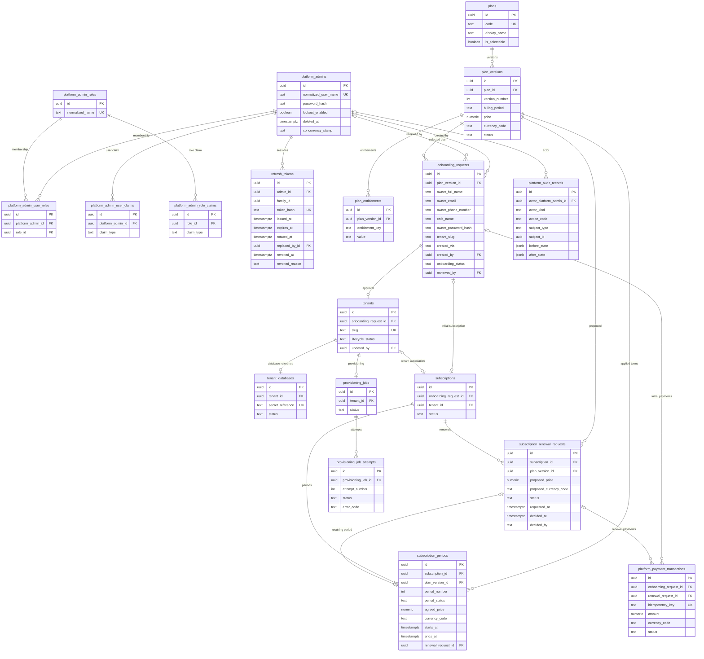

# Master Database ERD

Entity-relationship design for the Master/Registry database, derived from the recorded decisions in `architecture/database-conventions.md`, `architecture/database-schema-decisions.md`, and `architecture/architecture-decisions.md`, cited through PRD requirement identifiers (the PRD v1.1 text stays untracked). Every naming, type, and deletion rule here follows `architecture/database-conventions.md`, including the confirmed logical-deletion policy (PRD section 9, rule 23). The onboarding/subscription/provisioning sequence, the permanent public-registration guard with its Support exception, per-plan version sequences, and the renewal-approval gate follow the owner-approved decisions aligned with PRD v1.1. Items marked **Proposed** await owner confirmation. `CFMD-79` consumes this ERD for entity classes and migrations; no entity, migration, or DbContext change is made in this story.

Note: the Mermaid diagram shows the tables and relationships with key columns only; the dictionary below is the complete column list (pervasive `created_at`/`updated_at` audit and identifier boilerplate is omitted from the diagram, and is stated per table in the dictionary). Every foreign key constraint receives a `fk_<table>_<column>` name and every index a `uq_` or `ix_` name through the mapping work for each table (CFMD-79); the dictionary names the ones whose definition is not obvious.

**Proposed, pending owner confirmation (diagram conventions):** the diagram omits every table's audit columns (`created_at`, `updated_at`, `created_by`, `updated_by`) for readability; the dictionary states them per table. Cardinality markers follow the FK optionality in the dictionary: a non-null child FK draws the parent side as exactly-one, a nullable child FK draws it as zero-or-one, and a unique child FK caps the other side at zero-or-one.

## Onboarding, subscription, and provisioning sequence (Confirmed, owner decision)

The owner-approved provisioning model keeps four states strictly separate — payment state, onboarding review state, provisioning state, and tenant lifecycle state (FR-ONB-003). In order:

1. A cafe owner submits a public registration request for a chosen plan; the request is stored with `created_via = 'PublicRegistration'`, the requested slug in `tenant_slug`, and `onboarding_status = 'AwaitingPayment'` (FR-ONB-001, FR-ONB-002).
2. The initial subscription payment is attempted against that request (`platform_payment_transactions.onboarding_request_id`). Failure keeps the request still unpaid (`PaymentFailed` is surfaced to the owner) and a retry reuses the same request row (FR-ONB-002, FR-ONB-004); no second request is created.
3. After a successful payment the logical subscription is created with `subscriptions.onboarding_request_id` set and status `Active`, together with its first `subscription_periods` row (FR-ONB-003 acceptance: successful payment may activate the subscription; FR-SUB-002: activation follows a succeeded payment).
4. The request turns `PaidAwaitingReview` and awaits CafeHub Admin review; the UI may state that the request is being processed (FR-ONB-003). **No `tenants` row and no Tenant Database exist at this point.**
5. After explicit Admin approval (`onboarding_status = 'Approved'`, `reviewed_by`/`reviewed_at` set), the `tenants` row is created from the request — `tenants.onboarding_request_id` points at it, the slug is carried over from the request's `tenant_slug`, and `lifecycle_status` starts at `Provisioning`; the subscription is then associated with the tenant (`subscriptions.tenant_id`). A rejected paid request creates no registry record and no Tenant Database; its subscription transition and any refund must follow the TBD-03/TBD-04 policies once they are approved — never an invented outcome (FR-ONB-005).
6. A background provisioning job runs for the tenant, creating/preparing the dedicated Tenant Database, applying migrations and seed data, and recording every attempt and failure (`provisioning_jobs`, `provisioning_job_attempts`; FR-ONB-006, FR-ONB-007).
7. The environment is marked ready (`Tenant Database` status `Provisioned`, tenant `lifecycle_status = 'Active'`) only after successful provisioning.
8. The owner is notified and signs in to the Tenant Application; the readiness notification is a later story (FR-ONB-008, FR-IAM-001, PRD TBD-09).

A successful initial payment is never treated as Admin approval, and approval is never treated as proof that provisioning succeeded (FR-ONB-003).

## Tenant slug rules

- The slug is chosen at registration and stored on the onboarding request (`onboarding_requests.tenant_slug`); the tenant carries it from approval onward. Before a tenant exists, claim protection comes from the request-side partial unique index below; from approval onward, permanence comes from the tenant-side index (Proposed).
- Uniqueness at the tenant is `uq_tenants_slug ON tenants (slug)` — a **plain unique index**, not a `lower(slug)` expression index, because lowercase storage is already enforced by the CHECK below; an expression index would only duplicate the guarantee (aligned with the last-revised `architecture/database-conventions.md` uniqueness mechanism).
- Among live onboarding requests, `uq_onboarding_requests_slug ON onboarding_requests (tenant_slug) WHERE onboarding_status NOT IN ('Approved', 'Rejected', 'Cancelled')` — non-terminal requests hold their requested slug so two live requests cannot race for the same slug; terminal requests release it, so a never-materialized slug can be requested again later. A slug that became a tenant stays taken because tenants are never physically deleted.
- Lowercase-only storage on both tables: `CHECK (slug = lower(slug))` as `ck_tenants_slug_lowercase` / `ck_onboarding_requests_slug_lowercase`; application validation lowercases before writing, and the CHECK backstops any write outside application paths.
- Format and length on both tables: pattern `^[a-z0-9][a-z0-9-]{1,38}[a-z0-9]$` as `ck_tenants_slug_format` / `ck_onboarding_requests_slug_format` — 3 to 40 characters, lowercase letters and digits, optional internal hyphens, never a leading or trailing hyphen.
- Reserved words on both tables: `ck_tenants_slug_reserved` / `ck_onboarding_requests_slug_reserved` with `CHECK (tenant slug NOT IN ('admin','api','t','www','app','static','assets','health','login','signup','support','platform'))`. The initial list is Proposed and extensible; a lookup table replaces the CHECK only when the list becomes dynamic.
- Stability after approval: the slug does **not** change once the tenant row exists. URLs embed `t/{slug}` as the MVP tenant identifier and customer table QR codes resolve to tenant-scoped resources, so a change would invalidate links and QR material; a change would need an explicit redirect design. While only the request exists (non-terminal), the owner may revise `tenant_slug` with the same validation because nothing external references it yet.
- The MVP tenant identifier is the URL path prefix `t/{slug}` (owner decision, 2026-10-19); the choice of identifier source for customer QR resolution is still undecided (`architecture/database-schema-decisions.md` records that no PRD TBD number exists for it). Tenant resolution code itself is later work, not part of this ERD story.

## Identity model documentation (Confirmed, owner decision)

- Mechanism: **ASP.NET Core Identity with explicitly customized GUID-keyed entities** for platform admin identity. "Customized" means the key type (UUID instead of the framework default string key), snake_case table and column names, and the repository's explicit EF configuration; the account behavior — password hashing through the framework's hasher, lockout, and the stamp columns — stays the framework's default. No custom password-hashing or authentication behavior is introduced.
- Included for platform admin authentication needs: users (`platform_admins`), roles (`platform_admin_roles`), user-role memberships (`platform_admin_user_roles`), per-user claims (`platform_admin_user_claims`), and per-role claims (`platform_admin_role_claims`).
- Intentionally excluded because the MVP does not use them: external-login storage (no external login provider is approved, so no `user_logins` table) and default token storage (the password-based admin flows persist no tokens, so no `user_tokens` table; token issuance belongs to later Auth work and any needed tables are added explicitly then — the `refresh_tokens` table below is that explicit addition, owner-confirmed 2026-10-23). These exclusions are design statements only — no entity or migration change is made here.
- Platform admin rows are logically deleted (deactivated), never physically deleted: `deleted_at`/`deleted_by` per the deletion convention, authorization treats a deactivated admin as unauthorized, and every foreign key into `platform_admins` (audit actor, `reviewed_by`, `created_by`) stays valid precisely because the row survives. Role-membership and claim-assignment rows are removable assignment state as documented in the conventions.

## Refresh token sessions (Confirmed, owner decision, 2026-10-23)

Long-lived refresh tokens keep a platform administrator signed in without long-lived access tokens (FR-IAM-001: valid credentials establish the configured authenticated session/token; the access token itself is short-lived by the JWT work of CFMD-267/268). The `refresh_tokens` table below is the explicit token-storage addition the Identity model documentation reserved for the Auth work — the Identity `user_tokens` table stays excluded as before, and reusing it was the recorded rejected alternative.

- One token family per sign-in: issuing a refresh token opens a family (`family_id`); every token the family ever contains belongs to that one sign-in session.
- Rotation on every use (owner-confirmed): using a refresh token marks it rotated (`rotated_at`, `replaced_by_id`) and issues a fresh token in the same family. Rejected alternative: non-rotating long-lived tokens (a single stolen token would be usable indefinitely).
- Reuse detection (owner-confirmed): presenting an already-rotated token revokes every token of the family with reason `reuse_detected` and returns the same safe rejection as any other invalid token.
- Storage is hash-only (owner-confirmed): the raw token value is never persisted, logged, or returned after issuance; the table stores the lowercase hex SHA-256 of the raw value and looks tokens up through its unique index. Rejected alternative: storing the raw value (any read of the table would be a session takeover).
- Raw token format (documented here, implemented by the later rotation service, not in this story): 32 random bytes from a cryptographically secure generator, base64url-encoded, returned to the client exactly once at issuance and at each rotation.
- Default lifetime 7 days (owner-confirmed); the concrete lifetime is a validated service option (1..90 days), never a schema constant, so the CHECK only enforces internal consistency (`expires_at > issued_at`).
- Placement in the Master database: refresh tokens authenticate platform administrators, whose identity lives in the Master (FR-PLT-001); cross-database references are forbidden by the conventions, and owner/staff refresh sessions are a separate Tenant-side concern not modeled here.
- Enforcement split: the schema guarantees hash uniqueness and the integrity of rotation/revocation state through the CHECK constraints; reuse detection, expiry, family-wide revocation, and idempotent revocation are service behaviors of the later rotation-service sub-task, because a family update is a cross-row application transaction, not a constraint.

## Registration data and the provisioning seed

When provisioning seeds a new Tenant database (FR-ONB-006), the registration data captured on the approved onboarding request is the source for the tenant's initial Owner account and cafe profile row. This section is the contract between the two designs: it states what is copied, where it lands (using the real column names of `architecture/erd-tenant.md`), and what is deliberately not copied. No foreign key or reference crosses the database boundary in either direction (conventions), and the Master keeps its own copy of the registration data — on every request, terminal states included — permanently for now (owner decision, 2026-10-21; see `architecture/architecture-decisions.md`).

| Master source (`onboarding_requests`) | Tenant target (`architecture/erd-tenant.md`) | Note |
|---|---|---|
| `cafe_name` | `cafe_settings.cafe_name` | Copied as-is, so the tenant profile row starts with its real name (FR-CAF-001). The cafe contact columns on `cafe_settings` (`contact_phone`, `contact_email`, `contact_address`) have no source in this contract — they have no registration-time data and start NULL for the owner to configure later. The tenant ERD's seeding paragraph currently describes contact data as copied from the onboarding request; this table is the newer, narrower contract, and the disagreement is reported (not fixed there) because `erd-tenant.md` is outside this sub-task's edit scope. |
| `owner_full_name` | `tenant_users.full_name` | Copied as-is; the account holder's display name for audit display and staff views (the tenant-side column is Proposed, pending owner confirmation — see `architecture/erd-tenant.md`). |
| `owner_email` | `tenant_users.email` + `tenant_users.normalized_email` | Copied as-is; the mechanism normalizes on the tenant side. **Proposed, pending owner confirmation**: the same value also seeds the account's `user_name`/`normalized_user_name`, so the first login has a username; the rejected alternative is a separate username-selection step, which invents a flow the PRD does not describe. Tenant-side `uq_tenant_users_normalized_user_name` guards the account. |
| `owner_phone_number` | `tenant_users.phone_number` | Copied when present; NULL when the owner did not enter one (see the Proposed nullability above). |
| `owner_password_hash` | `tenant_users.password_hash` | Copied as-is — a hasher-produced value, never plaintext and never transformed. First authentication happens in the Tenant Application (FR-ONB-001, FR-IAM-001); afterwards the owner's password changes make this Master copy stale by design and it is never refreshed. |
| `tenant_slug` | — (not copied) | The slug is resolved and owned by the Master (`tenants.slug` is carried from the request at approval); the Tenant database never receives it, so the tenant URL scheme stays a Master/platform concern. |
| (no Master source) | `tenant_users.user_kind = 'Owner'` | Set by the seed; the account is the cafe's owner, and later staff accounts are separate stories. |
| (no Master source) | seeded Owner role (`tenant_roles`) and its membership row (`tenant_user_roles`) | Both rows are created by the seed, so the first login is authorized without manual setup (the tenant ERD's seeding section). |
| (no Master source) | `security_stamp`/`concurrency_stamp` on the seeded account (and other generated columns) | Generated at seed time — mechanism state, not copied registration data. |
| (no Master source) | first `tenant_audit_records` row | Written by the system (`actor_kind = 'System'`, actor NULL), capturing that the database was provisioned and seeded. |

- The copy executes as a single transaction in the Tenant Database — the initial rows land all together or not at all — and stays idempotent under provisioning retries (FR-ONB-007): a resumed attempt must not duplicate seeded rows or reset owner-configured state. The tenant-side `uq_tenant_users_normalized_user_name` makes a duplicated owner account structurally impossible instead of merely discouraged, which is what makes the retry safe.
- The mapping is a provisioning behavior documented here, not a schema construct: no cross-database foreign key, join, or trigger expresses it (conventions), and the tenant's first System audit record is the trace that the seed ran.
- The Master retains its own copy of the registration data — including the credential hash, and including rows whose request ended in `Rejected` or `Cancelled` — per the retention decision recorded in `architecture/architecture-decisions.md`; that document also records the revisit option (clearing the hash column after successful provisioning) and the byte-level protections still to be decided (backup/encryption specifics under PRD TBD-19).

## Table dictionary

### platform_admins

Purpose: Super Admin user identity in the Master database (platform-side identity only), using the confirmed Identity mechanism described under `Identity model documentation` above; the alternative — a bespoke minimal admin table with manual password hashing, lockout, and security stamps — remains rejected (reinventing battle-tested account semantics with higher risk and no benefit).

- `id uuid NOT NULL` — entity identity; `pk_platform_admins` (Identity keyed by GUID; the default string key is intentionally not used because all other identities are UUIDv7).
- `user_name text NOT NULL` (CHECK length 1..256, `ck_platform_admins_user_name_length`).
- `normalized_user_name text NOT NULL` (CHECK length 1..256) — `uq_platform_admins_normalized_user_name` unique index; the mechanism's own case-normalized column.
- `email text NULL` (CHECK length 1..320) and `normalized_email text NULL` (CHECK length 1..320) — the normalization style follows the mechanism. **Proposed, pending owner confirmation**: uniqueness for real mailboxes moves to a partial unique index `uq_platform_admins_normalized_email ON platform_admins (normalized_email) WHERE normalized_email IS NOT NULL`, replacing the existing non-unique `ix_platform_admins_normalized_email`. Rationale: this table holds the platform's admin identities; owners are never rows here (owner identity lives in the Tenant database, registration emails live on onboarding requests), so no legitimate workflow gives two admins one normalized mailbox — and a duplicate mailbox would make password resets and audit attribution ambiguous. The partial form states the mail-scoped intent explicitly and can never be falsified by how PostgreSQL mixes NULLs in unique indexes. The rejected alternative is keeping the plain non-unique index: it leaves two admins able to share one mailbox with no integrity signal, which was only ever justified by the wrong rationale that an owner and an admin may share one mailbox — owners are not in this table.
- `email_confirmed boolean NOT NULL` default `false`.
- `password_hash text NOT NULL` (CHECK length 1..512) — set and verified only by the mechanism's hasher.
- `phone_number text NULL` (CHECK length 1..64), `phone_number_confirmed boolean NOT NULL` default `false`.
- `two_factor_enabled boolean NOT NULL` default `false` (the framework's flag; persisting second-factor data would require the excluded token tables and is designed explicitly if two-factor support is enabled later).
- `lockout_enabled boolean NOT NULL` default `true` — the Identity framework's default: lockout protection is active from account creation, so the highest-value target in the platform (a Super Admin account) is protected against password guessing from the start instead of relying on per-account opt-in (PRD section 11.1); the framework decides when a lockout applies, per its default behavior. `lockout_end_at timestamptz NULL`; `access_failed_count integer NOT NULL` default `0` (all three belong to the mechanism's lockout functionality).
- `security_stamp text NOT NULL` (CHECK length 1..64) and `concurrency_stamp text NOT NULL` (CHECK length 1..64) — the mechanism's own stamp columns; the framework updates `concurrency_stamp` per save, so these identity tables intentionally keep the mechanism's stamp-based concurrency instead of the general `xmin` rule (documented as the main exception to it).
- `deleted_at timestamptz NULL`, `deleted_by uuid NULL FK platform_admins.id` — the generic logical-deletion marker of the confirmed deletion policy: a deactivated admin keeps the row (so audit actor references, `reviewed_by`, and `created_by` FKs never dangle) while every authorization check treats a non-null `deleted_at` as unauthorized; the stamp rotation at deactivation is standard framework usage, not custom behavior. `deleted_by` references another admin acting on this account.
- `created_at timestamptz NOT NULL`, `updated_at timestamptz NOT NULL`, `created_by uuid NULL FK platform_admins.id`, `updated_by uuid NULL FK platform_admins.id` (Bootstrap of the first Super Admin account happens outside a user action; `created_by` is NULL there).

### platform_admin_roles

Purpose: role catalog for authorization checks (for example a single `SuperAdmin` role to start — value Proposed; roles beyond it appear when platform authorization work arrives, FR-PLT-005).

- `id uuid NOT NULL` — `pk_platform_admin_roles`.
- `name text NOT NULL` (CHECK length 1..256), `normalized_name text NOT NULL` (CHECK length 1..256) with `uq_platform_admin_roles_normalized_name`.
- `concurrency_stamp text NOT NULL` (CHECK length 1..64) — mechanism column as above.
- `created_at timestamptz NOT NULL`, `updated_at timestamptz NOT NULL`, `created_by uuid NULL FK platform_admins.id`, `updated_by uuid NULL FK platform_admins.id`.

### platform_admin_user_roles

Purpose: membership join between an admin and a role; exactly the mechanism's user-role table with snake_case naming and a surrogate key to keep the primary-key convention. Rows are current assignment state, not history, and are removable as the documented exception to the logical-deletion policy; each removal is audited in `platform_audit_records`.

- `id uuid NOT NULL` — `pk_platform_admin_user_roles`.
- `platform_admin_id uuid NOT NULL FK platform_admins.id`; `role_id uuid NOT NULL FK platform_admin_roles.id`; `uq_platform_admin_user_roles_user_role ON (platform_admin_id, role_id)` keeps a pair unique.
- `created_at timestamptz NOT NULL`.

### platform_admin_user_claims

Purpose: extra claims attached directly to an admin user (mechanism-shaped; future-proofing for granular platform permissions). Same assignment-state treatment as membership rows.

- `id uuid NOT NULL` — `pk_platform_admin_user_claims`; `platform_admin_id uuid NOT NULL FK platform_admins.id`; `claim_type text NOT NULL` (CHECK length 1..512); `claim_value text NULL` (CHECK length 0..1024 when present).
- `created_at timestamptz NOT NULL`.

### platform_admin_role_claims

Purpose: claims granted to every holder of a role. Same assignment-state treatment as membership rows.

- `id uuid NOT NULL` — `pk_platform_admin_role_claims`; `role_id uuid NOT NULL FK platform_admin_roles.id`; `claim_type text NOT NULL` (CHECK length 1..512); `claim_value text NULL` (CHECK length 0..1024 when present).
- `created_at timestamptz NOT NULL`.

### refresh_tokens

Purpose: long-lived refresh-token sessions for platform administrators (FR-IAM-001; the session model and the owner-confirmed rules live in `Refresh token sessions` above): one row per issued token, one family per sign-in, rotation on every use, family-wide revocation on reuse. Only a hash is stored, never the raw token value.

- `id uuid NOT NULL` — app-generated UUIDv7; `pk_refresh_tokens`.
- `admin_id uuid NOT NULL FK platform_admins.id` (`fk_refresh_tokens_admin_id`, `ON DELETE RESTRICT`) — the owning administrator; one admin holds one family per sign-in and a family spans many rows over its rotations. `ix_refresh_tokens_admin_id` supports per-admin lookups (revocation, inspection). A deactivated admin keeps the row under the logical-deletion policy; treating that admin's tokens as unauthorized is a service-layer check consistent with FR-IAM-002.
- `family_id uuid NOT NULL` — the sign-in family identifier shared by every token of one session. Deliberately no foreign key: the family has no row of its own — it is the grouping key of these rows. `ix_refresh_tokens_family_id` supports family-wide revocation.
- `token_hash text NOT NULL` (CHECK length 64 and format `^[0-9a-f]{64}$`, `ck_refresh_tokens_token_hash_format`) — the lowercase hex SHA-256 of the raw token; `uq_refresh_tokens_token_hash` is the unique lookup key for every use, which also closes the concurrent double-use race at the data boundary (only one rotation can insert against a given successor state).
- `issued_at timestamptz NOT NULL`; `expires_at timestamptz NOT NULL` with `ck_refresh_tokens_expiry_after_issue CHECK (expires_at > issued_at)`.
- `rotated_at timestamptz NULL` — set exactly once at rotation; a set value marks the token rotated and any further presentation of it as reuse.
- `replaced_by_id uuid NULL` self foreign key to `refresh_tokens.id` (`fk_refresh_tokens_replaced_by_id`, `ON DELETE RESTRICT`) — set together with `rotated_at`, pointing at the successor token of the same family. **Proposed, pending owner confirmation**: `uq_refresh_tokens_replaced_by_id` — rotation always issues a fresh row, so each token is the successor of at most one predecessor, and the unique index turns that invariant into data integrity (and doubles as the replacement-chain lookup). Rejected alternative: leaving it non-unique (two rotated tokens could claim the same successor with no integrity signal).
- `revoked_at timestamptz NULL`; `revoked_reason text NULL` (CHECK length 1..64 when present) — `ck_refresh_tokens_revoked_reason_labels` limits the reason to the proposed closed list `('logout', 'reuse_detected', 'admin_revoked')`. **Proposed, pending owner confirmation**: `ck_refresh_tokens_revocation_pair CHECK ((revoked_at IS NULL AND revoked_reason IS NULL) OR (revoked_at IS NOT NULL AND revoked_reason IS NOT NULL))` — the required rule is that a reason is present whenever `revoked_at` is set; the symmetric form additionally forbids a dangling reason without a revocation time. Rejected alternative: the one-directional CHECK only.
- State model: a token is active while `rotated_at IS NULL AND revoked_at IS NULL AND expires_at > <current time>`; active, rotated, revoked, and expired are derivable from these columns, so no separate status column exists. Rejected alternative: a redundant status text column duplicating derivable state.
- Audit columns (Proposed, pending owner confirmation): `issued_at` doubles as the creation timestamp and every mutation carries its own semantic timestamp (`rotated_at`, `revoked_at`), so generic `created_at`/`updated_at` are not duplicated here (same reasoning as `platform_audit_records.recorded_at` and the immutable `plan_entitlements` rows); `created_by`/`updated_by` are omitted because rows are system-written during the owning administrator's own session — the actor is `admin_id` — and sensitive revocations are additionally captured in `platform_audit_records`. Rejected alternative: duplicating the generic audit columns beside the semantic ones (two timestamps for one fact).
- Retention: rows are never physically deleted by ordinary application workflows (logical-deletion policy, PRD section 9 rule 23); rotation and revocation history is security state, and cleanup of expired families is explicitly later work.

### tenants

Purpose: platform tenant identity and lifecycle state (FR-PLT-001); every other Master table that belongs to a cafe points here, and no cafe operational data is stored in the Master database (FR-PLT-002). A row is created only when an Admin approves a paid onboarding request — never before (FR-ONB-005) — and each row is derived from exactly one request.

- `id uuid NOT NULL` — app-generated UUIDv7; `pk_tenants`.
- `onboarding_request_id uuid NOT NULL FK onboarding_requests.id` with `uq_tenants_onboarding_request_id` — the reverse relationship of the owner-approved design: the request exists first and standalone, and the tenant created from it points back. Exactly one tenant per request (the unique index) and zero-or-one tenant per request (the FK is on `tenants`, so a rejected request yields no row at all, FR-ONB-005).
- `slug text NOT NULL` — carried over from the approved request's `tenant_slug`; rules above; `ck_tenants_slug_format`, `ck_tenants_slug_lowercase`, `ck_tenants_slug_reserved`, and plain unique index `uq_tenants_slug`.
- `lifecycle_status text NOT NULL` — `ck_tenants_lifecycle_status` over the proposed label set `('Provisioning', 'Active', 'Suspended', 'Terminated')`. The row is born at approval with `Provisioning` and turns `Active` only after provisioning succeeds (approval is never proof of provisioning, FR-ONB-003); transitions are validated in application code; the exact suspend/terminate/reactivation semantics follow the still-undecided lifecycle policy (PRD TBD-04).
- `created_at timestamptz NOT NULL`, `updated_at timestamptz NOT NULL`, `created_by uuid NULL FK platform_admins.id`, `updated_by uuid NULL FK platform_admins.id` — `created_by` is the approving admin, because the row exists only after approval.
- Tenants are never physically deleted (logical-deletion policy, PRD section 9 rule 23): a `Terminated` tenant keeps its row, its slug out of circulation, and every FK into it intact.

### tenant_databases

Purpose: the per-tenant database reference. The reference stores a **secret reference only, never a raw connection string**; resolution at runtime reads configuration under the established `TenantConnections:<SecretReference>` convention (`src/CafeHub.Infrastructure` `ConfigurationKeys.cs`) and fails closed (FR-PLT-002, PRD sections 10.2 and 11.1).

- `id uuid NOT NULL` — `pk_tenant_databases`.
- `tenant_id uuid NOT NULL FK tenants.id` with `uq_tenant_databases_tenant_id` — one reference per tenant, never two.
- `secret_reference text NOT NULL` (CHECK length 1..128 and format `^[a-z0-9][a-z0-9-]*$`, `ck_tenant_databases_secret_reference_format`) with `uq_tenant_databases_secret_reference` — the value is the configuration key tail, not a secret; per-tenant uniqueness avoids accidental key collisions across `TenantConnections:` settings.
- `status text NOT NULL` — `ck_tenant_databases_status` over `('Pending', 'Provisioned', 'Failed')` (Proposed): the row is created while provisioning prepares the database, and `Provisioned` is set only after successful completion so resume/reconcile logic can trust it (FR-ONB-007).
- `created_at timestamptz NOT NULL`, `updated_at timestamptz NOT NULL`, `created_by uuid NULL FK platform_admins.id`, `updated_by uuid NULL FK platform_admins.id` (provisioning system writes leave actor columns NULL; actions are captured in `platform_audit_records`).
- Separate-table choice (Proposed, pending owner confirmation): keeping the database reference out of `tenants` isolates sensitive provisioning metadata from ordinary tenant inspection, gives the row its own maintenance lifecycle (status, later rotation metadata if any), and keeps the "database exists and which key resolves it" question easy to audit. A single column on `tenants` was rejected as the alternative: it mixes registry identity with infrastructure detail and leaves no natural place for provisioning state without widening the main table.

### plans

Purpose: catalog selection entry for owner registration and plan selection (FR-SUB-001). One row per sellable product; its purchasable offerings are versions.

- `id uuid NOT NULL` — `pk_plans`.
- `code text NOT NULL` (CHECK format `^[a-z][a-z0-9-]{2,63}$`) with `uq_plans_code` — stable, machine-readable reference for system code paths (Proposed).
- `display_name text NOT NULL` (CHECK length 1..256) — marketing-facing name stored as data. The actual names are PRD TBD-01; the retired Start/Growth names are never assumed active (FR-PLT-004).
- `is_selectable boolean NOT NULL` default `false` — only `is_selectable = true` plans can be newly chosen; inactive or historical plans stay listed for record linkage without being selectable (FR-SUB-001).
- `created_at timestamptz NOT NULL`, `updated_at timestamptz NOT NULL`, `created_by uuid NULL FK platform_admins.id`, `updated_by uuid NULL FK platform_admins.id`.

### plan_versions

Purpose: the priced offering of a plan over time (FR-SUB-001, FR-PLT-004); versions are immutable once published — a price or entitlement change creates a new version for the affected plan and never edits one already referenced by a subscription period. Historical versions stay intact so purchase references are never rewritten (FR-SUB-001 acceptance criteria).

- `id uuid NOT NULL` — `pk_plan_versions`.
- `plan_id uuid NOT NULL FK plans.id`.
- `version_number integer NOT NULL CHECK (version_number >= 1)` with `uq_plan_versions_plan_version ON (plan_id, version_number)` — **the sequence is scoped per plan**: Basic can be at Version 3 while Premium is still at Version 1, and publishing a new version for one plan never disturbs any other plan's numbering or its referenced history (owner-approved per-plan versioning, FR-SUB-001). A price/entitlement change produces a new version for that plan; the previously applicable offering is retired so it cannot be newly selected (status change below), and no version is edited to replace a historical price or entitlement set.
- `billing_period text NOT NULL` — `ck_plan_versions_billing_period` over `('Monthly', 'Annual')` (Proposed; the final allowed set follows PRD TBD-01 period policy).
- `price numeric NOT NULL CHECK (price >= 0)` — `numeric(12,2)` per `architecture/database-conventions.md`; the value belongs to the version, not the plan.
- `currency_code text NOT NULL` (CHECK format `^[a-z]{3}$`, `ck_plan_versions_currency_code_format`) — the settled country/currency default is unresolved (PRD TBD-01/TBD-02); the column is provider- and currency-neutral.
- `status text NOT NULL` — `ck_plan_versions_status` over `('Draft', 'Active', 'Retired')` (Proposed). Only `Active` versions may be newly selected for a subscription period, a first onboarding selection, or an upcoming renewal; `Draft` versions exist before publishing; `Retired` versions stay referenced by historical periods without being selectable at their obsolete price (FR-SUB-001).
- Selectability and simultaneous offerings (open decision preserved): the schema deliberately imposes **no** "exactly one Active version per plan" uniqueness. Whether a plan may legitimately offer several simultaneous billing-period offerings (for example Monthly and Annual at the same time) is unresolved and must follow PRD TBD-01 and the FR-SUB-001 acceptance criteria, which leave it open. The model as documented supports any number of Active versions per plan; if the TBD-01 outcome requires a uniqueness rule (per plan, or per plan and billing period), it would become an additional conditional unique index — decided then, not invented now.
- `created_at timestamptz NOT NULL`, `updated_at timestamptz NOT NULL`, `created_by uuid NULL FK platform_admins.id`, `updated_by uuid NULL FK platform_admins.id`.

### plan_entitlements

Purpose: entitlement values as data (FR-PLT-004: configurable, never hard-coded quotas; explicitly no 3-branch or 15-table rule). Keys are stable feature identifiers; values are opaque strings interpreted by the consuming feature code. A version's entitlement set is immutable: changing it means a new version, so every historical period's version keeps the entitlements that were applicable to it (FR-SUB-001).

- `id uuid NOT NULL` — `pk_plan_entitlements`.
- `plan_version_id uuid NOT NULL FK plan_versions.id`.
- `entitlement_key text NOT NULL` (CHECK format `^[a-z][a-z0-9_.]*$`, CHECK length 1..128) — e.g. a feature flag key; the name avoids the fragile `key` spelling inside generated SQL and tooling; not a pre-decided per-feature list (Proposed).
- `value text NOT NULL` (CHECK length 1..512) — opaque value (boolean or limit or quota; interpretation stays in feature code, so this schema never encodes the retired quotas).
- `uq_plan_entitlements_key` over `(plan_version_id, entitlement_key)` — one value per key per version.
- `created_at timestamptz NOT NULL` (rows are written once per version; no `updated_at` because a version's entitlement set is immutable — changing it means a new version).

### onboarding_requests

Purpose: the owner's application for a new cafe environment, through plan selection, initial payment, review, approval, and provisioning handoff (FR-ONB-001 through FR-ONB-005). The row exists **standalone**: under the owner-approved provisioning sequence no `tenants` row or Tenant Database exists before Admin approval (FR-ONB-005), so the request carries no tenant foreign key — the relationship is reversed via `tenants.onboarding_request_id` (zero-or-one tenant per request; see `tenants` above). A Support-created request for an additional cafe is also stored here, distinguished by `created_via` (FR-ONB-004). The registration data captured on the request — the owner's full name, email, phone number where present, cafe name, and the credential hash — is copied into the new Tenant database by the provisioning seed (see `Registration data and the provisioning seed` below) and is never edited by application workflows once the request has left its non-terminal states.

- `id uuid NOT NULL` — `pk_onboarding_requests`.
- `created_via text NOT NULL` — `ck_onboarding_requests_created_via` over `('PublicRegistration', 'Support')` (Proposed): the creation path is explicit data, so the permanent public-registration duplicate guard and the auditable Support exception are separable at the schema level (FR-ONB-004).
- `created_by uuid NULL FK platform_admins.id` — the responsible Support actor; required when `created_via = 'Support'` (proposed CHECK `ck_onboarding_requests_support_actor CHECK (created_via = 'PublicRegistration' OR created_by IS NOT NULL)`) and NULL for public registration, where the owner has no identity yet. Each Support-created row is additionally audited in `platform_audit_records` (FR-ONB-004).
- `plan_version_id uuid NOT NULL FK plan_versions.id` — required by FR-ONB-002: a request is never reviewable without the selected plan recorded (the selected version must be an `Active` offering at selection; application validation enforces FK data plus version currency).
- `owner_email text NOT NULL` (CHECK length 1..320) — the registering owner's contact address stored as typed for any later display; case-insensitive duplicate protection comes from the partial index below.
- `owner_full_name text NOT NULL` (CHECK length 1..256, `ck_onboarding_requests_owner_full_name_length`) — the owner's full name as entered on the public registration page (Confirmed owner decision, 2026-10-21: the page collects full name, email, phone, cafe name, and password); copied to the Tenant database at seeding so the tenant Owner account can carry the owner's display data.
- `owner_phone_number text NULL` (CHECK length 1..64 when present, `ck_onboarding_requests_owner_phone_number_length`) — **Proposed, pending owner confirmation**: kept nullable because the PRD does not require a phone number at registration; the rejected alternative was making it `NOT NULL`, which invents a requirement the PRD does not set and blocks a minimal legitimate registration. When present it is copied to the tenant Owner account's phone.
- `cafe_name text NOT NULL` (CHECK length 1..256, `ck_onboarding_requests_cafe_name_length`) — the cafe name entered at registration (Confirmed owner decision, 2026-10-21); copied to the tenant profile row at seeding so the environment starts with its own name instead of a placeholder.
- `owner_password_hash text NULL` (CHECK length 1..512 when present, `ck_onboarding_requests_owner_password_hash_length`) — the owner credential hash produced by the framework's password hasher at registration (PRD section 11.1); NULL only where no credential applies (see the CHECK below). It is consumed by the provisioning seed and never used for authentication in this database — full rules in `Sensitive-column rules` below.
- `ck_onboarding_requests_owner_credential CHECK (created_via = 'Support' OR owner_password_hash IS NOT NULL)` — required by the sub-task acceptance criteria: every public-registration request carries its owner credential, and a Support-created request may omit it. How an owner first signs in to a tenant whose request was created by Support is a recorded open decision deliberately left to a later story (see `architecture/architecture-decisions.md`).
- `tenant_slug text NOT NULL` — the slug requested for the future tenant; same CHECK set as `tenants` (`ck_onboarding_requests_slug_format`, `ck_onboarding_requests_slug_lowercase`, `ck_onboarding_requests_slug_reserved`); revisable while the request is non-terminal (nothing external references it yet); carried over to `tenants.slug` at approval. Claim protection among live requests is `uq_onboarding_requests_slug` above.
- `onboarding_status text NOT NULL` — `ck_onboarding_requests_status` over the Proposed set `('AwaitingPayment', 'PaymentFailed', 'PaidAwaitingReview', 'Approved', 'Rejected', 'Cancelled')`: FR-ONB-002 requires the payment attempt state to be recorded before admin review and failure to be represented without false activation; a failed initial payment and its retries stay on the same request row (FR-ONB-004); FR-ONB-005 provides approval and rejection; transitions are validated in application code.
- `reviewed_by uuid NULL FK platform_admins.id` — set with (and only with) the approval or rejection decision (FR-ONB-005); `reviewed_at timestamptz NULL` — decision time; `rejection_reason text NULL` (CHECK length 0..1024 when present) — reason where provided.
- `uq_onboarding_requests_public_owner_email` (Proposed, pending owner confirmation — the owner-approved permanent guard supersedes the earlier status-scoped index): a **partial unique expression index** `CREATE UNIQUE INDEX ... ON onboarding_requests (lower(owner_email)) WHERE created_via = 'PublicRegistration'`. The `lower()` expression covers mixed-case email input, and the filter is the creation path — not a status subset — because the owner-approved rule is permanent: one email can never use public registration for a second request, even after an earlier request reached `Approved`, `Rejected`, or `Cancelled`, so a rejected or cancelled request does not grant a bypass (FR-ONB-004). The Support path is deliberately outside the index so authorized Support can still create a legitimate additional-cafe request for the same email, with `created_by` and an audit record making the exception traceable. Honest edge: the index guarantees that no two public rows share the email; the complete rule — that public registration must not create a row when the email already has *any* request or an existing cafe — needs the application's duplicate lookup before insert (the neighbor cafe association lives in the Tenant database, where no same-database constraint can reach, and cross-database foreign keys are forbidden by the conventions). FR-ONB-004's required database-plus-application enforcement is exactly this pair.
- `created_at timestamptz NOT NULL`, `updated_at timestamptz NOT NULL`, `created_by uuid NULL` as above, `updated_by uuid NULL FK platform_admins.id` (set by the reviewing admin).
- Requests are never physically deleted (logical-deletion policy): terminal states are `Approved`, `Rejected`, `Cancelled`, and every historical request keeps its payment and review trail.

**Sensitive-column rules (`owner_password_hash`):**

- Provenance: the value is produced only by the framework's password hasher in the API layer at registration — the same hasher used by the confirmed Identity mechanism in both databases (PRD section 11.1). A plaintext password never reaches the Master database.
- One write, one read: written once at registration on the public-registration path and read only by the provisioning seed when it creates the tenant Owner account (FR-ONB-006); no application workflow edits or re-reads the column afterwards.
- Never exposed through views or review queries, and never serialized into audit snapshots: an audit row that references an onboarding request (`platform_audit_records.before_state`/`after_state`) must exclude this column — a snapshot carrying it would ship the hash outside its intended storage (where FR-AUD-001 allows snapshots "where applicable", this rule narrows them).
- Never used for authentication in the Master database: platform administrators authenticate through `platform_admins` with its own hasher, and the owner's login exists only in the Tenant Application after the environment is ready (FR-ONB-001, FR-IAM-001) — the Master's copy of the credential is provisioning input, not a platform-wide owner identity.
- Stale by design: after the tenant is live, a password change in the Tenant Application makes the Master's copy stale, and it is not refreshed — the Master stores the registration-time hash, not a live owner credential, because the tenant database owns the owner's identity (FR-IAM-001).
- Retained on every request (owner decision, 2026-10-21): the hash stays on `Approved`, `Rejected`, and `Cancelled` requests alike; requests are never physically deleted, so this retention is a recorded decision with a revisit option — clearing the column after successful provisioning would be a later, separate decision, and clearing a column is not a record deletion, so it stays consistent with the logical-deletion policy (recorded in `architecture/architecture-decisions.md`).
- Access surface: the table is reachable only through the least-privilege Master role, and reads outside the provisioning workflow are exactly what reviews must look for — this is the compensating control recorded together with the retention decision.

### subscriptions

Purpose: the logical subscription of one cafe — exactly one row for the cafe's whole journey — kept structurally separate from onboarding state, tenant lifecycle, and provisioning (FR-ONB-003, FR-SUB-003: an active subscription alone never proves the environment is ready, and no provisioning starts before explicit admin approval). Under the owner-approved model the subscription exists from the initial successful payment, before any tenant row is possible, and historical billing periods are not stored here — they live in `subscription_periods`, renewal decisions in `subscription_renewal_requests`.

- `id uuid NOT NULL` — `pk_subscriptions`.
- `onboarding_request_id uuid NULL FK onboarding_requests.id` with `uq_subscriptions_onboarding_request_id` — set when the initial successful payment activates the subscription (owner-approved sequence; an active subscription after payment and before Admin approval is a PRD requirement, FR-ONB-003), and the subscription is genuinely tenant-less during that window.
- `tenant_id uuid NULL FK tenants.id` with `uq_subscriptions_tenant_id` — set only after Admin approval created the tenant from the request and linking the subscription to it is an application-level update; nullable only for the pre-approval window and never reverting afterward.
- `ck_subscriptions_owner` (Proposed): `CHECK (num_nonnulls(onboarding_request_id, tenant_id) = 1)` — every subscription is owned by exactly one of the two anchors, so the pre-approval phase stays honest (no invented tenant reference) and the post-approval phase stays anchored to the tenant. Both anchor FKs are unique, so a request or a tenant can never own two logical subscriptions. Integrity trade-off stated openly: the exactly-one rule is a CHECK over two nullable FKs rather than a single always-non-null column, because tenant creation legitimately happens only at Admin approval, after payment — supporting "subscription exists without a tenant" is the requirement, not an accident.
- No `plan_version_id` on this table: the version applicable at any point in time is identified by the subscription's periods (`subscription_periods.plan_version_id`), so a catalog change can exist exactly once per period and a changed price can never silently drift into the logical row or the historical snapshots (FR-SUB-003).
- `status text NOT NULL` — `ck_subscriptions_status` over the Proposed set `('Active', 'Suspended', 'Expired', 'Cancelled')`. A subscription row exists only from the initial succeeded payment onward, so there is no pre-payment label here: the request's own status carries the pre-payment and paid-awaiting-review states (FR-ONB-002, FR-ONB-003). Transitions are validated in application code; expiry/grace/suspension/reactivation remain undecided (PRD TBD-04); after a rejected paid request, the subscription's terminal transition (the `Cancelled` label is reserved for it) and any refund must follow the TBD-03/TBD-04 policies once they are approved, without inventing an outcome (FR-ONB-005).
- `created_at timestamptz NOT NULL`, `updated_at timestamptz NOT NULL`, `created_by uuid NULL FK platform_admins.id`, `updated_by uuid NULL FK platform_admins.id` (the row is system-created at payment success, so `created_by` is NULL there).
- Renewal approval state is explicit in `subscription_renewal_requests` (FR-SUB-004), not inferred from transaction rows.

### subscription_periods

Purpose: the complete, immutable history of billed subscription periods (FR-SUB-003; owner-approved model: one logical subscription with every historical period preserved separately). Every period preserves which plan version, agreed price, currency, dates, and status applied to it, and nothing later may rewrite that snapshot: a changed current plan price never silently changes a historical period's terms (FR-SUB-001). The first period is created together with the logical subscription at the initial successful payment; each subsequent period comes from an approved renewal.

- `id uuid NOT NULL` — `pk_subscription_periods`.
- `subscription_id uuid NOT NULL FK subscriptions.id` — the owning logical subscription; every period of the cafe's journey points to it.
- `plan_version_id uuid NOT NULL FK plan_versions.id` — the applicable offering version whose entitlements cover the period, so historical periods keep identifying the correct version and its entitlements even after a newer version is published (FR-SUB-001).
- `period_number integer NOT NULL CHECK (period_number >= 1)` with `uq_subscription_periods_period_number ON (subscription_id, period_number)` (Proposed) — per-subscription 1..n history order that does not depend on timestamps.
- `period_status text NOT NULL` — `ck_subscription_periods_status` over the Proposed set `('Active', 'Ended', 'Cancelled')`; exactly one running period per subscription is enforced by the partial unique index `uq_subscription_periods_active ON subscription_periods (subscription_id) WHERE period_status = 'Active'` (Proposed). Renewal/expiry outcomes and the transition rules follow the still-undecided lifecycle policy (PRD TBD-04); refund outcomes follow TBD-03 — no proration, expiry, or grace semantics are invented.
- `agreed_price numeric NOT NULL CHECK (agreed_price >= 0)` — `numeric(12,2)`; `currency_code text NOT NULL` (CHECK format `^[a-z]{3}$`, `ck_subscription_periods_currency_code_format`) — the agreed commercial snapshot copied at period creation. Kept as explicit snapshot columns even though plan versions are immutable, so each period's terms stay self-contained and robust against any catalog correction or later restructuring; the columns are never rewritten after creation.
- `starts_at timestamptz NOT NULL`; `ends_at timestamptz NULL` — NULL while the period is running; set when the period ends per the lifecycle policy (TBD-04).
- `renewal_request_id uuid NULL FK subscription_renewal_requests.id` with `uq_subscription_periods_renewal_request` — the approved renewal that produced the period, where one exists (the initial period is NULL). Uniqueness means one approved renewal can never produce two periods, closing the duplicate-renewal/double-charge path (FR-SUB-004 acceptance criteria).
- `created_at timestamptz NOT NULL`, `updated_at timestamptz NOT NULL`, `created_by uuid NULL FK platform_admins.id`, `updated_by uuid NULL FK platform_admins.id` (rows are system-written at payment success and renewal completion, so actor columns are NULL).
- Period rows are never updated or deleted by ordinary application workflows (logical-deletion policy): the period history is the financial record (PRD section 9, rule 23). A renewal continuation or an approved upgrade always creates a new period; it never mutates a previous one.

### subscription_renewal_requests

Purpose: the explicit owner-approval gate in front of every renewal payment (FR-SUB-004). The owner reviews and explicitly approves the applicable plan version, price, currency, and billing period before the renewal payment is initiated; the approval is recorded with its status and decision timestamp; and the renewal continues the current plan or applies an approved upgrade for the next period, with upgrades taking effect only at a renewal — never inside an already-paid period (FR-SUB-001, FR-SUB-004). Payment initiation is withheld until approval is recorded.

- `id uuid NOT NULL` — `pk_subscription_renewal_requests`.
- `subscription_id uuid NOT NULL FK subscriptions.id` — the logical subscription being renewed; the approval record stays linked to it (FR-SUB-004).
- `plan_version_id uuid NOT NULL FK plan_versions.id` — the proposed version for the upcoming period, which the owner explicitly approves (a continuation proposes the currently applicable version; an upgrade proposes a newer `Active` version, applied only at the next renewal). Whether a plan-specific simultaneous-offering rule constrains the proposal follows TBD-01 as documented under `plan_versions`.
- `proposed_price numeric NOT NULL CHECK (proposed_price >= 0)` (`numeric(12,2)`) and `proposed_currency_code text NOT NULL` (CHECK format `^[a-z]{3}$`, `ck_subscription_renewal_requests_currency_code_format`) — the owner-approved terms copied onto the request for traceability: the reviewed amount is recorded as data and the eventual payment charge is verifiable against it. They must equal the proposed version's price and currency at request creation; that equality is application-validated at creation (a CHECK cannot compare across rows), and plan versions are immutable so the proposed terms cannot drift afterward. The billing period is not duplicated as a column: it is read from the proposed version's `billing_period` (single source of truth while the TBD-01 period policy stays open).
- `status text NOT NULL` — `ck_subscription_renewal_requests_status` over the Proposed set `('PendingOwnerApproval', 'Approved', 'Rejected', 'Cancelled', 'Completed')`. `PendingOwnerApproval` blocks payment initiation; `Approved` is the only state from which a renewal payment may be recorded; `Rejected` records the owner's explicit no; `Completed` marks the succeeded renewal payment and its created period; `Cancelled` is reserved for the still-undecided lifecycle policy (PRD TBD-04), with no invented outcome.
- `requested_at timestamptz NOT NULL` — when the renewal and its proposed terms were recorded; `decided_at timestamptz NULL` — the explicit decision time, set exactly once; `decided_by text NULL` (CHECK length 1..256 when present) — the acting owner's principal as recorded at the decision. Integrity pair: `ck_subscription_renewal_requests_decided CHECK ((status = 'PendingOwnerApproval') = (decided_at IS NULL))` (Proposed), so every terminal-or-approved state carries its decision time and no pending request claims one.
- Approval actor: the owner acts in the Tenant Application, so the principal lives in the Tenant database; because cross-database foreign keys are forbidden, `decided_by` is documented as a textual principal reference, not an FK — the honest limit of referential integrity here, backed by the `platform_audit_records` entry for the sensitive approval action (FR-SUB-004 requires the recorded status, decision time, and linkage, which this model satisfies).
- Duplicate guard: `uq_subscription_renewal_requests_open ON subscription_renewal_requests (subscription_id) WHERE status IN ('PendingOwnerApproval', 'Approved')` (Proposed) — at most one renewal in flight (pending or approved-but-unpaid) per subscription, so duplicate requests, retries, or payment callbacks cannot create duplicate approved renewals or charge twice for the same intended renewal (FR-SUB-004 acceptance criteria). Once a request turns `Rejected`, `Cancelled`, or `Completed`, the slot frees for the next explicitly approved cycle.
- `created_at timestamptz NOT NULL`, `updated_at timestamptz NOT NULL`, `created_by uuid NULL FK platform_admins.id`, `updated_by uuid NULL FK platform_admins.id` (proposal and decision transitions are system-driven from the owner's actions in the Tenant Application).
- Requests are never physically deleted (logical-deletion policy): each cycle's approval trail survives (PRD section 9, rule 23).

### platform_payment_transactions

Purpose: traceable, provider-neutral record of each CafeHub **subscription** payment attempt — the initial onboarding payment and approved renewal payments — and its result (FR-SUB-002). These are not cafe-customer bill payments: tenant-side billing records stay in the Tenant database, and the PRD keeps the two payment-record families separate (PRD section 10.5).

- `onboarding_request_id uuid NULL FK onboarding_requests.id` — the request whose initial payment this transaction traces; a request may have several rows (failed attempts retried against the same request never create new request rows, FR-ONB-004).
- `renewal_request_id uuid NULL FK subscription_renewal_requests.id` — the approved renewal request whose payment this transaction traces (FR-SUB-002 acceptance criteria: renewal payment processing must be linked to the corresponding approved renewal request).
- `ck_platform_payment_transactions_target` (Proposed): `CHECK (num_nonnulls(onboarding_request_id, renewal_request_id) = 1)` — every payment is unambiguously attached to exactly one purpose: an initial onboarding charge or a renewal charge, never both and never neither. This is the integrity guarantee that replaces an ambiguous polymorphic column, and it makes the two payment purposes structurally distinguishable.
- `idempotency_key text NOT NULL` (CHECK length 8..128) with `uq_platform_payment_transactions_key` — opaque, app-generated key for every attempt; the uniqueness makes a duplicate call or callback reuse the same row instead of creating a second payment record, and payment-result handling treats an existing row with its succeeded result as already processed (FR-SUB-002) (Proposed).
- `amount numeric NOT NULL CHECK (amount >= 0)` — `numeric(12,2)`; `currency_code text NOT NULL` (CHECK format `^[a-z]{3}$`) — the money snapshot copied at initiation so the charge is reconstructible independently of any later catalog state (Proposed). For a renewal payment the amount is verifiable against `subscription_renewal_requests.proposed_price` through the FK.
- `status text NOT NULL` — `ck_platform_payment_transactions_status` over `('Initiated', 'Succeeded', 'Failed')` (Proposed); a payment row with a non-succeeded status never moves `onboarding_requests.onboarding_status` to `PaidAwaitingReview` and never starts a renewal period, so a false activation is impossible (FR-ONB-002, FR-SUB-002).
- `settled_at timestamptz NULL` — set together with a terminal status; kept provider-neutral.
- `failure_code text NULL` (CHECK length 0..128 when present) — a short machine code only; provider messages are never stored (they can embed sensitive context; `architecture/database-conventions.md`).
- `created_at timestamptz NOT NULL`, `updated_at timestamptz NOT NULL` (rows are state-full across initiation to settlement), `created_by uuid NULL`, `updated_by uuid NULL FK platform_admins.id`.
- Application precondition (documented, not DB-enforced): a renewal transaction row is created only when its `renewal_request_id` request is currently `Approved`, so a payment is never initiated before the owner's approval is recorded (FR-SUB-004). The database cannot express that cross-row status check without a trigger, which the conventions do not employ; the exactly-one-target CHECK plus the in-flight guard on the request table are the schema-side guarantees.
- Rows are never physically deleted from this table (logical-deletion policy): every attempt, succeeded or failed, is preserved financial history (PRD section 9, rule 23).

### provisioning_jobs

Purpose: the idempotent work item that provisions one tenant environment (FR-ONB-006: application of the new database, tenant migrations, seed data, and readiness stamps recorded as state).

- `id uuid NOT NULL` — `pk_provisioning_jobs`.
- `tenant_id uuid NOT NULL FK tenants.id` with `uq_provisioning_jobs_tenant_id` — a tenant has at most one job, and every retry resumes that same job instead of creating a second environment pipeline (FR-ONB-007). The FK is satisfiable only because the tenant row exists before the job (approval first, FR-ONB-005).
- `status text NOT NULL` — `ck_provisioning_jobs_status` over `('Pending', 'Running', 'Succeeded', 'Failed')` (Proposed); the environment is never stamped ready before a successful completion (FR-ONB-007 acceptance).
- `created_at timestamptz NOT NULL`, `updated_at timestamptz NOT NULL`, `created_by uuid NULL`, `updated_by uuid NULL FK platform_admins.id` (background-system writes are NULL and appear in `platform_audit_records`; the approval admin may be recorded).
- Jobs are created only after explicit admin approval (FR-ONB-003): there is no FK from a successful payment to a job, and a rejected paid request produces no job and no tenant database (FR-ONB-005).

### provisioning_job_attempts

Purpose: the execution history of one provisioning job (FR-ONB-007 retries and failure recording), append-per-attempt so reconciliation has an audit surface. Attempts are preserved through ordinary application workflows (logical-deletion policy).

- `id uuid NOT NULL` — `pk_provisioning_job_attempts`.
- `provisioning_job_id uuid NOT NULL FK provisioning_jobs.id`; `attempt_number integer NOT NULL CHECK (attempt_number >= 1)` with `uq_provisioning_job_attempts_attempt` over `(provisioning_job_id, attempt_number)` (Proposed).
- `status text NOT NULL` — `ck_provisioning_job_attempts_status` over `('Running', 'Succeeded', 'Failed')` (Proposed).
- `started_at timestamptz NOT NULL`; `finished_at timestamptz NULL` (NULL while running).
- `error_code text NULL` (CHECK length 0..128 when present) — machine error code only. Failure detail never includes secrets, connection strings, or raw provider messages (the prompt requirement and the conventions document; the error text that a human needs is logged inside the task, not persisted as a secret-bearing column).
- `created_at timestamptz NOT NULL`, `updated_at timestamptz NOT NULL`.

### platform_audit_records

Purpose: append-only record of sensitive platform actions (FR-PLT-005: authorized Super Admin inspection, and sensitive actions are audited; FR-AUD-001: actor, action, target, timestamp, and where applicable before/after values). Foreign keys are deliberately asymmetric: the generic subject pointer (`subject_type`, `subject_id`) has no foreign key so audit rows stay insertable regardless of later subject data changes, while `actor_platform_admin_id` keeps its real foreign key because platform admin rows are never physically deleted under the approved logical-deletion policy — the FK cannot orphan, and removing it would needlessly drop traceability.

- `id uuid NOT NULL` — `pk_platform_audit_records`.
- `recorded_at timestamptz NOT NULL` — the universal time of the event (append-only; no `updated_at`).
- `actor_platform_admin_id uuid NULL FK platform_admins.id` — set when an authenticated Super Admin acts; `actor_kind text NOT NULL` — `ck_platform_audit_records_kind` over `('PlatformAdmin', 'System')` (Proposed) distinguishes automated work (provisioning) from verified acting users even when the FK is NULL.
- `action_code text NOT NULL` (CHECK length 1..128) — a stable, snippet-friendly code following the `<Module>.<Reason>` style of application error codes (Proposed). Support-created onboarding requests record their responsible actor here (FR-ONB-004).
- `subject_type text NOT NULL` (CHECK length 1..64) and `subject_id uuid NULL` — generic target pointer retained without a foreign key (append-only, Proposed).
- `before_state jsonb NULL`, `after_state jsonb NULL` — structured old/new snapshots where applicable (FR-AUD-001). Both follow the `jsonb` rule: they are never filtered, joined, or constrained; queries run on `recorded_at`, `action_code`, and actor columns (indexed in CFMD-79's indexing story).
- Append-only: rows are inserted once, and ordinary application workflows can neither update nor delete them (`architecture/database-conventions.md`); the retention and tamper-resistance design is its own topic (PRD TBD-20).

## Explicitly out of scope (later modules/departments)

- Cafe profile, branches, tables, and QRs — Tenant database (FR-CAF-001 through FR-CAF-004).
- Menu catalog and OCR import (Menu), orders (Ordering), bills/payments/receipts (Billing), WiFi packages and tokens (WiFi), inventory (Inventory), attendance (Attendance), printing connectors (Printing), reporting (Reporting).
- Notifications: FR-ONB-008's readiness notification is produced by a later story and depends on the provider decision (PRD TBD-09); no notification courier table is designed here.
- Customer identity: none exists by guest-only ordering (FR-IAM-004).
- Owner/staff identity: tenant-side identity tables (FR-IAM-001) belong to `architecture/erd-tenant.md`, not here.
- Payment-provider specifics and refund flows (PRD TBD-02, TBD-03); the final renewal/upgrade lifecycle policy stays with TBD-04 (the approval-gate structure is modeled above, the commercial policy is not).
- Provisioning infrastructure internals (database creation tooling, secrets-store integration) — infrastructure implementation, not schema.
- Identity token storage other than refresh-token sessions (two-factor devices, external-login tokens, one-time codes) — deferred; the `refresh_tokens` table is designed above, other token kinds stay unmodeled until their feature arrives.

## TBD register

| PRD ID | Neutral title |
|---|---|
| TBD-01 | Subscription plan catalog content: names, entitlements, limits, prices, billing periods — including whether multiple billing-period offerings may be selectable at the same time |
| TBD-02 | Production payment provider for SaaS subscription payments |
| TBD-03 | Refund policy after admin rejection of a paid onboarding request |
| TBD-04 | Subscription lifecycle policy: expiry, grace, suspension, reactivation, upgrade/downgrade, renewal |
| TBD-05 | Online-payment authoritative confirmation flow and AI evidence-checking fallback |
| TBD-09 | Notification provider, channels, retries, and fallbacks for the readiness notification |
| TBD-20 | Data retention and tamper-resistance requirements for audit logs |
| — | Customer QR tenant/branch/table identifier resolution (no PRD TBD number exists; undecided) |

`CFMD-79` consumes this ERD for entity classes and migrations.
