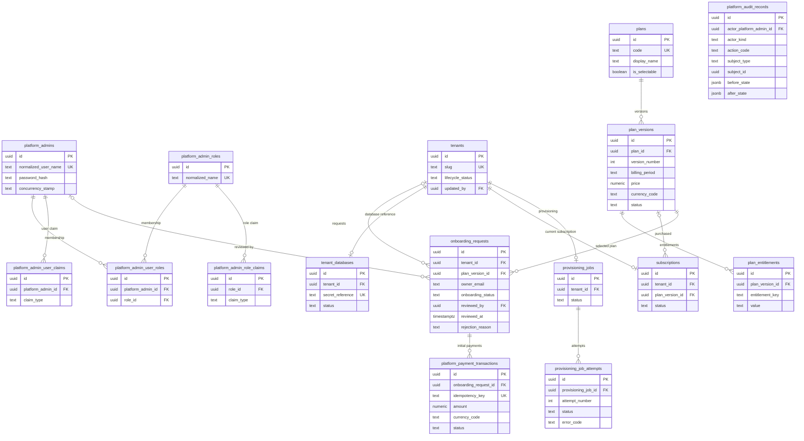

# Master Database ERD

Entity-relationship design for the Master/Registry database, derived from the recorded decisions in `architecture/database-conventions.md`, `architecture/database-schema-decisions.md`, and `architecture/architecture-decisions.md`, cited through PRD requirement identifiers (the PRD text stays untracked). Every naming, type, and deletion rule here follows `architecture/database-conventions.md`. Items marked **Proposed** await owner confirmation. `CFMD-79` consumes this ERD for entity classes and migrations; no entity, migration, or DbContext change is made in this story.

Note: the Mermaid diagram shows the tables and relationships with key columns only; the dictionary below is the complete column list (pervasive `created_at`/`updated_at` audit and identifier boilerplate is omitted from the diagram, and is stated per table in the dictionary). Every foreign key constraint receives a `fk_<table>_<column>` name and every index a `uq_` or `ix_` name through the mapping work for each table (CFMD-79); the dictionary names the ones whose definition is not obvious.

**Proposed, pending owner confirmation (diagram conventions):** the diagram omits every table's audit columns (`created_at`, `updated_at`, `created_by`, `updated_by`) for readability; the dictionary states them per table.

## Tenant slug rules

- Uniqueness is enforced at the database: unique index `uq_tenants_slug ON tenants (lower(slug))` (Proposed).
- Lowercase-only storage: `CHECK (slug = lower(slug))` named `ck_tenants_slug_lowercase`; application validation lowercases before writing, and the CHECK backstops any write outside application paths (Proposed).
- Format and length: pattern `^[a-z0-9]([a-z0-9-]{1,38}[a-z0-9])?$` as `ck_tenants_slug_format` — 3 to 40 characters, lowercase letters, digits, single or repeated hyphens inside, never a leading or trailing hyphen (Proposed).
- Reserved words: `ck_tenants_slug_reserved CHECK (slug NOT IN ('admin','api','t','www','app','static','assets','health','login','signup','support','platform'))`. The initial list is Proposed and extensible; a lookup table replaces the CHECK only when the list becomes dynamic.
- Stability after activation: the slug does **not** change once the tenant environment is ready (Proposed). URLs embed `t/{slug}` as the MVP tenant identifier, and customer table QR codes resolve to tenant-scoped resources, so a change would invalidate links and QR material; a change would need an explicit redirect design. Before activation (`Pending` lifecycle), the owner-in-progress request may revise the slug with the same validation because nothing external references it yet (Proposed).
- The MVP tenant identifier is the URL path prefix `t/{slug}` (owner decision, 2026-10-19); the choice of identifier source for customer QR resolution is still undecided (`architecture/database-schema-decisions.md` records that no PRD TBD number exists for it). Tenant resolution code itself is later work, not part of this ERD story.

## Table dictionary

### platform_admins

Purpose: Super Admin user identity in the Master database (platform-side identity only); default mechanism is **Proposed, pending owner confirmation** — ASP.NET Core Identity with custom GUID-keyed user and role classes; alternative would be a bespoke minimal admin table with manual password hashing, lockout, and security stamps (rejected: reinventing battle-tested account semantics with higher risk and no benefit).

- `id uuid NOT NULL` — entity identity; `pk_platform_admins` (ASP.NET Identity keyed by GUID; the default string key is intentionally not used because all other identities are UUIDv7).
- `user_name text NOT NULL` (CHECK length 1..256, `ck_platform_admins_user_name_length`).
- `normalized_user_name text NOT NULL` (CHECK length 1..256) — `uq_platform_admins_normalized_user_name` unique index; the mechanism's own case-normalized column.
- `email text NULL` (CHECK length 1..320) and `normalized_email text NULL` (CHECK length 1..320) — indexed (`ix_platform_admins_normalized_email`), not unique: an owner and an admin may share one mailbox; the normalization style follows the mechanism.
- `email_confirmed boolean NOT NULL` default `false`.
- `password_hash text NOT NULL` (CHECK length 1..512) — set and verified only by the mechanism's hasher.
- `phone_number text NULL` (CHECK length 1..64), `phone_number_confirmed boolean NOT NULL` default `false`.
- `two_factor_enabled boolean NOT NULL` default `false`.
- `lockout_enabled boolean NOT NULL` default `false`; `lockout_end_at timestamptz NULL`; `access_failed_count integer NOT NULL` default `0` (all three belong to the mechanism's lockout functionality).
- `security_stamp text NOT NULL` (CHECK length 1..64) and `concurrency_stamp text NOT NULL` (CHECK length 1..64) — the mechanism's own stamp columns; ASP.NET Core stores update `concurrency_stamp` per save, so these identity tables intentionally keep the mechanism's stamp-based concurrency instead of the general `xmin` rule (documented as the main exception to it).
- `created_at timestamptz NOT NULL`, `updated_at timestamptz NOT NULL`, `created_by uuid NULL FK platform_admins.id`, `updated_by uuid NULL FK platform_admins.id` (Bootstrap of the first Super Admin account happens outside a user action; `created_by` is NULL there).

### platform_admin_roles

Purpose: role catalog for authorization checks (for example a single `SuperAdmin` role to start — value Proposed; roles beyond it appear when platform authorization work arrives, FR-PLT-005).

- `id uuid NOT NULL` — `pk_platform_admin_roles`.
- `name text NOT NULL` (CHECK length 1..256), `normalized_name text NOT NULL` (CHECK length 1..256) with `uq_platform_admin_roles_normalized_name`.
- `concurrency_stamp text NOT NULL` (CHECK length 1..64) — mechanism column as above.
- `created_at timestamptz NOT NULL`, `updated_at timestamptz NOT NULL`, `created_by uuid NULL FK platform_admins.id`, `updated_by uuid NULL FK platform_admins.id`.

### platform_admin_user_roles

Purpose: membership join between an admin and a role; exactly the mechanism's user-role table with snake_case naming and a surrogate key to keep the primary-key convention.

- `id uuid NOT NULL` — `pk_platform_admin_user_roles`.
- `platform_admin_id uuid NOT NULL FK platform_admins.id`; `role_id uuid NOT NULL FK platform_admin_roles.id`; `uq_platform_admin_user_roles_user_role ON (platform_admin_id, role_id)` keeps a pair unique.
- `created_at timestamptz NOT NULL`.

### platform_admin_user_claims

Purpose: extra claims attached directly to an admin user (mechanism-shaped; future-proofing for granular platform permissions).

- `id uuid NOT NULL` — `pk_platform_admin_user_claims`; `platform_admin_id uuid NOT NULL FK platform_admins.id`; `claim_type text NOT NULL` (CHECK length 1..512); `claim_value text NULL` (CHECK length 0..1024 when present).
- `created_at timestamptz NOT NULL`.

### platform_admin_role_claims

Purpose: claims granted to every holder of a role.

- `id uuid NOT NULL` — `pk_platform_admin_role_claims`; `role_id uuid NOT NULL FK platform_admin_roles.id`; `claim_type text NOT NULL` (CHECK length 1..512); `claim_value text NULL` (CHECK length 0..1024 when present).
- `created_at timestamptz NOT NULL`.

### tenants

Purpose: platform tenant identity and lifecycle state (FR-PLT-001); every other Master table that belongs to a cafe points here. A row is created together with its first onboarding request and never holds cafe operational data (FR-PLT-002).

- `id uuid NOT NULL` — app-generated UUIDv7; `pk_tenants`.
- `slug text NOT NULL` — rules above; `ck_tenants_slug_format`, `ck_tenants_slug_lowercase`, `ck_tenants_slug_reserved`, and unique index `uq_tenants_slug ON tenants (lower(slug))`.
- `lifecycle_status text NOT NULL` — `ck_tenants_lifecycle_status` over the proposed label set `('Pending', 'Provisioning', 'Active', 'Suspended', 'Terminated')`; transitions are validated in application code; the exact suspend/terminate semantics follow the still-undecided lifecycle policy (PRD TBD-04).
- `created_at timestamptz NOT NULL`, `updated_at timestamptz NOT NULL`, `created_by uuid NULL FK platform_admins.id`, `updated_by uuid NULL FK platform_admins.id` — actor columns are NULL while no formal principal exists (a public owner request creates the tenant); approval and later admin actions stamp `updated_by`.

### tenant_databases

Purpose: the per-tenant database reference. The reference stores a **secret reference only, never a raw connection string**; resolution at runtime reads configuration under the established `TenantConnections:<SecretReference>` convention (`src/CafeHub.Infrastructure` `ConfigurationKeys.cs`) and fails closed (FR-PLT-002, PRD sections 10.2 and 11.1).

- `id uuid NOT NULL` — `pk_tenant_databases`.
- `tenant_id uuid NOT NULL FK tenants.id` with `uq_tenant_databases_tenant_id` — one reference per tenant, never two.
- `secret_reference text NOT NULL` (CHECK length 1..128 and format `^[a-z0-9][a-z0-9-]*$`, `ck_tenant_databases_secret_reference_format`) with `uq_tenant_databases_secret_reference` — the value is the configuration key tail, not a secret; per-tenant uniqueness avoids accidental key collisions across `TenantConnections:` settings.
- `status text NOT NULL` — `ck_tenant_databases_status` over `('Pending', 'Provisioned', 'Failed')` (Proposed): the row is created while provisioning prepares the database, and `Provisioned` is set only after successful completion so resume/reconcile logic can trust it (FR-ONB-007).
- `created_at timestamptz NOT NULL`, `updated_at timestamptz NOT NULL`, `created_by uuid NULL FK platform_admins.id`, `updated_by uuid NULL FK platform_admins.id` (provisioning system writes leave actor columns NULL; actions are captured in `platform_audit_records`).
- Separate-table choice (Proposed, pending owner confirmation): keeping the database reference out of `tenants` isolates sensitive provisioning metadata from ordinary tenant inspection, gives the row its own maintenance lifecycle (status, later rotation metadata if any), and keeps the "database exists and which key resolves it" question easy to audit. A single column on `tenants` was rejected as the alternative: it mixes registry identity with infrastructure detail and leaves no natural place for provisioning state without widening the main table.

### plans

Purpose: catalog selection entry for owner registration and plan selection (FR-SUB-001). One row per sellable product; its purchasable offerings are versions.

- `id uuid NOT NULL` — `pk_plans`.
- `code text NOT NULL` (CHECK format `^[a-z][a-z0-9-]{2,63}$`) with `uq_plans_code` — stable, machine-readable reference for system code paths (Proposed).
- `display_name text NOT NULL` (CHECK length 1..256) — marketing-facing name stored as data. The actual names are PRD TBD-01; the retired Start/Growth names are never assumed active (FR-PLT-004).
- `is_selectable boolean NOT NULL` default `false` — only `is_selectable = true` plans can be newly chosen; inactive or historical plans stay listed for record linkage without being selectable (FR-SUB-001).
- `created_at timestamptz NOT NULL`, `updated_at timestamptz NOT NULL`, `created_by uuid NULL FK platform_admins.id`, `updated_by uuid NULL FK platform_admins.id`.

### plan_versions

Purpose: the priced offering of a plan over time (FR-SUB-001, FR-PLT-004); historical versions stay intact so purchase references are never rewritten.

- `id uuid NOT NULL` — `pk_plan_versions`.
- `plan_id uuid NOT NULL FK plans.id`.
- `version_number integer NOT NULL CHECK (version_number >= 1)` with `uq_plan_versions_plan_version ON (plan_id, version_number)` — a price/entitlement change produces a new version, never an edit of an active one (Proposed).
- `billing_period text NOT NULL` — `ck_plan_versions_billing_period` over `('Monthly', 'Annual')` (Proposed; final allowed set follows PRD TBD-01 period policy).
- `price numeric NOT NULL CHECK (price >= 0)` — `numeric(12,2)` per `architecture/database-conventions.md`; the value belongs to the version, not the plan.
- `currency_code text NOT NULL` (CHECK format `^[a-z]{3}$`, `ck_plan_versions_currency_code_format`) — the settled country/currency default is unresolved (PRD TBD-01/TBD-02); the column is provider- and currency-neutral.
- `status text NOT NULL` — `ck_plan_versions_status` over `('Draft', 'Active', 'Retired')` (Proposed). Only `Active` versions may be selected; `Draft` versions exist before publishing; `Retired` versions remain referenced by purchased subscriptions.
- `created_at timestamptz NOT NULL`, `updated_at timestamptz NOT NULL`, `created_by uuid NULL FK platform_admins.id`, `updated_by uuid NULL FK platform_admins.id`.

### plan_entitlements

Purpose: entitlement values as data (FR-PLT-004: configurable, never hard-coded quotas; explicitly no 3-branch or 15-table rule). Keys are stable feature identifiers; values are opaque strings interpreted by the consuming feature code.

- `id uuid NOT NULL` — `pk_plan_entitlements`.
- `plan_version_id uuid NOT NULL FK plan_versions.id`.
- `entitlement_key text NOT NULL` (CHECK format `^[a-z][a-z0-9_.]*$`, CHECK length 1..128) — e.g. a feature flag key; the name avoids the fragile `key` spelling inside generated SQL and tooling; not a pre-decided per-feature list (Proposed).
- `value text NOT NULL` (CHECK length 1..512) — opaque value (boolean or limit or quota; interpretation stays in feature code, so this schema never encodes the retired quotas).
- `uq_plan_entitlements_key` over `(plan_version_id, entitlement_key)` — one value per key per version.
- `created_at timestamptz NOT NULL` (rows are written once per version; no `updated_at` because a version's entitlement set is immutable — changing it means a new version).

### subscriptions

Purpose: a tenant's subscription state, kept structurally separate from onboarding requests, tenant lifecycle, and provisioning (FR-ONB-003, FR-SUB-003: an active subscription alone never proves the environment is ready, and no provisioning starts before explicit admin approval).

- `id uuid NOT NULL` — `pk_subscriptions`.
- `tenant_id uuid NOT NULL FK tenants.id` with `uq_subscriptions_tenant_id` — one current subscription per tenant (Proposed). If upgrade/downgrade or multi-subscription history is required after TBD-04, the structure evolves explicitly rather than guessing now.
- `plan_version_id uuid NOT NULL FK plan_versions.id` — the purchased offering.
- `status text NOT NULL` — `ck_subscriptions_status` over the Proposed set `('AwaitingInitialPayment', 'PendingActivation', 'Active', 'Expired', 'Suspended', 'Cancelled')`; transitions are validated in application code; expiry/grace/suspension/reactivation policy is undecided (PRD TBD-04).
- `started_at timestamptz NULL` — the moment the subscription became (or most recently became) active; NULL means never activated. Activation happens only after a succeeded payment is recorded (FR-ONB-002) and never falsifies provisioning state (FR-ONB-003).
- `created_at timestamptz NOT NULL`, `updated_at timestamptz NOT NULL`, `created_by uuid NULL FK platform_admins.id`, `updated_by uuid NULL FK platform_admins.id`.
- Renewal approval state is not modeled: FR-SUB-004 states ownership approval must be recorded before a renewal charge, but the renewal policy is undecided (PRD TBD-04, TBD-02, TBD-09); the structure is added when that story is agreed.

### onboarding_requests

Purpose: the owner's application for a new cafe environment, through plan selection, initial payment, review, approval, and provisioning handoff (FR-ONB-001 through FR-ONB-005). Each row references a still-`Pending` tenant row (Proposed: `tenants` is created with the request and reserves the slug immediately so registry identity and slug uniqueness exist before any approval, FR-PLT-001).

- `id uuid NOT NULL` — `pk_onboarding_requests`.
- `tenant_id uuid NOT NULL FK tenants.id` (no uniqueness: a rejected or cancelled request may be superseded by a new request that reuses the same tenant row while its lifecycle is still `Pending`, Proposed).
- `plan_version_id uuid NOT NULL FK plan_versions.id` — required by FR-ONB-002: a request is never reviewable without the selected plan recorded (the selected version must be `Active`; application validation enforces FK data plus version currency).
- `owner_email text NOT NULL` (CHECK length 1..320) — the registering owner's contact address stored as typed for any later display; uniqueness protection is case-insensitive (see `uq_onboarding_requests_active_owner_email`).
- `onboarding_status text NOT NULL` — `ck_onboarding_requests_status` over the Proposed set `('AwaitingPayment', 'PaymentFailed', 'PaidAwaitingReview', 'Approved', 'Rejected', 'Cancelled')`: FR-ONB-002 requires the payment attempt state to be recorded before admin review and failure to be represented without false activation; FR-ONB-005 provides approval and rejection; transitions are validated in application code.
- `reviewed_by uuid NULL FK platform_admins.id` — set with (and only with) the approval or rejection decision (FR-ONB-005); `reviewed_at timestamptz NULL` — decision time; `rejection_reason text NULL` (CHECK length 0..1024 when present) — reason where provided.
- `uq_onboarding_requests_active_owner_email` (Proposed, pending owner confirmation — the sub-task's required constraint): a **partial unique expression index** `CREATE UNIQUE INDEX ... ON onboarding_requests (lower(owner_email)) WHERE onboarding_status IN ('AwaitingPayment', 'PaymentFailed', 'PaidAwaitingReview')`. The `lower()` expression index survives the owner's email casing at input; the partial WHERE keeps terminal requests (Approved, Rejected, Cancelled) out of the index so an owner can reapply later and a different owner with the same historical address is not blocked. Readable statement of intent: an owner has at most one active request at a time; FR-ONB-004 turns repeated registration attempts into "return the existing state" rather than new rows.
- `created_at timestamptz NOT NULL`, `updated_at timestamptz NOT NULL`, `created_by uuid NULL` (the owner has no identity yet at submission time), `updated_by uuid NULL FK platform_admins.id` (set by the reviewing admin).

### platform_payment_transactions

Purpose: traceable record of each initial-subscription payment attempt and its result (FR-SUB-002: the same payment result cannot activate or charge twice; where the provider supports it the key maps to its transaction/idempotency reference). Provider-neutral by design — the provider itself is undecided (PRD TBD-02).

- `id uuid NOT NULL` — `pk_platform_payment_transactions`.
- `onboarding_request_id uuid NOT NULL FK onboarding_requests.id` — one request can have many payment attempts (a failed attempt may be retried by creating a row, Proposed). A second target (subscription renewals) is added only when renewal structuring arrives (TBD-04); it is not half-designed now.
- `idempotency_key text NOT NULL` (CHECK length 8..128) with `uq_platform_payment_transactions_key` — opaque, app-generated key for every attempt; the uniqueness makes a duplicated call or callback reuse the same row instead of creating a second payment record, and activation logic treats an existing row with its succeeded result as already processed (FR-SUB-002) (Proposed).
- `amount numeric NOT NULL CHECK (amount >= 0)` — `numeric(12,2)`; `currency_code text NOT NULL` (CHECK format `^[a-z]{3}$`) — the money snapshot copied at initiation so the charge is reconstructible without depending on later plan-price edits (Proposed).
- `status text NOT NULL` — `ck_platform_payment_transactions_status` over `('Initiated', 'Succeeded', 'Failed')` (Proposed); a payment row failing does not move `onboarding_requests.status` to `PaidAwaitingReview`, so a false activation is impossible (FR-ONB-002).
- `settled_at timestamptz NULL` — set together with a terminal status; kept provider-neutral.
- `failure_code text NULL` (CHECK length 0..128 when present) — a short machine code only; provider messages are never stored (they can embed sensitive context; `architecture/database-conventions.md`).
- `created_at timestamptz NOT NULL`, `updated_at timestamptz NOT NULL` (rows are state-full across initiation to settlement), `created_by uuid NULL`, `updated_by uuid NULL FK platform_admins.id`.

### provisioning_jobs

Purpose: the idempotent work item that provisions one tenant environment (FR-ONB-006: application of the new database, tenant migrations, seed data, and readiness stamps recorded as state).

- `id uuid NOT NULL` — `pk_provisioning_jobs`.
- `tenant_id uuid NOT NULL FK tenants.id` with `uq_provisioning_jobs_tenant_id` — a tenant has at most one job, and every retry resumes that same job instead of creating a second environment pipeline (FR-ONB-007).
- `status text NOT NULL` — `ck_provisioning_jobs_status` over `('Pending', 'Running', 'Succeeded', 'Failed')` (Proposed); the environment is never stamped ready before a successful completion (FR-ONB-007 acceptance).
- `created_at timestamptz NOT NULL`, `updated_at timestamptz NOT NULL`, `created_by uuid NULL`, `updated_by uuid NULL FK platform_admins.id` (background-system writes are NULL and appear in `platform_audit_records`; the approval admin may be recorded).
- Jobs are created only after explicit admin approval (FR-ONB-003): there is no FK from a successful payment to a job.

### provisioning_job_attempts

Purpose: the execution history of one provisioning job (FR-ONB-007 retries and failure recording), append-per-attempt so reconciliation has an audit surface.

- `id uuid NOT NULL` — `pk_provisioning_job_attempts`.
- `provisioning_job_id uuid NOT NULL FK provisioning_jobs.id`; `attempt_number integer NOT NULL CHECK (attempt_number >= 1)` with `uq_provisioning_job_attempts_attempt` over `(provisioning_job_id, attempt_number)` (Proposed).
- `status text NOT NULL` — `ck_provisioning_job_attempts_status` over `('Running', 'Succeeded', 'Failed')` (Proposed).
- `started_at timestamptz NOT NULL`; `finished_at timestamptz NULL` (NULL while running).
- `error_code text NULL` (CHECK length 0..128 when present) — machine error code only. Failure detail never includes secrets, connection strings, or raw provider messages (the prompt requirement and the conventions document; the error text that a human needs is logged inside the task, not persisted as a secret-bearing column).
- `created_at timestamptz NOT NULL`, `updated_at timestamptz NOT NULL`.

### platform_audit_records

Purpose: append-only record of sensitive platform actions (FR-PLT-005: authorized Super Admin inspection, and sensitive actions are audited; FR-AUD-001: actor, action, target, timestamp, and where applicable before/after values). Deliberately no foreign keys: audit rows must survive deletion of their subject.

- `id uuid NOT NULL` — `pk_platform_audit_records`.
- `recorded_at timestamptz NOT NULL` — the universal time of the event (append-only; no `updated_at`).
- `actor_platform_admin_id uuid NULL FK platform_admins.id` — set when an authenticated Super Admin acts; `actor_kind text NOT NULL` — `ck_platform_audit_records_kind` over `('PlatformAdmin', 'System')` (Proposed) distinguishes automated work (provisioning) from verified acting users even when the FK is NULL.
- `action_code text NOT NULL` (CHECK length 1..128) — a stable, snippet-friendly code following the `<Module>.<Reason>` style of application error codes (Proposed).
- `subject_type text NOT NULL` (CHECK length 1..64) and `subject_id uuid NULL` — generic target pointer retained without a foreign key (append-only, Proposed).
- `before_state jsonb NULL`, `after_state jsonb NULL` — structured old/new snapshots where applicable (FR-AUD-001). Both follow the `jsonb` rule: they are never filtered, joined, or constrained; queries run on `recorded_at`, `action_code`, and actor columns (indexed in CFMD-79's indexing story).
- Append-only: rows are inserted once and never updated or deleted (`architecture/database-conventions.md`); the retention and tamper-resistance design is its own topic (PRD TBD-20).

## Explicitly out of scope (later modules/departments)

- Cafe profile, branches, tables, and QRs — Tenant database (FR-CAF-001 through FR-CAF-004).
- Menu catalog and OCR import (Menu), orders (Ordering), bills/payments/receipts (Billing), WiFi packages and tokens (WiFi), inventory (Inventory), attendance (Attendance), printing connectors (Printing), reporting (Reporting).
- Notifications: FR-ONB-008's readiness notification is produced by a later story and depends on the provider decision (PRD TBD-09); no notification courier table is designed here.
- Customer identity: none exists by guest-only ordering (FR-IAM-004).
- Owner/staff identity: tenant-side identity tables (FR-IAM-001) belong to `architecture/erd-tenant.md`, not here.
- Payment-provider specifics, refund flows, renewal rules (PRD TBD-02, TBD-03, TBD-04).
- Provisioning infrastructure internals (database creation tooling, secrets-store integration) — infrastructure implementation, not schema.
- Identity token/refresh-token storage — deferred to the Auth work (not modeled per the story).

## TBD register

| PRD ID | Neutral title |
|---|---|
| TBD-01 | Subscription plan catalog content: names, entitlements, limits, prices, billing periods |
| TBD-02 | Production payment provider for SaaS subscription payments |
| TBD-03 | Refund policy after admin rejection of a paid onboarding request |
| TBD-04 | Subscription lifecycle policy: expiry, grace, suspension, reactivation, upgrade/downgrade, renewal |
| TBD-05 | Online-payment authoritative confirmation flow and AI evidence-checking fallback |
| TBD-09 | Notification provider, channels, retries, and fallbacks for the readiness notification |
| TBD-20 | Data retention and tamper-resistance requirements for audit logs |
| — | Customer QR tenant/branch/table identifier resolution (no PRD TBD number exists; undecided) |

`CFMD-79` consumes this ERD for entity classes and migrations.
