# Tenant Database ERD

Entity-relationship design for the per-cafe Tenant database at the baseline scope of `CFMD-254` (owner decision, 2026-10-21): owner and staff identity, the cafe profile, branches, and tenant audit. Modules outside this scope are designed later with their own stories (see `Explicitly out of scope (later stories)` below).

The Tenant model contains 37 tables, including `menu_categories` for the cafe-wide menu hierarchy, the product catalog (`products`, `product_sizes`, `product_addons`, `product_tags`), per-branch product availability (`branch_product_availability`), the cafe currency used by menu prices, the order schema (`orders`, `order_items`, `order_item_addons`, `order_number_counters`), the missed-response record (`order_response_misses`, `order_response_miss_holders`), the guest device mutes (`guest_mutes`), the per-table settlement bill (`bills`), the money record of its payments (`payments`), the digital receipt snapshot (`receipts`, `receipt_lines`, `receipt_payments`, `receipt_number_counters`), and the cafe WiFi policy with its per-branch network details and paid packages (`wifi_settings`, `branch_wifi_networks`, `wifi_packages`).

Derived from the decisions recorded in `architecture/database-conventions.md`, `architecture/database-schema-decisions.md`, `architecture/architecture-decisions.md`, and `architecture/erd-master.md`, cited through PRD requirement identifiers (the PRD v1.1 text stays untracked). Every naming, type, and deletion rule here follows `architecture/database-conventions.md`: logical deletion (PRD section 9, rule 23), no tenant discriminator column (one database per cafe), UUIDv7 keys, snake_case naming, `timestamptz` UTC timestamps, and text + CHECK status labels. Items marked **Proposed** await owner confirmation. This amendment adds the product schema and the cafe currency used by menu prices; the order schema (`orders`, `order_items`, `order_item_addons`, `order_number_counters`) is added by the same amendment for Story CFMD-404; later entities and migrations consume this ERD through their own stories. The bill schema (`bills` and the nullable `orders.bill_id`) is added by the amendment for Story CFMD-425 (CFMD-426). The payment schema (`payments`) is added by the amendment for Story CFMD-425 (CFMD-427). The receipt schema (`receipts`, `receipt_lines`, `receipt_payments`, `receipt_number_counters`) is added by the amendment for Story CFMD-433 (CFMD-434). The WiFi settings schema (`wifi_settings`, `branch_wifi_networks`) is added by the amendment for Story CFMD-436 (CFMD-437). The paid WiFi package schema (`wifi_packages`) is added by the same story (CFMD-438).

```mermaid
erDiagram
    tenant_users {
        uuid id PK
        text user_kind
        uuid branch_id FK
        text full_name
        text normalized_user_name UK
        text password_hash
        boolean lockout_enabled
        timestamptz deleted_at
        text concurrency_stamp
    }
    tenant_roles {
        uuid id PK
        text normalized_name UK
    }
    tenant_user_roles {
        uuid id PK
        uuid tenant_user_id FK
        uuid role_id FK
    }
    tenant_user_claims {
        uuid id PK
        uuid tenant_user_id FK
        text claim_type
    }
    tenant_role_claims {
        uuid id PK
        uuid role_id FK
        text claim_type
    }
    branches {
        uuid id PK
        text name
        text lifecycle_status
    }
    stations {
        uuid id PK
        uuid branch_id FK
        text name
        text status
    }
    menu_categories {
        uuid id PK
        uuid parent_id FK
        text name
        integer sort_order
        text status
    }
    products {
        uuid id PK
        uuid category_id FK
        uuid station_id FK
        text name
        text kind
        boolean caffeine
        integer preparation_minutes
        integer sort_order
        text status
    }
    product_sizes {
        uuid id PK
        uuid product_id FK
        text name
        numeric price
        boolean is_default
        text status
    }
    product_addons {
        uuid id PK
        uuid product_id FK
        text name
        numeric price
        text status
    }
    product_branch_station_slots {
        uuid product_id PK, FK
        uuid branch_id PK, FK
    }
    product_station_assignments {
        uuid id PK
        uuid product_id FK
        uuid branch_id FK
        uuid station_id FK
        timestamptz ended_at
    }
    product_routing_readiness {
        boolean singleton PK
        timestamptz verified_at
    }
    product_tags {
        uuid id PK
        uuid product_id FK
        text tag
    }
    branch_product_availability {
        uuid branch_id PK, FK
        uuid product_id PK, FK
        boolean is_available
        text reason_code
    }
    branch_tables {
        uuid id PK
        uuid branch_id FK
        integer number
        text label
        text qr_code
        text status
    }
    tenant_user_stations {
        uuid tenant_user_id FK
        uuid station_id FK
    }
    cafe_settings {
        uuid id PK
        text cafe_name
        text timezone
        text currency_code
    }
    tenant_audit_records {
        uuid id PK
        uuid actor_user_id FK
        text actor_kind
        text action_code
        text subject_type
        uuid subject_id
        jsonb before_state
        jsonb after_state
    }
    refresh_tokens {
        uuid id PK
        uuid user_id FK
        uuid family_id
        text token_hash UK
        timestamptz issued_at
        timestamptz expires_at
        timestamptz rotated_at
        uuid replaced_by_id FK
        timestamptz revoked_at
        text revoked_reason
    }
    orders {
        uuid id PK
        uuid branch_id FK
        uuid table_id FK
        integer order_number
        date business_date
        text service_type
        text status
        text source
        text guest_display_name
        text public_reference UK
        numeric total_amount
        timestamptz submitted_at
        timestamptz response_deadline
    }
    order_items {
        uuid id PK
        uuid order_id FK
        uuid product_id FK
        uuid station_id FK
        text product_name
        text size_name
        numeric unit_price
        integer quantity
        numeric line_total
    }
    order_item_addons {
        uuid id PK
        uuid order_item_id FK
        uuid product_addon_id FK
        text addon_name
        numeric price
    }
    order_number_counters {
        uuid branch_id PK, FK
        date business_date PK
        integer last_number
    }
    order_response_misses {
        uuid id PK
        uuid order_id FK, UK
        uuid branch_id FK
        timestamptz expired_at
    }
    order_response_miss_holders {
        uuid order_response_miss_id PK, FK
        uuid user_id PK, FK
    }
    guest_mutes {
        uuid id PK
        uuid branch_id FK
        uuid order_id FK
        text device_id
        uuid muted_by_user_id FK
        text reason
        timestamptz expires_at
        timestamptz lifted_at
        uuid lifted_by_user_id FK
    }
    receipts {
        uuid id PK
        uuid bill_id FK, UK
        uuid branch_id FK
        text receipt_number UK
        timestamptz issued_at
        numeric total_amount
        numeric paid_amount
        numeric remaining_amount
    }
    receipt_lines {
        uuid id PK
        uuid receipt_id FK
        integer order_number
        text guest_display_name
        text product_name
        text size_name
        text addons
        integer quantity
        numeric unit_price
        numeric line_total
    }
    receipt_payments {
        uuid id PK
        uuid receipt_id FK
        text method
        numeric amount
        timestamptz confirmed_at
    }
    receipt_number_counters {
        uuid branch_id PK, FK
        date business_date PK
        integer last_number
    }
    wifi_settings {
        uuid id PK
        text policy
    }
    branch_wifi_networks {
        uuid branch_id PK, FK
        text ssid
        text security
        text password
    }
    wifi_packages {
        uuid id PK
        text name
        integer duration_minutes
        numeric speed_mbps
        text data_mode
        integer quota_mb
        numeric price
        integer sort_order
        text status
    }
    tenant_users ||--o{ tenant_user_roles : "membership"
    tenant_roles ||--o{ tenant_user_roles : "membership"
    tenant_users ||--o{ tenant_user_claims : "user claim"
    tenant_roles ||--o{ tenant_role_claims : "role claim"
    tenant_users |o--o{ tenant_audit_records : "actor"
    tenant_users ||--o{ refresh_tokens : "sessions"
    branches ||--o{ tenant_users : "staff branch"
    branches ||--o{ stations : "stations"
    menu_categories |o--o{ menu_categories : "parent"
    menu_categories ||--o{ products : "catalog"
    stations |o--o{ products : "legacy scalar before contract"
    products ||--o{ product_branch_station_slots : "routing versions"
    branches ||--o{ product_branch_station_slots : "branch routing"
    product_branch_station_slots ||--o{ product_station_assignments : "assignment history"
    stations ||--o{ product_station_assignments : "assigned station"
    products ||--o{ product_sizes : "sizes"
    products ||--o{ product_addons : "add-ons"
    products ||--o{ product_tags : "tags"
    branches ||--o{ branch_product_availability : "availability"
    products ||--o{ branch_product_availability : "availability"
    branches ||--o{ branch_tables : "tables"
    tenant_users ||--o{ tenant_user_stations : "station assignments"
    stations ||--o{ tenant_user_stations : "assigned staff"
    branches ||--o{ orders : "orders"
    branch_tables ||--o{ orders : "orders"
    tenant_users |o--o{ orders : "captain or responder"
    orders ||--o{ order_items : "items"
    products |o--o{ order_items : "snapshot source"
    product_sizes |o--o{ order_items : "snapshot source"
    stations |o--o{ order_items : "routing snapshot"
    order_items ||--o{ order_item_addons : "add-ons"
    product_addons |o--o{ order_item_addons : "snapshot source"
    branches ||--o{ order_number_counters : "counters"
    orders |o--o| order_response_misses : "missed response"
    branches ||--o{ order_response_misses : "missed responses"
    order_response_misses ||--o{ order_response_miss_holders : "holders"
    tenant_users ||--o{ order_response_miss_holders : "holder"
    branches ||--o{ guest_mutes : "device mutes"
    orders ||--o{ guest_mutes : "mute source order"
    tenant_users ||--o{ guest_mutes : "muted by"
    tenant_users |o--o{ guest_mutes : "lifted by"
    branches ||--o{ bills : "bills"
    branch_tables ||--o{ bills : "table bill"
    bills |o--o{ orders : "orders"
    bills ||--o{ payments : "payments"
    orders |o--o{ payments : "named settlement"
    tenant_users |o--o{ payments : "confirmed by"
    bills |o--o| receipts : "receipt"
    branches ||--o{ receipts : "receipts"
    receipts ||--o{ receipt_lines : "lines"
    receipts ||--o{ receipt_payments : "payment snapshot"
    branches ||--o{ receipt_number_counters : "receipt counters"
    branches ||--o| branch_wifi_networks : "free wifi network"
```

Note: the Mermaid diagram shows the tables and relationships with key columns only; the dictionary below is the complete column list (pervasive `created_at`/`updated_at` audit boilerplate is omitted from the diagram, and is stated per table in the dictionary). Every foreign key constraint receives a `fk_<table>_<column>` name and every index a `uq_` or `ix_` name through the mapping work for each table (CFMD-74); the dictionary names the ones whose definition is not obvious.

**Proposed, pending owner confirmation (diagram conventions):** the diagram omits every table's audit columns (`created_at`, `updated_at`, `created_by`, `updated_by`) for readability; the dictionary states them per table. Cardinality markers follow the FK optionality in the dictionary: a non-null child FK draws the parent side as exactly-one, a nullable child FK draws it as zero-or-one, and a unique child FK caps the other side at zero-or-one.

## Tenant scoping and cross-database references

- Every table belongs to exactly one cafe: the connection itself establishes the tenant boundary (one Tenant DB per cafe, PRD section 9 rule 2), so **no tenant identifier column exists anywhere in this design** (`architecture/database-schema-decisions.md`); tenant-scoped work reaches the database only through the validated, fail-closed tenant context (FR-PLT-002, PRD section 10.2).
- No foreign key may cross to the Master database or any other tenant database (conventions): platform-side knowledge — the tenant's slug, subscription and plan versions, entitlement values, and lifecycle decisions — reaches the Tenant Application only through the provisioning path and validated platform metadata, never as a schema FK. Entitlement limits (FR-PLT-004) are enforced by the application from that delivered configuration; nothing in these tables encodes the retired 3-branch/15-table quotas (PRD section 9 rule 3). `What provisioning seeds into a new Tenant database` below documents the initial delivery.
- Customer-facing URL and QR identifier decisions (including the `t/{slug}` prefix and the QR resolution source) belong to the later stories that introduce those flows; this ERD models only the opaque `branch_tables.qr_code` value, never a URL or a resolution scheme.
- All references a tenant row holds stay inside this database, so every FK in this design is resolvable locally and never orphaned by another database.

## Identity model documentation

- Mechanism (**Proposed, pending owner confirmation**; consistent with the confirmed Master mechanism): ASP.NET Core Identity with explicitly customized GUID-keyed entities for owner and staff identity. "Customized" means the key type (UUID), snake_case table and column names, and the repository's explicit EF configuration; account behavior — password hashing through the framework's hasher, lockout enabled from creation, and the stamps — stays the framework's default. No custom password-hashing or authentication behavior is introduced (PRD section 11.1).
- Included for owner/staff authentication needs: users (`tenant_users`), roles (`tenant_roles`), user-role memberships (`tenant_user_roles`), per-user claims (`tenant_user_claims`), per-role claims (`tenant_role_claims`). The MVP role example set (e.g. `Owner`, `Manager`, `Captain`, `Barista`) is Proposed and grows as the later stories define roles (FR-IAM-002).
- Intentionally excluded because the MVP does not use them: external-login storage (no external login provider is approved; no `user_logins` table) and default token storage (the password-based flows persist no tokens; no `user_tokens` table — token issuance belongs to later Auth work and is added explicitly then). These exclusions are design statements only — no entity or migration change is made here.
- Staff lifecycle (FR-IAM-003): creation, role assignment, activation, deactivation, and credential management happen through approved workflows; deactivation uses the generic `deleted_at`/`deleted_by` marker and every authorization check treats a deactivated user as unauthorized, so an access change takes effect in authorization checks immediately; identity and role changes — including join-row removals under the documented assignment-state exception — are audited in `tenant_audit_records`.
- Deactivated users are never physically deleted, so every FK that references them — the audit actor and the provisioning/`created_by` references — stays historically resolvable.

## What provisioning seeds into a new Tenant database

Provisioning creates the database, applies migrations, and seeds required data (FR-ONB-006). Seed steps must stay safe under provisioning retries (FR-ONB-007): a resumed attempt must not duplicate seeded rows or reset owner-configured state. The seeds and the source of each row:

- `cafe_settings` — the singleton profile row: `cafe_name` is copied from the approved onboarding request (Master source `onboarding_requests.cafe_name`; FR-CAF-001 for the profile row it initializes) as delivered by the provisioning pipeline; `timezone` receives the provisioning default (**Proposed** — the value and its derivation await owner confirmation); `currency_code` receives the owner-approved default `egp` (this story's owner decision); the cafe contact fields (`contact_phone`, `contact_email`, `contact_address`), the logo reference, and the template colors are **empty after seeding** — they have no registration-time source — and are filled by the owner through the cafe profile screen later (**Proposed, pending owner confirmation**; rejected alternative: collecting cafe contact fields on the public registration form and copying them, which widens the Master registration data and the public form — a product decision, not a schema detail); the row exists from seed with `created_by` NULL (no acting user).
- `tenant_roles` — the protected seeded `Owner` role. The active database Owner account receives every catalog permission without per-permission seed rows.
- `tenant_users` — the seeded Owner account, copied row by row from the approved onboarding request as delivered by the provisioning pipeline: `full_name` from its `owner_full_name`; `email` and the mechanism's `normalized_email` from its `owner_email` (the same value also seeds `user_name`/`normalized_user_name` — **Proposed**, matching the Master contract); `phone_number` from its `owner_phone_number`, NULL when the owner did not enter one; and `password_hash` from its `owner_password_hash`, copied as-is — a hasher-produced value, never transformed or decrypted; it is verified only through the mechanism's hasher (PRD section 11.1). Generated at seed with no Master source: `user_kind` (`'Owner'`), the `security_stamp`/`concurrency_stamp` mechanism stamps, and the lockout start state (enabled — the Identity default). The private slug (`tenant_slug`) is **not copied** — the Tenant database never stores it.
- `tenant_user_roles` — the membership row linking the seeded Owner user to the seeded Owner role, so the first login is authorized without manual setup.
- `tenant_audit_records` — the first audit record, written by the system (`actor_kind = 'System'`, `actor_user_id` NULL), capturing that the database was provisioned and seeded.

Nothing links back to the Master database: no foreign key crosses databases (conventions), so all seed values are copies in this database's own rows. The Master/Registry database keeps its own copy of the registration data — its onboarding request (FR-ONB-001 through FR-ONB-005) — together with its platform-owned references; the Tenant database never reads them through schema references.

## Table dictionary

### tenant_users

Purpose: owner and staff authentication and authorization subjects in this cafe's database (FR-IAM-001, FR-IAM-002); the lifecycle behaviors and included/excluded Identity tables are documented under `Identity model documentation` above.

- `id uuid NOT NULL` — entity identity; `pk_tenant_users` (Identity keyed by GUID; the default string key is intentionally not used because all identities are UUIDv7).
- `user_kind text NOT NULL` — `ck_tenant_users_kind` over `('Owner', 'Staff')`. The active Owner receives all catalog permissions; active staff receive the union of active role grants and additive personal grants. Deactivated accounts have no effective permissions.
- `branch_id uuid NULL FK branches.id` (`fk_tenant_users_branch_id`, ON DELETE RESTRICT) — the staff member's assigned branch; NULL for Owner accounts. Indexed via `ix_tenant_users_branch_id`. CHECK constraint `ck_tenant_users_branch_scope`: `((user_kind = 'Staff' AND branch_id IS NOT NULL) OR (user_kind = 'Owner' AND branch_id IS NULL))`.
- `user_name text NOT NULL` (CHECK length 1..256, `ck_tenant_users_user_name_length`); `normalized_user_name text NOT NULL` (CHECK length 1..256) with `uq_tenant_users_normalized_user_name` — the mechanism's own case-normalized column and the uniqueness enforcement.
- `full_name text NOT NULL` (CHECK length 1..256, `ck_tenant_users_full_name_length`) — **Proposed, pending owner confirmation**: every account holder (the Owner now, staff later) is a person whose name audit display and staff screens need (FR-IAM-005 audit attribution, FR-IAM-003 staff views). The rejected alternative is a nullable column: accounts could exist with no human-readable name, and both audit records and staff screens would need fallback rules instead. The Owner seed fills it from the onboarding request's `owner_full_name` (see the seeding section above).
- `email text NULL` (CHECK length 1..320) and `normalized_email text NULL` (CHECK length 1..320) — `uq_tenant_users_normalized_email` is unique for non-null tenant sign-in emails across owners and staff, including deactivated accounts. The normalized value uses invariant lowercase after trimming.
- `email_confirmed boolean NOT NULL` default `false`; `phone_number text NULL` (CHECK length 1..64), `phone_number_confirmed boolean NOT NULL` default `false`.
- `password_hash text NOT NULL` (CHECK length 1..512) — set and verified only by the mechanism's hasher (PRD section 11.1); the seeded owner's hash arrives with the provisioning copy (see the seeding section above).
- `two_factor_enabled boolean NOT NULL` default `false` (persisting second-factor data needs the excluded token tables and is designed explicitly when enabled).
- `lockout_enabled boolean NOT NULL` default `true` — the Identity default, so lockout protection against password guessing is active from creation (PRD section 11.1); `lockout_end_at timestamptz NULL`; `access_failed_count integer NOT NULL` default `0`.
- `security_stamp text NOT NULL` (CHECK length 1..64) and `concurrency_stamp text NOT NULL` (CHECK length 1..64) — mechanism columns; the mechanism's stamp-based concurrency is augmented with the PostgreSQL system column `xmin` mapped as a row version on `tenant_users` for optimistic concurrency on staff updates (Task 41).
- `deleted_at timestamptz NULL`, `deleted_by uuid NULL FK tenant_users.id` — the logical-deletion marker: a deactivated staff account keeps the row (FKs of history stay resolvable) while every authorization check treats a non-null `deleted_at` as unauthorized (FR-IAM-003 acceptance criteria).
- `created_at timestamptz NOT NULL`, `updated_at timestamptz NOT NULL`, `created_by uuid NULL FK tenant_users.id`, `updated_by uuid NULL FK tenant_users.id` (the seeded owner account is bootstrapped outside a user action; `created_by` is NULL there).

### tenant_roles

Purpose: role catalog for owner/staff authorization (FR-IAM-002); the MVP role example values are Proposed (see `Identity model documentation` above) until the later staff story confirms the actual role values. The seeded value is the Owner role.

- `id uuid NOT NULL` — `pk_tenant_roles`.
- `name text NOT NULL` (CHECK length 1..256); `normalized_name text NOT NULL` (CHECK length 1..256) with `uq_tenant_roles_normalized_name`.
- `concurrency_stamp text NOT NULL` (CHECK length 1..64) — Identity stamp. PostgreSQL system column `xmin` is mapped as a row version for role updates, including permission-only changes.
- `deleted_at timestamptz NULL`, `deleted_by uuid NULL FK tenant_users.id` (indexed) mark retirement. Owner is protected. Any membership, including one held by a deactivated user, prevents retirement. Retired rows and their grants remain for history, and the unique normalized name stays reserved.
- `created_at timestamptz NOT NULL`, `updated_at timestamptz NOT NULL`, `created_by uuid NULL FK tenant_users.id`, `updated_by uuid NULL FK tenant_users.id` (the seeded Owner role is bootstrapped by provisioning with NULL actor).

### tenant_user_roles

Purpose: membership join between a user and a role; the mechanism's user-role table with snake_case naming and a surrogate key. Rows are current assignment state, not history — removable as the documented exception, and every removal is audited in `tenant_audit_records` (FR-IAM-003 acceptance criteria). The seeded membership (Owner user ↔ Owner role) is the first row.

- `id uuid NOT NULL` — `pk_tenant_user_roles`.
- `tenant_user_id uuid NOT NULL FK tenant_users.id`; `role_id uuid NOT NULL FK tenant_roles.id`; `uq_tenant_user_roles_user_role ON (tenant_user_id, role_id)`.
- `created_at timestamptz NOT NULL`.

### tenant_user_claims

Purpose: extra claims attached directly to a user (mechanism-shaped; future-proofing for granular permissions). Same assignment-state treatment as membership rows.

- `id uuid NOT NULL` — `pk_tenant_user_claims`; `tenant_user_id uuid NOT NULL FK tenant_users.id`; `claim_type text NOT NULL` (CHECK length 1..512); `claim_value text NULL` (CHECK length 0..1024 when present).
- `created_at timestamptz NOT NULL`.

### tenant_role_claims

Purpose: claims granted to every holder of a role. Same assignment-state treatment.

- `id uuid NOT NULL` — `pk_tenant_role_claims`; `role_id uuid NOT NULL FK tenant_roles.id`; `claim_type text NOT NULL` (CHECK length 1..512); `claim_value text NULL` (CHECK length 0..1024 when present).
- `created_at timestamptz NOT NULL`.

Role and personal permissions use claim type `cafehub.permission` and a non-null catalog code. Partial unique indexes `uq_tenant_role_claims_permission` and `uq_tenant_user_claims_permission` enforce one row per role or user and code. Only the Owner can assign grants. `roles.manage`, `branches.manage`, and `cafe-profile.manage` are reserved for the Owner. Replacing a grant set removes only permission rows of the relevant type and audits the before/after values.

### branches

Purpose: the cafe's branch(es) — branch state, opening hours, contact/address fields, and operational status are managed data, with no hard-coded quota (FR-CAF-002).

- `id uuid NOT NULL` — `pk_branches`.
- `name text NOT NULL` (CHECK length 1..256).
- `lifecycle_status text NOT NULL` — `ck_branches_lifecycle_status` over `('Active', 'Suspended', 'Retired')` (Proposed): operational status is a managed column; transitions are application-validated; a branch is never physically deleted (logical-deletion policy).
- `address text NULL` (CHECK length 1..512 when present), `contact_phone text NULL` (CHECK length 1..32 when present) — contact/address fields are recorded only where configured.
- `opening_hours_summary text NULL` (CHECK length 0..512) — freeform summary of configured opening hours; structured per-day hours are not PRD-mandated and are deferred until an approved shape exists (Proposed).
- `created_at timestamptz NOT NULL`, `updated_at timestamptz NOT NULL`, `created_by uuid NULL FK tenant_users.id`, `updated_by uuid NULL FK tenant_users.id`.

### stations

Purpose: preparation stations within one branch (FR-IAM-002) — named, ordered units such as Bar or Kitchen that limit which items a station sees. Stations are managed data and are never physically deleted.

- `id uuid NOT NULL` — `pk_stations`.
- `branch_id uuid NOT NULL` — `fk_stations_branch_id` foreign key to `branches.id` (ON DELETE RESTRICT); `ix_stations_branch_id` supports the per-branch list.
- `name text NOT NULL` (CHECK length 1..64, `ck_stations_name_length`) — application validation trims the value and rejects control characters.
- `status text NOT NULL` — `ck_stations_status` over `('Active', 'Inactive')`; deactivation changes the status instead of deleting the row, and staff assignments are ignored while a station is inactive.
- `sort_order integer NOT NULL` (CHECK `sort_order >= 0`, `ck_stations_sort_order`) — the branch station list orders by `sort_order`, then `name`, then `id`, so equal orders stay deterministic.
- `created_at timestamptz NOT NULL`, `updated_at timestamptz NOT NULL`, `created_by uuid NULL FK tenant_users.id`, `updated_by uuid NULL FK tenant_users.id`.
- The PostgreSQL system column `xmin` is mapped as a row version for optimistic concurrency on station updates.
- `uq_stations_branch_active_name` — unique expression index on `(branch_id, lower(name))` WHERE `status = 'Active'`; a name is unique among a branch's active stations, case-insensitively, while an inactive duplicate stays allowed. The expression index is hand-written raw SQL in the migration, following `architecture/database-conventions.md`.

### tenant_user_stations

Purpose: the many-to-many assignment of staff to stations within one branch (FR-IAM-002) — a staff member sees only their assigned stations, while a staff member with no assignments sees every active station of their branch. Rows are never physically deleted; moving a staff member to another branch clears their assignments.

- `tenant_user_id uuid NOT NULL` — `fk_tenant_user_stations_tenant_user_id` foreign key to `tenant_users.id` (ON DELETE RESTRICT); the user must be a Staff user of the station's branch.
- `station_id uuid NOT NULL` — `fk_tenant_user_stations_station_id` foreign key to `stations.id` (ON DELETE RESTRICT); the station must be Active and belong to the same branch as the staff member.
- `created_at timestamptz NOT NULL` — when the assignment was made.
- `pk_tenant_user_stations` — composite primary key on `(tenant_user_id, station_id)`; a staff member is assigned to a given station at most once.
- `ix_tenant_user_stations_station_id` — index on `station_id` to support per-station staff lookups.
- `ix_tenant_user_stations_tenant_user_id` — index on `tenant_user_id` to support per-staff station lookups (covered by the PK in most engines but stated explicitly for the tenant upgrade path).

### branch_tables

Purpose: the numbered physical tables of one branch (FR-CAF-003), each carrying from creation a random QR code that later resolves the customer table journey (the resolution design belongs to a later story). Tables are managed data and are never physically deleted; deactivation keeps the row and frees its number.

- `id uuid NOT NULL` — `pk_branch_tables`.
- `branch_id uuid NOT NULL` — `fk_branch_tables_branch_id` foreign key to `branches.id` (ON DELETE RESTRICT); `ix_branch_tables_branch_id` supports the per-branch list.
- `number integer NOT NULL` (CHECK `number >= 1 AND number <= 9999`, `ck_branch_tables_number_range`) — the table number shown to the cafe; the application trims and validates nothing else, an integer is the whole value.
- `label text NULL` (CHECK `label IS NULL OR length(label) >= 1 AND length(label) <= 64`, `ck_branch_tables_label_length`) — an optional human label (for example "Terrace 3"); application validation trims the value and stores an empty result as NULL.
- `qr_code text NOT NULL` (CHECK `length(qr_code) = 22 AND qr_code ~ '^[A-Za-z0-9_-]{22}$'`, `ck_branch_tables_qr_code_format`) — 22 URL-safe base64url characters (about 128 bits) produced from `RandomNumberGenerator` by `ITableQrCodeGenerator`, never derived from the number or the branch id. `uq_branch_tables_qr_code` makes the code unique across the whole Tenant database.
- `status text NOT NULL` — `ck_branch_tables_status` over `('Active', 'Inactive')`; deactivation changes the status instead of deleting the row. New tables are created Active.
- `created_at timestamptz NOT NULL`, `updated_at timestamptz NOT NULL`, `created_by uuid NULL FK tenant_users.id`, `updated_by uuid NULL FK tenant_users.id`.
- The PostgreSQL system column `xmin` is mapped as a row version for optimistic concurrency on table updates.
- `uq_branch_tables_branch_active_number` — unique partial index on `(branch_id, number)` WHERE `status = 'Active'`; a number is unique among a branch's active tables, while an inactive table frees its number. Reactivation fails when an active table already uses the number. The partial index is hand-written raw SQL in the migration, following `architecture/database-conventions.md`.

### menu_categories

Purpose: the cafe-wide, two-level category tree (FR-MENU-001).

- `id uuid NOT NULL` — app-generated UUIDv7, `pk_menu_categories`.
- `parent_id uuid NULL` — immutable; `fk_menu_categories_parent_id` references `menu_categories.id` with ON DELETE RESTRICT. `ck_menu_categories_parent_not_self` rejects self-parenting. The write path validates that a new child references an active root and takes the parent lock before checking parent state. `ix_menu_categories_parent_id_sort_order_id` on `(parent_id, sort_order, id)` supports the FK and sibling order.
- `name text NOT NULL` — trimmed, case-preserving, 1 to 64 Unicode scalars on UTF-8 (`ck_menu_categories_name_length`); no Unicode normalization.
- `sort_order integer NOT NULL` — `ck_menu_categories_sort_order` enforces nonnegative order. Ties are allowed; sibling reads sort by `sort_order, id`.
- `status text NOT NULL` — `ck_menu_categories_status` permits `Active` and `Inactive`. Parent lifecycle changes never change child status. A child is visible only when it and its parent are active.
- `created_at timestamptz NOT NULL`, `updated_at timestamptz NOT NULL`, `created_by uuid NULL`, `updated_by uuid NULL`. Each actor FK references `tenant_users.id` with ON DELETE RESTRICT and its own index.
- PostgreSQL `xmin` is mapped as the row version.
- `uq_menu_categories_active_root_name` uniquely indexes `lower(name)` where `parent_id IS NULL AND status = 'Active'`. `uq_menu_categories_active_child_name` uniquely indexes `(parent_id, lower(name))` where `parent_id IS NOT NULL AND status = 'Active'`. An active child under an inactive root still reserves its name. Both expression indexes use the Tenant database's default collation. Run the [category-name preflight](../database/postgresql-commands.md#task-46-category-name-preflight) before applying the migration.

### products

Purpose: the cafe-wide sellable menu items (FR-MENU-002) with kind, caffeine signal, optional preparation routing, display order, and lifecycle. Products are managed data and are never physically deleted; deactivation keeps the row and its history.

- `id uuid NOT NULL` — app-generated UUIDv7, `pk_products`.
- `category_id uuid NOT NULL` — `fk_products_category_id` references `menu_categories.id` with ON DELETE RESTRICT; `ix_products_category_id` supports category filters and the foreign key. The category may be top-level or a sub-category; the write path requires an Active category.
- Legacy station_id stays nullable until the approved Contract phase. The migration may treat a scalar reference only as a candidate in the station's actual branch.
- `name text NOT NULL` (CHECK length 1..96, `ck_products_name_length`) — application validation trims the value and rejects control characters.
- `description text NULL` (CHECK `description IS NULL OR length(description) >= 1 AND length(description) <= 1000`, `ck_products_description_length`) — application validation trims the value and stores an empty result as NULL.
- `ingredients text NULL` (CHECK `ingredients IS NULL OR length(ingredients) >= 1 AND length(ingredients) <= 1000`, `ck_products_ingredients_length`) — application validation trims the value and stores an empty result as NULL.
- `kind text NOT NULL` — `ck_products_kind` over `('Food', 'Drink')`.
- `caffeine boolean NOT NULL` — whether the item contains caffeine; independent of `kind`.
- `preparation_minutes integer NULL` (CHECK `preparation_minutes IS NULL OR preparation_minutes >= 0 AND preparation_minutes <= 240`, `ck_products_preparation_minutes`) — optional preparation estimate.
- `sort_order integer NOT NULL` (CHECK `sort_order >= 0`, `ck_products_sort_order`) — menu ordering; ties are resolved by `id`.
- `status text NOT NULL` — `ck_products_status` over `('Active', 'Inactive')`; new products are Active, and deactivation/reactivation never physically deletes the row.
- `created_at timestamptz NOT NULL`, `updated_at timestamptz NOT NULL`, `created_by uuid NULL FK tenant_users.id`, `updated_by uuid NULL FK tenant_users.id`. Each actor FK uses ON DELETE RESTRICT and its own index.
- PostgreSQL `xmin` is mapped as the row version for optimistic concurrency on product updates, including the whole size/add-on/tag replacement.
- The product aggregate enforces at least one Active size, exactly one Active default size, and unique Active size/add-on names. Child rows are retained and deactivated rather than deleted.

### Product station remediation (CFMD-397)

Product-to-station routing is branch-specific. The expansion retains the legacy scalar
until the approved contract phase. The new assignment history has at most one current
row per product and branch, with an end timestamp for explicit replacement or removal.
Branch and station lifecycle changes preserve assignment history. A current assignment
to an inactive station blocks guest ordering. Only a genuinely unassigned product in
a ready, active branch is routed to the manual queue. Existing order snapshots remain
immutable. Queue authorization and handling of affected existing orders belong to Task 50.

New routing is gated per Tenant after approved backfill, reconciliation and integrity
verification. The legacy scalar is a candidate only in the referenced station's actual
branch. Backfill execution and production cutover remain open. Product images remain
deferred under FR-MENU-002.

### product_sizes

Purpose: the selectable sizes of one product; every product has at least one, with exactly one Active default. Rows are never physically deleted; a removed size becomes Inactive so order history can keep referencing it.

- `id uuid NOT NULL` — app-generated UUIDv7, `pk_product_sizes`.
- `product_id uuid NOT NULL` — `fk_product_sizes_product_id` references `products.id` with ON DELETE RESTRICT; `ix_product_sizes_product_id` supports the per-product read and the foreign key.
- `name text NOT NULL` (CHECK length 1..32, `ck_product_sizes_name_length`) — trimmed by application validation, which also rejects control characters; a single-size product uses a neutral name such as `Regular`.
- `price numeric(12,2) NOT NULL` (CHECK `price >= 0 AND price <= 99999999.99`, `ck_product_sizes_price_range`) — application validation rejects negative values, more than two decimal places, and values above the maximum.
- `is_default boolean NOT NULL` — exactly one Active default per product is enforced by the aggregate; `uq_product_sizes_active_default` is a unique partial index on `(product_id)` WHERE `is_default AND status = 'Active'` that blocks a second active default at the data boundary.
- `status text NOT NULL` — `ck_product_sizes_status` over `('Active', 'Inactive')`; **Proposed, pending owner confirmation** because the story lists only name, price, and default: sub-task 2 requires missing sizes to be deactivated rather than deleted, and the name rule is stated only among active rows. Rejected alternative: physical deletion, which would break later order references.
- `created_at timestamptz NOT NULL`, `updated_at timestamptz NOT NULL`, `created_by uuid NULL FK tenant_users.id`, `updated_by uuid NULL FK tenant_users.id`.
- `uq_product_sizes_active_name` — unique expression index on `(product_id, lower(name))` WHERE `status = 'Active'`; inactive duplicates stay allowed. The expression index is hand-written raw SQL in the migration, following `architecture/database-conventions.md`.
- No separate `xmin`: the parent `products` row version guards the aggregate update that replaces sizes.

### product_addons

Purpose: fixed-price extras that belong to one product (shared add-on groups are rejected for this story and recorded as an open item). Rows are never physically deleted; a removed add-on becomes Inactive.

- `id uuid NOT NULL` — app-generated UUIDv7, `pk_product_addons`.
- `product_id uuid NOT NULL` — `fk_product_addons_product_id` references `products.id` with ON DELETE RESTRICT; `ix_product_addons_product_id` supports the per-product read and the foreign key.
- `name text NOT NULL` (CHECK length 1..48, `ck_product_addons_name_length`) — trimmed by application validation, which also rejects control characters.
- `price numeric(12,2) NOT NULL` (CHECK `price >= 0 AND price <= 99999999.99`, `ck_product_addons_price_range`) — application validation rejects negative values, more than two decimal places, and values above the maximum.
- `status text NOT NULL` — `ck_product_addons_status` over `('Active', 'Inactive')`.
- `created_at timestamptz NOT NULL`, `updated_at timestamptz NOT NULL`, `created_by uuid NULL FK tenant_users.id`, `updated_by uuid NULL FK tenant_users.id`.
- `uq_product_addons_active_name` — unique expression index on `(product_id, lower(name))` WHERE `status = 'Active'`; inactive duplicates stay allowed. The expression index is hand-written raw SQL in the migration.
- No separate `xmin`: the parent `products` row version guards the aggregate update that replaces add-ons.

### product_tags

Purpose: normalized filter tags for one product, at most 10 per product (application-enforced), stored as rows because tag filters are indexed; a filtered value must not live in `jsonb`.

- `product_id uuid NOT NULL` — `fk_product_tags_product_id` references `products.id` with ON DELETE RESTRICT.
- `tag text NOT NULL` — stored lower-case and trimmed, 1 to 32 characters (`ck_product_tags_tag_length`); `ck_product_tags_tag_lowercase` enforces `tag = lower(tag)` and `ck_product_tags_tag_format` permits lower-case ASCII letters, digits, hyphens, and spaces only (`^[a-z0-9 -]+$`).
- After verified backfill, the tag uses an application-generated UUIDv7 primary key. The active (product_id, tag) partial unique index allows logical history.
  Finalization adds the ck_product_tags_normalized_label constraint to enforce trimmed, nonempty labels.
- The active tag search index uses (tag, product_id). A separate index covers the product foreign key, including inactive tags.
- `created_at timestamptz NOT NULL`.
- Tag replacement uses stable IDs, preserves retained rows and logically deactivates omitted rows. The expansion adds nullable IDs without assigning identities to existing records.
- **Proposed, pending owner confirmation**: ASCII letters are used for the allowed character set because the tag is matched exactly and exposed as a simple filter; rejected alternative: Unicode letters, which widen normalization and matching rules without an approved need.

### branch_product_availability

Purpose: per-branch availability of one product for the guest menu (FR-MENU-002). A missing row means the product is available in that branch, so a row exists only for a product made unavailable in a branch, and it is kept when the product is marked available again. Rows are never physically deleted; the change history lives in `tenant_audit_records`.

- `branch_id uuid NOT NULL` — `fk_branch_product_availability_branch_id` foreign key to `branches.id` (ON DELETE RESTRICT); the branch must be Active when availability is set.
- `product_id uuid NOT NULL` — `fk_branch_product_availability_product_id` foreign key to `products.id` (ON DELETE RESTRICT); only Active products can have availability set. `ix_branch_product_availability_product_id` supports the per-product lookup and the foreign key.
- `is_available boolean NOT NULL` — the effective availability in the branch; a restored product keeps its row with `true` so the row itself is the record that this product was once unavailable here.
- `reason_code text NOT NULL` — `ck_branch_product_availability_reason_code` over `('manual', 'out_of_stock', 'expired')`. `manual` is the only value the management API accepts in this story; `out_of_stock` and `expired` are reserved for the future inventory link so that it needs no migration.
- `created_at timestamptz NOT NULL`, `updated_at timestamptz NOT NULL`, `created_by uuid NULL FK tenant_users.id`, `updated_by uuid NULL FK tenant_users.id`. Each actor FK uses ON DELETE RESTRICT and its own index.
- `pk_branch_product_availability` — composite primary key on `(branch_id, product_id)`, the unique key on branch and product that the idempotent upsert uses as its final guard.
- No separate `xmin`: every write is a single-row upsert, not a multi-row aggregate update.

### cafe_settings

Purpose: the cafe's profile and branding configuration (FR-CAF-001), the timezone used for explicit daily/hourly interpretations (PRD section 13 peak-hours precondition), and the currency unit for cafe-menu prices. A singleton row: created once by provisioning (see the seeding section above) with no acting user.

- `id uuid NOT NULL` — `pk_cafe_settings`. Singleton guarantee **(Proposed)**: `uq_cafe_settings_singleton` — a unique index over a constant expression (`CREATE UNIQUE INDEX uq_cafe_settings_singleton ON cafe_settings ((true))`), which PostgreSQL enforces as at most one row.
- `cafe_name text NOT NULL` (CHECK length 1..256) — seeded from the approved onboarding request's registration data (see the seeding section above).
- `logo_media_reference text NULL` — neutral media reference (CHECK length 1..512 when present); the blob-storage backing is not decided and no TBD number exists for it; only the reference lives here, never the binary.
- `primary_color text NULL`, `secondary_color text NULL`, `accent_color text NULL` (each CHECK `^#[0-9a-fA-F]{6}$` when present, `ck_cafe_settings_color_format`) — approved standard-template colors (FR-PLT-003, FR-CAF-001).
- `contact_phone text NULL` (CHECK length 1..32 when present), `contact_email text NULL` (CHECK length 1..320 when present), `contact_address text NULL` (CHECK length 1..512 when present) — **empty after seeding**: they carry no registration-time source (see the seeding section above); the owner configures them through the cafe profile screen later (FR-CAF-001).
- `timezone text NOT NULL` (CHECK length 1..64, `ck_cafe_settings_timezone`) — an IANA zone name; PG validity is application-validated (reporting hour/day grouping is explicit, PRD section 13); seeded with the Proposed provisioning default (see the seeding section above).
- `currency_code text NOT NULL DEFAULT 'egp'` (CHECK `currency_code ~ '^[a-z]{3}$'`, `ck_cafe_settings_currency_code_format`) — the unit for every cafe-menu price, seeded with the owner-approved default `egp` (2026-11-16 decision) and returned read-only by the cafe profile in this story; the change workflow is later work. This is the intentional money-convention shape for a single-cafe Tenant database: `product_sizes.price` and `product_addons.price` carry no per-row currency because this database holds exactly one cafe, and the singleton settings row is its unit. Rejected alternative: a currency column on every product price row, which would duplicate one immutable-per-database value.
- `created_at timestamptz NOT NULL`, `updated_at timestamptz NOT NULL`, `created_by uuid NULL FK tenant_users.id` (NULL at provisioning seed), `updated_by uuid NULL FK tenant_users.id`.

### cafe_payment_settings

Purpose: the cafe's online payment option (FR-PAY-003, FR-PAY-006, Story CFMD-429): whether online payment is enabled and what the frontend turns into a QR. One row per cafe, seeded by the `AddCafePaymentSettings` migration with the disabled defaults (Proposed, pending owner confirmation; the rejected alternatives are seeding through the provisioning seeder, which would duplicate the row creation, or creating the row lazily on the first update, which leaves a first-write race the singleton index resolves only by failing one writer). The seed carries no acting user and no audit record; every later configuration change is audited. The link and address are business data, not secrets, and are audited on change.

- `id uuid NOT NULL` — `pk_cafe_payment_settings`. Singleton guarantee: `uq_cafe_payment_settings_singleton` — a unique index over a constant expression (`CREATE UNIQUE INDEX uq_cafe_payment_settings_singleton ON cafe_payment_settings ((true))`), the same shape as `cafe_settings`.
- `online_enabled boolean NOT NULL DEFAULT false` — the enabled flag; the application refuses to enable without at least one of `payment_link` or `payment_address` (`ck_cafe_payment_settings_enable_needs_destination CHECK (NOT online_enabled OR payment_link IS NOT NULL OR payment_address IS NOT NULL)`).
- `method_label text NOT NULL DEFAULT 'InstaPay'` — `ck_cafe_payment_settings_method_label_length CHECK (length(method_label) >= 1 AND length(method_label) <= 32)`; free text, formats vary by bank.
- `payment_link text NULL` — `ck_cafe_payment_settings_payment_link_format CHECK (payment_link IS NULL OR (payment_link ~ '^https://' AND length(payment_link) <= 512))`; absolute-URL validity is application-validated, the database enforces the scheme and length.
- `payment_address text NULL` — `ck_cafe_payment_settings_payment_address_format CHECK (payment_address IS NULL OR (length(payment_address) >= 1 AND length(payment_address) <= 128 AND payment_address !~ '[[:cntrl:]]'))`; the format is not validated beyond length and characters (formats vary by bank).
- `display_name text NULL` — `ck_cafe_payment_settings_display_name_format CHECK (display_name IS NULL OR (length(display_name) >= 1 AND length(display_name) <= 128 AND display_name !~ '[[:cntrl:]]'))` (Proposed, pending owner confirmation: optional, shown to guests next to the payment option).
- `created_at timestamptz NOT NULL`, `updated_at timestamptz NOT NULL`, `created_by uuid NULL FK tenant_users.id` (`fk_cafe_payment_settings_created_by`, ON DELETE RESTRICT, `ix_cafe_payment_settings_created_by`), `updated_by uuid NULL FK tenant_users.id` (`fk_cafe_payment_settings_updated_by`, ON DELETE RESTRICT, `ix_cafe_payment_settings_updated_by`).
- `xmin` row version — the aggregate concurrency token.

### tenant_audit_records

Purpose: append-only record of sensitive tenant actions (FR-IAM-005, FR-AUD-001): actor, action, target, timestamp, and where applicable before/after values. Within the current scope of this database, the minimum audited subjects are staff identity and role/claim changes (FR-IAM-003) and sensitive settings/configuration changes (branches, `cafe_settings`); the PRD's other minimum subjects (FR-AUD-001) belong to modules designed in later stories and will use this same record shape there. The first record is the provisioning seed record (see the seeding section above).

- `id uuid NOT NULL` — `pk_tenant_audit_records`.
- `recorded_at timestamptz NOT NULL` — the UTC timestamp of the event (append-only; no `updated_at`).
- `actor_user_id uuid NULL FK tenant_users.id` — set when an authenticated person acts; NULL for system writes. `actor_kind text NOT NULL` — `ck_tenant_audit_records_kind` over `('User', 'System')` (Proposed): `'System'` for automated/system writes (actor NULL, such as the provisioning seed), `'User'` when an authenticated human acts. Owner versus staff is not stored redundantly — it is derived through `actor_user_id` and `tenant_users.user_kind`.
- `action_code text NOT NULL` (CHECK length 1..128) — a stable code following the `<Module>.<Reason>` style (Proposed).
- `subject_type text NOT NULL` (CHECK length 1..64) and `subject_id uuid NULL` — generic target pointer retained without a foreign key (append-only, Proposed).
- `before_state jsonb NULL`, `after_state jsonb NULL` — structured old/new snapshots where applicable (FR-AUD-001); `jsonb` without filtering/queries by content.
- Append-only: rows are inserted once and ordinary application workflows can neither update nor delete them (`architecture/database-conventions.md`); retention duration and tamper-resistance follow TBD-20.

### refresh_tokens

Purpose: long-lived refresh-token sessions for tenant owners and staff (FR-IAM-001); one row per issued token, one family per sign-in, rotation on every use, and family-wide revocation on reuse. The table stores only token hashes, never raw token values. The table is created in each Tenant database; it has no cross-database references and is not seeded.

- `id uuid NOT NULL` — app-generated UUIDv7; `pk_refresh_tokens`.
- `user_id uuid NOT NULL FK tenant_users.id` (`fk_refresh_tokens_user_id`, `ON DELETE RESTRICT`) — the owning tenant user; `ix_refresh_tokens_user_id` supports per-user lookups. Logical user deactivation does not delete this row; rejecting that user's tokens is a service-layer check consistent with FR-IAM-002.
- `family_id uuid NOT NULL` — sign-in family identifier shared by tokens in one session; no separate family row exists. `ix_refresh_tokens_family_id` supports family-wide revocation.
- `token_hash text NOT NULL` (CHECK length 64 and format `^[0-9a-f]{64}$`, `ck_refresh_tokens_token_hash_format`) — lowercase hex SHA-256 of the raw token; `uq_refresh_tokens_token_hash` is the unique lookup key.
- `issued_at timestamptz NOT NULL`; `expires_at timestamptz NOT NULL` with `ck_refresh_tokens_expiry_after_issue CHECK (expires_at > issued_at)`. Lifetime is configured by `RefreshTokens:LifetimeDays`, following the Master refresh-token service option.
- `rotated_at timestamptz NULL` — set once at rotation; a set value marks the token as rotated and further presentation as reuse.
- `replaced_by_id uuid NULL` self foreign key to `refresh_tokens.id` (`fk_refresh_tokens_replaced_by_id`, `ON DELETE RESTRICT`) — set with `rotated_at` and points to the successor in the same family. **Proposed, pending owner confirmation**: `uq_refresh_tokens_replaced_by_id` ensures a successor has at most one predecessor, matching the Master design; rejected alternative: a non-unique index that permits multiple predecessors to claim one successor.
- `revoked_at timestamptz NULL`; `revoked_reason text NULL` (CHECK length 1..64 when present) — `ck_refresh_tokens_revoked_reason_labels` limits values to the Master design's proposed closed list `('logout', 'reuse_detected', 'admin_revoked')`. **Proposed, pending owner confirmation**: `ck_refresh_tokens_revocation_pair CHECK ((revoked_at IS NULL AND revoked_reason IS NULL) OR (revoked_at IS NOT NULL AND revoked_reason IS NOT NULL))`, matching the Master design; rejected alternative: a one-directional check that allows a reason without a revocation time.
- State is derived from `rotated_at`, `revoked_at`, and `expires_at`; no status column is stored. Rows are retained as security history and are not physically deleted by ordinary workflows (PRD section 9, rule 23); cleanup of expired families is later work.

### orders

Purpose: one guest or captain submission from a table QR (FR-ORD-001 through FR-ORD-010) with its branch, table, cafe-local business date, per-branch order number, service type, status, server-computed total, opaque public reference, and the decision fields the later handling story fills. Rows are never physically deleted; the status column carries the lifecycle.

- `id uuid NOT NULL` — app-generated UUIDv7; `pk_orders`.
- `branch_id uuid NOT NULL` — `fk_orders_branch_id` to `branches.id` (ON DELETE RESTRICT). The branch is the first column of both `uq_orders_branch_business_date_number` and `ix_orders_branch_id_status_submitted_at`, so the foreign key is covered by those indexes.
- `table_id uuid NOT NULL` — `fk_orders_table_id` to `branch_tables.id` (ON DELETE RESTRICT); `ix_orders_table_id`. A Takeaway order still starts from a table QR, so the table is never null and never comes from the request body.
- `order_number integer NOT NULL` — `ck_orders_order_number CHECK (order_number >= 1)`. One number per branch per business date, shared by every item of the order (Proposed, pending owner confirmation: it resets each cafe-local day; rejected alternatives: one global sequence shared by all dates, and an hourly reset). `IOrderNumberAllocator` assigns it before insert.
- `business_date date NOT NULL` — the cafe-local calendar date derived from `cafe_settings.timezone` and `TimeProvider` at submission; it is part of the numbering key, never a client value.
- `service_type text NOT NULL` — `ck_orders_service_type` over `('DineIn', 'Takeaway')`.
- `status text NOT NULL DEFAULT 'Pending'` — `ck_orders_status` over `('Pending', 'Accepted', 'Rejected', 'Expired')`.
- `source text NOT NULL` — `ck_orders_source` over `('Guest', 'Captain')`; the same use case serves both, and only the Captain flow sets `placed_by_user_id`.
- `guest_display_name text NOT NULL` — `ck_orders_guest_display_name_length CHECK (char_length(guest_display_name) BETWEEN 1 AND 64)`; trimmed, no control characters, and the only personal data a guest supplies (FR-IAM-004; guest data minimization TBD-10).
- `guest_device_id text NULL` — `ck_orders_guest_device_id_format CHECK (guest_device_id IS NULL OR (char_length(guest_device_id) BETWEEN 16 AND 64 AND guest_device_id ~ '^[A-Za-z0-9_-]+$'))`; an untrusted client identifier that no authorization decision reads and that is never logged.
- `placed_by_user_id uuid NULL` — `fk_orders_placed_by_user_id` to `tenant_users.id` (ON DELETE RESTRICT); `ix_orders_placed_by_user_id`. NULL for a guest submission.
- `public_reference text NOT NULL` — `ck_orders_public_reference_format CHECK (char_length(public_reference) = 22 AND public_reference ~ '^[A-Za-z0-9_-]{22}$')`; 16 random bytes encoded base64url, and `uq_orders_public_reference` keeps it unique. It is the only identifier a guest receives back.
- `idempotency_key text NOT NULL` — `ck_orders_idempotency_key_length CHECK (char_length(idempotency_key) BETWEEN 1 AND 128)`; `uq_orders_branch_idempotency_key` on `(branch_id, idempotency_key)` makes a replay return the stored order.
- `request_hash text NULL` — `ck_orders_request_hash_format CHECK (request_hash IS NULL OR request_hash ~ '^[0-9a-f]{64}$')`; the lowercase hex SHA-256 of the normalized submission, so a repeat under the same idempotency key with a different payload is refused instead of returning the wrong order (CFMD-406). Present from this migration so the idempotency story needs no second schema change.
- `total_amount numeric(12,2) NOT NULL` — `ck_orders_total_amount_range CHECK (total_amount >= 0)`; always recomputed on the server from current sizes and add-ons.
- `submitted_at timestamptz NOT NULL`, `response_deadline timestamptz NOT NULL` — `ck_orders_response_deadline CHECK (response_deadline > submitted_at)`. The deadline is the submission time plus the `Orders:ResponseWindowSeconds` window (Proposed default 300, pending owner confirmation).
- `responded_by_user_id uuid NULL`, `responded_at timestamptz NULL`, `rejection_reason text NULL` — the decision fields of the later handling story. `ix_orders_responded_by_user_id` covers the foreign key to `tenant_users.id` (ON DELETE RESTRICT). `ck_orders_decision_pair CHECK ((responded_at IS NULL AND responded_by_user_id IS NULL) OR (responded_at IS NOT NULL AND responded_by_user_id IS NOT NULL))` keeps the pair consistent, and `ck_orders_rejection_reason CHECK (rejection_reason IS NULL OR (status = 'Rejected' AND char_length(rejection_reason) BETWEEN 1 AND 256))` limits a reason to a rejected order.
- `bill_id uuid NULL` — `fk_orders_bill_id` to `bills.id` (ON DELETE RESTRICT); `ix_orders_bill_id`. The accept use case sets it in the same transaction as the decision (CFMD-426); orders accepted before the bill amendment keep NULL, and development data is never backfilled.
- `created_at timestamptz NOT NULL`, `updated_at timestamptz NOT NULL`, `created_by uuid NULL FK tenant_users.id`, `updated_by uuid NULL FK tenant_users.id`, each actor foreign key named `fk_orders_created_by` / `fk_orders_updated_by` with ON DELETE RESTRICT and its own index.
- `xmin` row version — the aggregate concurrency token.
- Unique keys: `uq_orders_branch_business_date_number` on `(branch_id, business_date, order_number)`, `uq_orders_public_reference`, `uq_orders_branch_idempotency_key` on `(branch_id, idempotency_key)`. Lookup index: `ix_orders_branch_id_status_submitted_at` on `(branch_id, status, submitted_at)` for the staff queue.

### order_items

Purpose: the immutable priced snapshot of one submitted line, so later catalog edits never rewrite history and the kitchen keeps the exact name, size, price, quantity, and routing it received. Rows are never updated after submission.

- `id uuid NOT NULL` — app-generated UUIDv7; `pk_order_items`.
- `order_id uuid NOT NULL` — `fk_order_items_order_id` to `orders.id` (ON DELETE RESTRICT); `ix_order_items_order_id`.
- `line_number integer NOT NULL` — `ck_order_items_line_number CHECK (line_number >= 1)`; `uq_order_items_order_id_line_number` on `(order_id, line_number)` keeps the submitted order stable when the guest and the kitchen read it.
- `product_id uuid NULL`, `product_size_id uuid NULL` — nullable reporting references to `products.id` and `product_sizes.id` (`fk_order_items_product_id`, `fk_order_items_product_size_id`, both ON DELETE RESTRICT, each indexed). Catalogs deactivate rather than delete, so these references never block a deactivation, and a snapshot survives even if a reference is cleared.
- `station_id uuid NULL` — the preparation station captured at submission (`fk_order_items_station_id`, ON DELETE RESTRICT); `ix_order_items_station_id`. NULL when the product had no routing when the order was placed.
- `product_name text NOT NULL` (CHECK 1..96, `ck_order_items_product_name_length`), `size_name text NOT NULL` (CHECK 1..32, `ck_order_items_size_name_length`) — the snapshot labels.
- `unit_price numeric(12,2) NOT NULL` — `ck_order_items_unit_price_range CHECK (unit_price >= 0)`; the size price at submission.
- `quantity integer NOT NULL` — `ck_order_items_quantity_range CHECK (quantity BETWEEN 1 AND 50)`.
- `line_total numeric(12,2) NOT NULL` — `ck_order_items_line_total_range CHECK (line_total >= 0)`; `quantity * unit_price` plus that line's add-on prices, computed on the server.
- `created_at timestamptz NOT NULL`, `updated_at timestamptz NOT NULL`, `created_by uuid NULL FK tenant_users.id`, `updated_by uuid NULL FK tenant_users.id`, each indexed with ON DELETE RESTRICT.

### order_item_addons

Purpose: the immutable snapshot of one add-on chosen for an order line.

- `id uuid NOT NULL` — app-generated UUIDv7; `pk_order_item_addons`.
- `order_item_id uuid NOT NULL` — `fk_order_item_addons_order_item_id` to `order_items.id` (ON DELETE RESTRICT); `ix_order_item_addons_order_item_id`.
- `product_addon_id uuid NULL` — nullable reporting reference to `product_addons.id` (`fk_order_item_addons_product_addon_id`, ON DELETE RESTRICT, indexed); it never blocks an add-on deactivation.
- `addon_name text NOT NULL` — the snapshot label (CHECK 1..48, `ck_order_item_addons_name_length`).
- `price numeric(12,2) NOT NULL` — `ck_order_item_addons_price_range CHECK (price >= 0)`; the add-on price at submission.
- `created_at timestamptz NOT NULL`, `updated_at timestamptz NOT NULL`, `created_by uuid NULL FK tenant_users.id`, `updated_by uuid NULL FK tenant_users.id`, each indexed with ON DELETE RESTRICT.

### order_number_counters

Purpose: the per-branch, per-business-date counter that hands out order numbers (Proposed). It exists so numbering is atomic without scanning `orders`, and it is the only mutable row the submission path locks.

- `branch_id uuid NOT NULL` — `fk_order_number_counters_branch_id` to `branches.id` (ON DELETE RESTRICT).
- `business_date date NOT NULL` — the cafe-local date; together with the branch it forms `pk_order_number_counters`.
- `last_number integer NOT NULL` — `ck_order_number_counters_last_number CHECK (last_number >= 1)`; the highest number already handed out for that branch and date.
- `updated_at timestamptz NOT NULL` — the moment of the last increment.
- No `created_at`, `created_by`, or `updated_by`: the counter is derived infrastructure state, not an audited business row.
- Allocation is one statement inside the order transaction: `INSERT INTO order_number_counters (branch_id, business_date, last_number, updated_at) VALUES (..., 1, ...) ON CONFLICT (branch_id, business_date) DO UPDATE SET last_number = order_number_counters.last_number + 1, updated_at = EXCLUDED.updated_at RETURNING last_number`. The conflicting insert holds the row lock until the transaction commits, so concurrent submissions serialize and committed orders never share a number.

### order_response_misses

Purpose: the missed-response record written once when a pending order crosses its response deadline without a decision (CFMD-411, FR-ORD-008) — the branch and the expiry moment, so unanswered orders stay attributable per branch. Payroll, penalties, and deductions are out of scope. A miss is immutable after insertion; the unique key on `order_id` makes a repeat expiry harmless.

- `id uuid NOT NULL` — app-generated UUIDv7; `pk_order_response_misses`.
- `order_id uuid NOT NULL` — `uq_order_response_misses_order_id` keeps exactly one miss per order and covers `fk_order_response_misses_order_id` to `orders.id` (ON DELETE RESTRICT).
- `branch_id uuid NOT NULL` — `fk_order_response_misses_branch_id` to `branches.id` (ON DELETE RESTRICT); the first column of `ix_order_response_misses_branch_expired_at`.
- `expired_at timestamptz NOT NULL` — the moment the lazy expiry first recorded the miss; the second column of `ix_order_response_misses_branch_expired_at`, which serves the missed-response summaries.
- `created_at timestamptz NOT NULL`, `updated_at timestamptz NOT NULL`, `created_by uuid NULL FK tenant_users.id`, `updated_by uuid NULL FK tenant_users.id`, each actor foreign key named `fk_order_response_misses_created_by` / `fk_order_response_misses_updated_by` with ON DELETE RESTRICT and its own index. The expiry command writes rows without an acting user, so both actor columns stay NULL.

### order_response_miss_holders

Purpose: the snapshot of the branch's active staff who held `orders.decide` at the moment a miss was first recorded (CFMD-411) — the attribution record behind the missed-response summaries. Off-shift staff are included because no attendance data exists yet (Proposed, pending owner confirmation; attendance integration is later work).

- `order_response_miss_id uuid NOT NULL` — `fk_order_response_miss_holders_miss_id` to `order_response_misses.id` (ON DELETE RESTRICT); the first column of `pk_order_response_miss_holders`.
- `user_id uuid NOT NULL` — `fk_order_response_miss_holders_user_id` to `tenant_users.id` (ON DELETE RESTRICT); the second column of the composite primary key, with `ix_order_response_miss_holders_user_id` covering the per-staff counts.
- `created_at timestamptz NOT NULL` — the moment the snapshot row was written; the join-table audit exception (no `updated_at`, `created_by`, or `updated_by`), matching the other pure join tables.

### guest_mutes

Purpose: the accountable record of a guest device muted by staff (FR-ORD-010, PRD section 8.7). A mute never deletes or rejects orders; it only hides the device's orders from the default staff feed until it is lifted or expires, and the register shows who muted and who lifted each device (CFMD-415, CFMD-416). The device identifier is never returned to staff outside the audit register and never audited.

- `id uuid NOT NULL` — app-generated UUIDv7, `pk_guest_mutes`.
- `branch_id uuid NOT NULL` — `fk_guest_mutes_branch_id` references `branches.id` (ON DELETE RESTRICT); a mute is branch-scoped, so a mute in one branch never hides another branch's orders. `ix_guest_mutes_branch_device` on `(branch_id, device_id)` supports the active-mute lookup the feed performs.
- `order_id uuid NOT NULL` — `fk_guest_mutes_order_id` references `orders.id` (ON DELETE RESTRICT); the order the mute was raised from, which is how staff select a device without typing the raw identifier, and the reference the register shows. **Proposed, pending owner confirmation**: the rejected alternative is storing only the device id, which leaves the register without a human-readable reference because device ids are never returned by the feed.
- `device_id text NOT NULL` (CHECK length 16..64 and `^[A-Za-z0-9_-]+$`, `ck_guest_mutes_device_id_format`) — the stored guest device id of the source order, read from `orders.guest_device_id`; it is never accepted from a staff payload, never audited, and is returned only to `guests.mute.audit` holders.
- `muted_by_user_id uuid NOT NULL` — `fk_guest_mutes_muted_by_user_id` references `tenant_users.id` (ON DELETE RESTRICT); `ix_guest_mutes_muted_by_user_id` supports the per-acting-staff counts of the mute summary.
- `reason text NOT NULL` (CHECK length 3..256 after trimming, `ck_guest_mutes_reason_length`) — the mandatory justification recorded for the mute.
- `expires_at timestamptz NOT NULL` — the mute's expiry; the default is 24 hours after creation and the maximum is 7 days (**Proposed, pending owner confirmation**). A mute without `lifted_at` is active while `expires_at` is in the future.
- `lifted_at timestamptz NULL` and `lifted_by_user_id uuid NULL FK tenant_users.id` (`fk_guest_mutes_lifted_by_user_id`, ON DELETE RESTRICT) — the early-lift record; both are NULL while the mute is not lifted. An expired mute is inactive without being lifted, and no index enforces one active mute per device because the active window is time-dependent: the write path returns the existing active mute instead of creating a second one.
- `created_at timestamptz NOT NULL` — the mute time; `updated_at timestamptz NOT NULL`, `created_by uuid NULL FK tenant_users.id`, `updated_by uuid NULL FK tenant_users.id` with `ix_guest_mutes_created_by` and `ix_guest_mutes_updated_by`.

### bills

Purpose: the per-table settlement bill (FR-PAY-001 through FR-PAY-005, Story CFMD-425, CFMD-426). One open bill per table: every accepted order attaches to it, and the bill total is the sum of its accepted orders' totals, derived at read time and never stored. Payment state is independent of order state and belongs to the later payments story; this table carries only the bill lifecycle.

- `id uuid NOT NULL` — app-generated UUIDv7; `pk_bills`.
- `branch_id uuid NOT NULL` — `fk_bills_branch_id` to `branches.id` (ON DELETE RESTRICT); `ix_bills_branch_id`.
- `table_id uuid NOT NULL` — `fk_bills_table_id` to `branch_tables.id` (ON DELETE RESTRICT); `ix_bills_table_id`. `uq_bills_table_open`, the unique partial index on `table_id` where `status = 'Open'`, allows at most one open bill per table; a concurrent accept that loses the insert race re-reads the winning open bill and never surfaces the database error.
- `status text NOT NULL` — `ck_bills_status` over `('Open', 'Closed')`.
- `public_reference text NOT NULL` — `ck_bills_public_reference_format CHECK (char_length(public_reference) = 22 AND public_reference ~ '^[A-Za-z0-9_-]{22}$')`; 16 random bytes encoded base64url, unique through `uq_bills_public_reference`. It is the only bill identifier a guest ever receives (**Proposed, pending owner confirmation**; the rejected alternative is exposing the internal UUID).
- `opened_at timestamptz NOT NULL` — the moment the first accepted order opened the bill.
- `closed_at timestamptz NULL`, `closed_by_user_id uuid NULL` (`fk_bills_closed_by_user_id` to `tenant_users.id`, ON DELETE RESTRICT; `ix_bills_closed_by_user_id`), `close_reason text NULL` — the closing record, filled by the close use case of the later sub-task; all three are NULL while the bill is open. `ck_bills_close_pair` keeps them consistent, and `ck_bills_close_reason` limits a reason to a closed bill (3 to 256 characters after trimming).
- `created_at timestamptz NOT NULL`, `updated_at timestamptz NOT NULL`, `created_by uuid NULL FK tenant_users.id`, `updated_by uuid NULL FK tenant_users.id`, each actor foreign key named `fk_bills_created_by` / `fk_bills_updated_by` with ON DELETE RESTRICT and its own index.
- `xmin` row version — the aggregate concurrency token.

### payments

Purpose: the money record of one confirmed or pending payment against a bill (FR-PAY-001 through FR-PAY-005, Story CFMD-425, CFMD-427, CFMD-431). A payment never writes to the order status and an order decision never marks money as paid: payment state is independent of order state. Paid and remaining amounts are computed from `Confirmed` payments only, and Cash, Online, and Hybrid settlement types are derived from the payment methods present and never stored. An Online payment is a guest-submitted proof in `PendingReview` with its screenshot reference, claimed amount, and note; staff review (CFMD-432) confirms or rejects it and never changes the order status.

- `id uuid NOT NULL` — app-generated UUIDv7; `pk_payments`.
- `bill_id uuid NOT NULL` — `fk_payments_bill_id` to `bills.id` (ON DELETE RESTRICT). The foreign key is covered by `uq_payments_bill_idempotency_key`, whose first column is `bill_id`.
- `order_id uuid NULL` — `fk_payments_order_id` to `orders.id` (ON DELETE RESTRICT); `ix_payments_order_id`. A payment may settle one named order of the same bill; NULL applies it to the bill as a whole. A payment linked to an order of another bill is refused by the application.
- `method text NOT NULL` — `ck_payments_method` over `('Cash', 'Online')`.
- `status text NOT NULL` — `ck_payments_status` over `('Confirmed', 'PendingReview', 'Rejected')`. Cash payments are created as `Confirmed` because the authorized staff confirmation is the act (CFMD-427); the online payment story reuses the same closed set.
- `amount numeric(12,2) NOT NULL` — `ck_payments_amount_range CHECK (amount > 0)`; an amount above the remaining amount of the bill or of the linked order is refused by the application.
- `confirmed_by_user_id uuid NULL` — `fk_payments_confirmed_by_user_id` to `tenant_users.id` (ON DELETE RESTRICT); `ix_payments_confirmed_by_user_id`.
- `confirmed_at timestamptz NULL` — the confirmation moment recorded by the server through `TimeProvider`; `ck_payments_confirmation_pair CHECK ((status = 'Confirmed') = (confirmed_at IS NOT NULL AND confirmed_by_user_id IS NOT NULL))` keeps the pair consistent with the status.
- `idempotency_key text NOT NULL` — `ck_payments_idempotency_key_length CHECK (char_length(idempotency_key) BETWEEN 1 AND 128)`; `uq_payments_bill_idempotency_key` on `(bill_id, idempotency_key)` makes a repeat with the same key return the stored payment and never count twice.
- `media_reference text NULL` — the neutral media storage key of the uploaded payment screenshot (Story CFMD-431): `ck_payments_media_reference_length CHECK (media_reference IS NULL OR length(media_reference) <= 512)`; only the reference lives here, never the binary, and the key is never audited or logged.
- `claimed_amount numeric(12,2) NULL` — the amount the guest claimed with the proof (Story CFMD-431): `ck_payments_claimed_amount_range CHECK (claimed_amount IS NULL OR claimed_amount > 0)`; it is the pending payment's `amount` until staff confirm a different one (CFMD-432), so the guest's claim survives a partial confirmation.
- `note text NULL` — the guest's optional free-text note of up to 140 characters (Story CFMD-431): `ck_payments_note_length CHECK (note IS NULL OR (length(note) >= 1 AND length(note) <= 140 AND note !~ '[[:cntrl:]]'))`; guest-typed text that must never include personal data and is never audited or logged.
- `ck_payments_online_proof CHECK (method <> 'Online' OR (media_reference IS NOT NULL AND claimed_amount IS NOT NULL))` — an Online payment always carries its proof and claim (Proposed, pending owner confirmation; the rejected alternative is a separate proof table, which would duplicate the payment identity and idempotency key the workflow already needs).
- `created_at timestamptz NOT NULL`, `updated_at timestamptz NOT NULL`, `created_by uuid NULL FK tenant_users.id`, `updated_by uuid NULL FK tenant_users.id`, each actor foreign key named `fk_payments_created_by` / `fk_payments_updated_by` with ON DELETE RESTRICT and its own index.
- Payment rows are never physically deleted; settlement history is immutable financial history.

### receipts

Purpose: the immutable digital receipt created exactly once when a bill becomes fully paid (FR-REC-001, Story CFMD-433, CFMD-434). It is a convenience record of what was bought and paid and is never presented as tax-compliance proof (FR-REC-002). A bill force-closed while money is still owed has no receipt. The receipt and its lines and payment snapshots are append-only: application workflows never update or delete them after insertion, so a later product price or order change cannot rewrite history.

- `id uuid NOT NULL` — app-generated UUIDv7; `pk_receipts`.
- `bill_id uuid NOT NULL` — `fk_receipts_bill_id` to `bills.id` (ON DELETE RESTRICT); `uq_receipts_bill_id` makes the bill unique, so exactly one receipt exists per fully paid bill and a repeated completion attempts nothing new.
- `branch_id uuid NOT NULL` — `fk_receipts_branch_id` to `branches.id` (ON DELETE RESTRICT); the first column of `ix_receipts_branch_issued_at` on `(branch_id, issued_at)`, which serves the staff reads.
- `receipt_number text NOT NULL` — the stable per-branch number formatted `R-<yyyyMMdd>-<number>` from the cafe-local business date and the daily counter: `ck_receipts_receipt_number_format` over `char_length(receipt_number) BETWEEN 11 AND 32 AND receipt_number ~ '^R-[0-9]{8}-[0-9]+$'`; `uq_receipts_branch_receipt_number` on `(branch_id, receipt_number)`.
- `issued_at timestamptz NOT NULL` — the server time of the completion recorded through `TimeProvider`.
- `total_amount numeric(12,2) NOT NULL` — the bill total at issue: `ck_receipts_total_amount_range CHECK (total_amount >= 0)`.
- `paid_amount numeric(12,2) NOT NULL` — the confirmed amount paid at issue: `ck_receipts_paid_amount_range CHECK (paid_amount > 0)`.
- `remaining_amount numeric(12,2) NOT NULL` — `ck_receipts_fully_paid CHECK (remaining_amount = 0)`; only a bill with zero remaining and no payment awaiting review reaches this table.
- `created_at timestamptz NOT NULL` and `created_by uuid NULL` (`fk_receipts_created_by` to `tenant_users.id`, ON DELETE RESTRICT; `ix_receipts_created_by`) — the completing actor. There is no `updated_at` or `updated_by` because the row is append-only by design.

### receipt_lines

Purpose: the immutable line snapshot copied from the accepted orders' item snapshots when the receipt is issued (Story CFMD-434). Future WiFi lines are copied the same generic way, so the copy never depends on the line type.

- `id uuid NOT NULL` — app-generated UUIDv7; `pk_receipt_lines`.
- `receipt_id uuid NOT NULL` — `fk_receipt_lines_receipt_id` to `receipts.id` (ON DELETE RESTRICT); `ix_receipt_lines_receipt_id`.
- `order_number integer NOT NULL` — `ck_receipt_lines_order_number CHECK (order_number >= 1)`; the source order number keeps the grouping and ordering stable.
- `guest_display_name text NOT NULL` — `ck_receipt_lines_guest_name CHECK (char_length(guest_display_name) BETWEEN 1 AND 64 AND guest_display_name !~ '[[:cntrl:]]')`; copied from the order and normalized to `Guest` when the order carried no name. No other personal data is copied.
- `product_name text NOT NULL` — `ck_receipt_lines_product_name CHECK (char_length(product_name) BETWEEN 1 AND 96)`.
- `size_name text NOT NULL` — `ck_receipt_lines_size_name CHECK (char_length(size_name) BETWEEN 1 AND 32)`.
- `addons text NULL` — the comma-joined add-on names copied from the line snapshot: `ck_receipt_lines_addons CHECK (addons IS NULL OR (char_length(addons) BETWEEN 1 AND 512 AND addons !~ '[[:cntrl:]]'))`.
- `quantity integer NOT NULL` — `ck_receipt_lines_quantity CHECK (quantity BETWEEN 1 AND 50)`.
- `unit_price numeric(12,2) NOT NULL` — `ck_receipt_lines_unit_price CHECK (unit_price >= 0 AND unit_price <= 99999999.99)`.
- `line_total numeric(12,2) NOT NULL` — `ck_receipt_lines_line_total CHECK (line_total >= 0 AND line_total <= 99999999.99)`.
- `created_at timestamptz NOT NULL` — the issue time. There are no actor or update columns: a line inherits the receipt's actor and is never updated.

### receipt_payments

Purpose: the immutable payment snapshot of the receipt (Story CFMD-434): one row per `Confirmed` payment, carrying only the method, amount, and confirmation time.

- `id uuid NOT NULL` — app-generated UUIDv7; `pk_receipt_payments`.
- `receipt_id uuid NOT NULL` — `fk_receipt_payments_receipt_id` to `receipts.id` (ON DELETE RESTRICT); `ix_receipt_payments_receipt_id`.
- `method text NOT NULL` — `ck_receipt_payments_method CHECK (method IN ('Cash', 'Online'))`.
- `amount numeric(12,2) NOT NULL` — `ck_receipt_payments_amount_range CHECK (amount > 0)`.
- `confirmed_at timestamptz NOT NULL` — the payment's stored confirmation time; no staff identity is copied.
- `created_at timestamptz NOT NULL` — the issue time. There is no `payment_id` foreign key because the row is the immutable snapshot itself; the rejected alternative is a reference to `payments`, which would couple the printed record to a mutable payment row.
- There are no actor or update columns: a snapshot inherits the receipt's actor and is never updated.

### receipt_number_counters

Purpose: the per-branch, per-business-date counter that hands out receipt numbers (Proposed). It mirrors `order_number_counters` so numbering is atomic without scanning `receipts` and restarts each cafe-local day.

- `branch_id uuid NOT NULL` — `fk_receipt_number_counters_branch_id` to `branches.id` (ON DELETE RESTRICT).
- `business_date date NOT NULL` — the cafe-local date; together with the branch it forms `pk_receipt_number_counters`.
- `last_number integer NOT NULL` — `ck_receipt_number_counters_last_number CHECK (last_number >= 1)`.
- `updated_at timestamptz NOT NULL` — the moment of the last increment.
- No `created_at`, `created_by`, or `updated_by`: the counter is derived infrastructure state, not an audited business row.
- Allocation uses the same single-statement upsert pattern as order numbers: `INSERT INTO receipt_number_counters (branch_id, business_date, last_number, updated_at) VALUES (..., 1, ...) ON CONFLICT (branch_id, business_date) DO UPDATE SET last_number = receipt_number_counters.last_number + 1, updated_at = EXCLUDED.updated_at RETURNING last_number`, inside the transaction that closes the bill. The receipt number prefixes the counter with `R-` and the business date.

### wifi_settings

Purpose: the cafe's single WiFi policy (FR-WIFI-001, Story CFMD-436, CFMD-437), one row per cafe. `Free` means guests receive the branch network details and no package or token record is ever created; `Paid` enables the package catalog of CFMD-438. The policy is cafe-level and identical for every branch. Switching the policy never deletes the free network details or the packages, so switching back restores the previous state.

- `id uuid NOT NULL` — app-generated UUIDv7; `pk_wifi_settings`.
- `policy text NOT NULL DEFAULT 'Free'` — `ck_wifi_settings_policy CHECK (policy IN ('Free', 'Paid'))`.
- `created_at timestamptz NOT NULL`, `updated_at timestamptz NOT NULL`, `created_by uuid NULL FK tenant_users.id`, `updated_by uuid NULL FK tenant_users.id`, each actor foreign key named `fk_wifi_settings_created_by` / `fk_wifi_settings_updated_by` with ON DELETE RESTRICT and its own index.
- `xmin` row version — the settings concurrency token.
- `uq_wifi_settings_singleton` on `((true))` enforces the single row; the migration seeds it with the default `Free` policy so every cafe starts from the same effective default.

### branch_wifi_networks

Purpose: the optional free WiFi network details of one branch (FR-WIFI-002, Story CFMD-437): network name, security type, and password. The password is guest-visible by design, so it is returned through the future WiFi QR resolution; it is never logged, and the audit deny rule drops it so an audit entry can say only that it changed. The row is kept while the cafe is on the Paid policy, so switching back to Free restores it, and clearing the network removes the row.

- `branch_id uuid NOT NULL` — `fk_branch_wifi_networks_branch_id` to `branches.id` (ON DELETE RESTRICT); it is also `pk_branch_wifi_networks`, so a branch has at most one free network row.
- `ssid text NOT NULL` — `ck_branch_wifi_networks_ssid CHECK (char_length(ssid) BETWEEN 1 AND 32 AND ssid !~ '[[:cntrl:]]')`.
- `security text NOT NULL` — `ck_branch_wifi_networks_security CHECK (security IN ('None', 'WPA', 'WEP'))`.
- `password text NULL` — `ck_branch_wifi_networks_password CHECK (password IS NULL OR (char_length(password) BETWEEN 1 AND 63 AND password !~ '[[:cntrl:]]'))`; the application treats it as optional guest-visible data and never returns it in any audit snapshot.
- `created_at timestamptz NOT NULL`, `updated_at timestamptz NOT NULL`, `created_by uuid NULL FK tenant_users.id`, `updated_by uuid NULL FK tenant_users.id`, each actor foreign key named `fk_branch_wifi_networks_created_by` / `fk_branch_wifi_networks_updated_by` with ON DELETE RESTRICT and its own index.

### wifi_packages

Purpose: the cafe's paid WiFi packages (FR-WIFI-003, Story CFMD-436, CFMD-438), managed only while the cafe policy is `Paid`. Each package describes one purchasable duration, an optional speed limit, and either unlimited data or a quota. Packages are never physically deleted: deactivation flips the status, and only `Active` packages are selectable by guests. The policy and package catalog are independent: switching the policy never deletes packages.

- `id uuid NOT NULL` — app-generated UUIDv7; `pk_wifi_packages`.
- `name text NOT NULL` — `ck_wifi_packages_name CHECK (char_length(name) BETWEEN 1 AND 48 AND name !~ '[[:cntrl:]]')`.
- `duration_minutes integer NOT NULL` — `ck_wifi_packages_duration CHECK (duration_minutes BETWEEN 1 AND 43200)`.
- `speed_mbps numeric(9,2) NULL` — `ck_wifi_packages_speed CHECK (speed_mbps IS NULL OR (speed_mbps > 0 AND speed_mbps <= 999999.99))`; NULL means no speed limit.
- `data_mode text NOT NULL` — `ck_wifi_packages_data_mode CHECK (data_mode IN ('Unlimited', 'Limited'))`.
- `quota_mb integer NULL` — `ck_wifi_packages_quota CHECK (quota_mb IS NULL OR quota_mb BETWEEN 1 AND 1000000)`, and `ck_wifi_packages_quota_mode CHECK ((data_mode = 'Limited') = (quota_mb IS NOT NULL))` keeps the quota and the data mode consistent.
- `price numeric(12,2) NOT NULL` — `ck_wifi_packages_price CHECK (price >= 0)`; a zero price is allowed.
- `sort_order integer NOT NULL` — `ck_wifi_packages_sort_order CHECK (sort_order >= 0)`; the list orders by it and then `id`.
- `status text NOT NULL` — `ck_wifi_packages_status CHECK (status IN ('Active', 'Inactive'))`.
- `uq_wifi_packages_active_name` on `lower(name)` where `status = 'Active'` — two active packages can never share a name, while an inactive one may keep a name that a later active package reuses.
- `created_at timestamptz NOT NULL`, `updated_at timestamptz NOT NULL`, `created_by uuid NULL FK tenant_users.id`, `updated_by uuid NULL FK tenant_users.id`, each actor foreign key named `fk_wifi_packages_created_by` / `fk_wifi_packages_updated_by` with ON DELETE RESTRICT and its own index.
- `xmin` row version — the package concurrency token.
- Rows are never physically deleted; deactivation is the retirement path.

## Explicitly out of scope (later stories)

- Per-user branch limits (FR-IAM-002 configured branch restrictions) remain out of scope; station catalogs are defined under `stations` above.
- Cafe tables and QR codes — the `branch_tables` schema and QR column are defined above; the customer table QR journeys and reprint flows remain later work (FR-CAF-004).
- Product images, OCR-assisted import, and promotional banners (FR-MENU-002 through FR-MENU-006); the product catalog and per-branch availability schemas are defined above.
- Ordering beyond the schema — guest status reads, captain (assisted) ordering, staff accept/reject handling, expiry of unanswered orders, and guest device mutes shipped with their own stories (FR-ORD-001 through FR-ORD-010), and the `orders`, `order_items`, `order_item_addons`, `order_number_counters`, `order_response_misses`, `order_response_miss_holders`, and `guest_mutes` schemas are defined above. Customer identity stays absent by design (FR-IAM-004; guest data minimization TBD-10); blocking by IP address is not modeled (FR-ORD-010).
- Online payments, receipts, and refunds — the online provider flows and refund handling; the `payments` schema, its staff review, and the receipt schema are defined above (FR-PAY-001 through FR-PAY-006, FR-REC-001, FR-REC-002; provider decisions TBD-02, TBD-05; refund handling TBD-06).
- Paid WiFi beyond the package catalog — purchases and tokens (FR-WIFI-001 through FR-WIFI-006; token/redemption rules TBD-07; router/platform integration TBD-08); the `wifi_settings`, `branch_wifi_networks`, and `wifi_packages` schemas are defined above.
- Attendance — daily QR windows and check-in/check-out records (FR-ATT-001 through FR-ATT-004).
- Printing — local print jobs and connector targets (FR-PRN-001 through FR-PRN-005; the PRD marks the hardware/protocol matrix TBD without a TBD number).
- Inventory — items, batches, movements, and alerts (FR-INV-001 through FR-INV-007; rule 18 keeps automatic deduction out).
- Reporting and analytics — read-model queries over the later operational tables (FR-ANL-001 through FR-ANL-004; revenue definitions TBD-16).
- AI insights — insight structures and their persistence (FR-AI-001, FR-AI-002; provider decisions TBD-22).
- Notifications — tenant-borne event delivery and its traceable attempts (FR-NOT-001, FR-NOT-002; TBD-09).
- Google Review — external final journey step; nothing hosted here (PRD section 9 rule 22).
- Tax eReceipt/eInvoice integration (TBD-14) — printing is not tax compliance (rule 16).
- Backup retention/frequency specifics (TBD-19) — per-database backups are operational work, not schema.
- Structured per-day opening-hours tables (FR-CAF-002 keeps a summary column until an approved shape exists).

## TBD register

| PRD ID | Neutral title |
|---|---|
| TBD-20 | Audit log retention and tamper-resistance requirements |
| — | Media object storage provider and cleanup policy (references only are modeled — the `cafe_settings` logo; no PRD TBD number exists; physical media deletion is the approved exception, rule 23) |

`CFMD-74` consumes this ERD for entity classes and migrations. Story CFMD-323 adds the refresh-token table in a later Tenant migration. Tenant databases provisioned before that migration need it applied; the mechanism for applying migrations to existing tenant databases remains an open item.
