# Tenant Database ERD

Entity-relationship design for the per-cafe Tenant database, derived from the decisions recorded in `architecture/database-conventions.md`, `architecture/database-schema-decisions.md`, `architecture/architecture-decisions.md`, and `architecture/erd-master.md`, cited through PRD requirement identifiers (the PRD v1.1 text stays untracked). Every naming, type, and deletion rule here follows `architecture/database-conventions.md`, including the confirmed logical-deletion policy (PRD section 9, rule 23). Items marked **Proposed** await owner confirmation. `CFMD-79` consumes this ERD for entity classes and migrations; no entity, migration, or DbContext change is made in this story. Guest-only ordering means no customer identity table exists anywhere in this design (FR-IAM-004).

```mermaid
erDiagram
    tenant_users {
        uuid id PK
        text user_kind
        text normalized_user_name UK
        text password_hash
        timestamptz deleted_at
        text concurrency_stamp
    }
    tenant_roles {
        uuid id PK
        text normalized_name UK
    }
    tenant_user_roles {
        uuid id PK
        uuid tenant_user_id FK
        uuid role_id FK
    }
    tenant_user_claims {
        uuid id PK
        uuid tenant_user_id FK
        text claim_type
    }
    tenant_role_claims {
        uuid id PK
        uuid role_id FK
        text claim_type
    }
    branches {
        uuid id PK
        text name
        text lifecycle_status
    }
    stations {
        uuid id PK
        uuid branch_id FK
        text name
        text lifecycle_status
    }
    tenant_user_branch_limits {
        uuid id PK
        uuid tenant_user_id FK
        uuid branch_id FK
    }
    tenant_user_stations {
        uuid id PK
        uuid tenant_user_id FK
        uuid station_id FK
    }
    cafe_settings {
        uuid id PK
        text cafe_name
        text wifi_policy
        text timezone
    }
    tables {
        uuid id PK
        uuid branch_id FK
        text qr_reference UK
        text name
        text lifecycle_status
    }
    menu_categories {
        uuid id PK
        uuid parent_id FK
        text name
        int display_order
        text lifecycle_status
    }
    menu_products {
        uuid id PK
        uuid category_id FK
        text name
        numeric base_price
        text currency_code
        text image_media_reference
        text lifecycle_status
    }
    menu_product_sizes {
        uuid id PK
        uuid product_id FK
        text name
        numeric price
        text currency_code
    }
    menu_product_addons {
        uuid id PK
        uuid product_id FK
        text name
        numeric price
        text currency_code
    }
    menu_product_branch_overrides {
        uuid id PK
        uuid product_id FK
        uuid branch_id FK
        boolean available
    }
    menu_import_drafts {
        uuid id PK
        text source_media_reference
        jsonb draft_payload
        text status
        uuid applied_by FK
        timestamptz applied_at
    }
    promo_banners {
        uuid id PK
        text title
        text image_media_reference
        boolean is_active
        int display_order
    }
    orders {
        uuid id PK
        uuid table_id FK
        uuid bill_id FK
        text order_number UK
        text submission_key UK
        text created_via
        uuid assisted_by_user_id FK
        text status
        numeric total_amount
        text currency_code
    }
    order_lines {
        uuid id PK
        uuid order_id FK
        text line_kind
        uuid product_id FK
        uuid product_size_id FK
        uuid product_addon_id FK
        uuid wifi_package_id FK
        int quantity
        numeric unit_price
        text currency_code
        numeric line_amount
    }
    bills {
        uuid id PK
        uuid table_id FK
        text bill_status
        timestamptz settled_at
    }
    bill_payments {
        uuid id PK
        uuid bill_id FK
        text method
        numeric amount
        text currency_code
        text payment_status
        text idempotency_key UK
        uuid confirmed_by_user_id FK
    }
    receipts {
        uuid id PK
        uuid bill_id FK
        text receipt_number UK
        jsonb snapshot
    }
    wifi_packages {
        uuid id PK
        text name UK
        text data_mode
        numeric price
        text currency_code
        text lifecycle_status
    }
    wifi_purchases {
        uuid id PK
        uuid order_id FK
        uuid wifi_package_id FK
    }
    wifi_tokens {
        uuid id PK
        uuid purchase_id FK
        text code UK
        text token_status
    }
    attendance_qr_windows {
        uuid id PK
        uuid branch_id FK
        text token UK
        timestamptz valid_from
        timestamptz valid_until
        text lifecycle_status
    }
    attendance_records {
        uuid id PK
        uuid tenant_user_id FK
        uuid branch_id FK
        uuid window_id FK
        timestamptz check_in_at
        timestamptz check_out_at
    }
    print_jobs {
        uuid id PK
        text kind
        uuid order_id FK
        uuid receipt_id FK
        text connector_kind
        text idempotency_key UK
        text status
        text error_code
    }
    inventory_items {
        uuid id PK
        text name UK
        text unit
        numeric low_stock_threshold
        boolean tracks_expiry
        text lifecycle_status
    }
    inventory_batches {
        uuid id PK
        uuid item_id FK
        uuid branch_id FK
        numeric received_quantity
        date expiry_date
        uuid received_by_user_id FK
    }
    inventory_movements {
        uuid id PK
        uuid batch_id FK
        text movement_kind
        numeric quantity_delta
        uuid recorded_by_user_id FK
        text reason
    }
    inventory_alerts {
        uuid id PK
        uuid item_id FK
        uuid branch_id FK
        text alert_kind
        timestamptz resolved_at
    }
    tenant_audit_records {
        uuid id PK
        uuid actor_user_id FK
        text actor_kind
        text action_code
        text subject_type
        uuid subject_id
        jsonb before_state
        jsonb after_state
    }
    tenant_users ||--o{ tenant_user_roles : "membership"
    tenant_roles ||--o{ tenant_user_roles : "membership"
    tenant_users ||--o{ tenant_user_claims : "user claim"
    tenant_roles ||--o{ tenant_role_claims : "role claim"
    tenant_users ||--o{ tenant_user_branch_limits : "branch limit"
    branches ||--o{ tenant_user_branch_limits : "limited branch"
    branches ||--o{ stations : "stations"
    tenant_users ||--o{ tenant_user_stations : "station assignment"
    stations ||--o{ tenant_user_stations : "assignment"
    branches ||--o{ tables : "tables"
    menu_categories |o--o{ menu_categories : "subcategories"
    menu_categories ||--o{ menu_products : "products"
    menu_products ||--o{ menu_product_sizes : "sizes"
    menu_products ||--o{ menu_product_addons : "add-ons"
    menu_products ||--o{ menu_product_branch_overrides : "branch overrides"
    branches ||--o{ menu_product_branch_overrides : "branch overrides"
    tenant_users |o--o{ menu_import_drafts : "applied by"
    tables ||--o{ bills : "bills"
    tables ||--o{ orders : "orders"
    bills ||--o{ orders : "table bill"
    bills ||--o{ bill_payments : "payments"
    bills ||--o| receipts : "receipt"
    tenant_users |o--o{ orders : "assisted by"
    menu_products |o--o{ order_lines : "menu lines"
    menu_product_sizes |o--o{ order_lines : "sized lines"
    menu_product_addons |o--o{ order_lines : "addon lines"
    wifi_packages ||--o{ wifi_purchases : "purchases"
    wifi_packages |o--o{ order_lines : "wifi lines"
    wifi_purchases ||--o| wifi_tokens : "issued token"
    branches ||--o{ attendance_qr_windows : "attendance windows"
    attendance_qr_windows ||--o{ attendance_records : "records"
    tenant_users ||--o{ attendance_records : "staff"
    branches ||--o{ attendance_records : "branch"
    orders |o--o{ print_jobs : "order jobs"
    receipts |o--o{ print_jobs : "receipt jobs"
    inventory_items ||--o{ inventory_batches : "batches"
    branches ||--o{ inventory_batches : "branch batches"
    inventory_batches ||--o{ inventory_movements : "movements"
    tenant_users ||--o{ inventory_movements : "recorded by"
    inventory_items ||--o{ inventory_alerts : "alerts"
    branches ||--o{ inventory_alerts : "branch alerts"
    tenant_users |o--o{ tenant_audit_records : "actor"
```

Note: the Mermaid diagram shows the tables and relationships with key columns only; the dictionary below is the complete column list (pervasive `created_at`/`updated_at` audit and identifier boilerplate is omitted from the diagram, and is stated per table in the dictionary). Every foreign key constraint receives a `fk_<table>_<column>` name and every index a `uq_` or `ix_` name through the mapping work for each table (CFMD-79); the dictionary names the ones whose definition is not obvious.

**Proposed, pending owner confirmation (diagram conventions):** the diagram omits every table's audit columns (`created_at`, `updated_at`, `created_by`, `updated_by`) for readability; the dictionary states them per table. Cardinality markers follow the FK optionality in the dictionary: a non-null child FK draws the parent side as exactly-one, a nullable child FK draws it as zero-or-one, and a unique child FK caps the other side at zero-or-one.

## Tenant scoping and cross-database references

- Every table belongs to exactly one cafe: the connection itself establishes the tenant boundary (one Tenant DB per cafe, PRD section 9 rule 2), so **no tenant identifier column exists anywhere in this design** (`architecture/database-schema-decisions.md`); tenant-scoped work reaches the database only through the validated, fail-closed tenant context (FR-PLT-002, PRD section 10.2).
- No foreign key may cross to the Master database or any other tenant database (conventions): platform-side knowledge — the tenant's slug, subscription and plan versions, entitlement values, and lifecycle decisions — reaches the Tenant Application only as provisioning-seeded configuration and validated platform metadata, never as a schema FK. Entitlement limits (FR-PLT-004) are enforced by the application from that delivered configuration; nothing in these tables encodes a subscription quota (PRD section 9 rule 3; FR-PLT-004: no retired 3-branch/15-table rules).
- The MVP tenant URL is `t/{slug}` (owner decision, 2026-10-19, `architecture/erd-master.md`) and a table QR embeds that slug plus this database's `tables.qr_reference`; the tenant database stores only the reference. The choice of identifier source used for customer QR resolution (path segment, host, or header) is still undecided and no PRD TBD number exists for it (`architecture/database-schema-decisions.md`); resolution code itself is later work, not part of this ERD story.
- All references a tenant row holds stay inside this database, so every FK in this design is resolvable locally and never orphaned by another database.

## Identifier, order, and token rules

- **Table QR reference** (`tables.qr_reference`): opaque, unique across all rows forever — a deactivated table's printed material must never resolve to a different table — plain `uq_tables_qr_reference`; invalid, deactivated, or unrecognized references fail safely (FR-CAF-003, FR-CAF-004, FR-ORD-001).
- **Order numbers** (`orders.order_number`): unique per cafe, app-generated (no database sequence); `uq_orders_order_number`.
- **Idempotency keys** (duplicate-safety rule 7 and PRD section 10.3/11.2): `orders.submission_key` (one intended submission creates one order, FR-ORD-004), `bill_payments.idempotency_key` (online callback/call duplicate-safety, FR-PAY-003), `print_jobs.idempotency_key` (retry does not double-print, FR-PRN-003). Keys are opaque, app-generated, length-checked, and unique.
- **WiFi token codes** (`wifi_tokens.code`): issued exactly once per purchase (`uq_wifi_tokens_purchase` — FR-WIFI-005), stored as issued so authorized support lookup and the customer display can re-show the code (FR-WIFI-006); lifecycle semantics (redemption timing, release, expiry, reissue) remain TBD-07, and router/platform integration is TBD-08.
- **Attendance QR tokens** (`attendance_qr_windows.token`): cryptographically random, unique, date/window-bound, never a reusable static token (FR-ATT-001); validation, replay rejection, and wrong-branch/invalid handling are enforced server-side (FR-ATT-003, FR-ATT-002).
- **Receipt numbers** (`receipts.receipt_number`): stable, unique per cafe, assigned when the receipt exists (FR-REC-001); reprints are new `print_jobs`, never new receipt rows.

## Identity model documentation

- Mechanism (**Proposed, pending owner confirmation**; consistent with the confirmed Master mechanism): ASP.NET Core Identity with explicitly customized GUID-keyed entities for owner and staff identity. "Customized" means the key type (UUID), snake_case table and column names, and the repository's explicit EF configuration; account behavior — password hashing through the framework's hasher, lockout, and the stamps — stays the framework's default. No custom password-hashing or authentication behavior is introduced (PRD section 11.1).
- Included for owner/staff authentication needs: users (`tenant_users`), roles (`tenant_roles`), user-role memberships (`tenant_user_roles`), per-user claims (`tenant_user_claims`), per-role claims (`tenant_role_claims`). The MVP role example set (e.g. `Owner`, `Manager`, `Captain`, `Barista`) is Proposed and grows with platform authorization work (FR-IAM-002).
- Intentionally excluded because the MVP does not use them: external-login storage (no external login provider is approved; no `user_logins` table) and default token storage (the password-based flows persist no tokens; no `user_tokens` table — token issuance belongs to later Auth work and is added explicitly then). These exclusions are design statements only — no entity or migration change is made here.
- Staff lifecycle (FR-IAM-003): creation, role/station assignment, activation, deactivation, and credential management happen through approved workflows; deactivation uses the generic `deleted_at`/`deleted_by` marker and every authorization check treats a deactivated user as unauthorized, so an access change takes effect in authorization checks immediately; identity and role changes — including join-row removals under the documented assignment-state exception — are audited in `tenant_audit_records`.
- Deactivated users are never physically deleted, so every FK that references them (audit actor, assisted orders, cash confirmations, movement recordings) stays historically resolvable.
- Guests: there is deliberately no customer identity, login, profile, or favourites table; only minimal operational display snapshots (for example the assisted-order display name) exist (FR-IAM-004, PRD section 9 rule 4; guest-data minimization itself is PRD TBD-10).

## Table dictionary

### tenant_users

Purpose: owner and staff authentication and authorization subjects in this cafe's database (FR-IAM-001, FR-IAM-002); the lifecycle behaviors and included/excluded Identity tables are documented under `Identity model documentation` above.

- `id uuid NOT NULL` — entity identity; `pk_tenant_users` (Identity keyed by GUID; the default string key is intentionally not used because all identities are UUIDv7).
- `user_kind text NOT NULL` — `ck_tenant_users_kind` over `('Owner', 'Staff')` (Proposed): the seeded cafe owner versus staff accounts; role claims stay the authoritative authorization input (FR-IAM-002).
- `user_name text NOT NULL` (CHECK length 1..256, `ck_tenant_users_user_name_length`); `normalized_user_name text NOT NULL` (CHECK length 1..256) with `uq_tenant_users_normalized_user_name` — the mechanism's own case-normalized column and the uniqueness enforcement.
- `email text NULL` (CHECK length 1..320) and `normalized_email text NULL` (CHECK length 1..320) — `ix_tenant_users_normalized_email`, not unique: staff addresses are not identity-critical in the MVP; the normalization style follows the mechanism.
- `email_confirmed boolean NOT NULL` default `false`; `phone_number text NULL` (CHECK length 1..64), `phone_number_confirmed boolean NOT NULL` default `false`.
- `password_hash text NOT NULL` (CHECK length 1..512) — set and verified only by the mechanism's hasher (PRD section 11.1).
- `two_factor_enabled boolean NOT NULL` default `false` (persisting second-factor data needs the excluded token tables and is designed explicitly when enabled).
- `lockout_enabled boolean NOT NULL` default `false`; `lockout_end_at timestamptz NULL`; `access_failed_count integer NOT NULL` default `0`.
- `security_stamp text NOT NULL` (CHECK length 1..64) and `concurrency_stamp text NOT NULL` (CHECK length 1..64) — mechanism columns; the mechanism's stamp-based concurrency intentionally replaces the general `xmin` rule here (the documented exception).
- `deleted_at timestamptz NULL`, `deleted_by uuid NULL FK tenant_users.id` — the logical-deletion marker: a deactivated staff account keeps the row (FKs of history stay resolvable) while every authorization check treats a non-null `deleted_at` as unauthorized (FR-IAM-003 acceptance criteria).
- `created_at timestamptz NOT NULL`, `updated_at timestamptz NOT NULL`, `created_by uuid NULL FK tenant_users.id`, `updated_by uuid NULL FK tenant_users.id` (the seeded owner account is bootstrapped outside a user action; `created_by` is NULL there).

### tenant_roles

Purpose: role catalog for owner/staff authorization (FR-IAM-002); example values are Proposed.

- `id uuid NOT NULL` — `pk_tenant_roles`.
- `name text NOT NULL` (CHECK length 1..256); `normalized_name text NOT NULL` (CHECK length 1..256) with `uq_tenant_roles_normalized_name`.
- `concurrency_stamp text NOT NULL` (CHECK length 1..64) — mechanism column as above.
- `created_at timestamptz NOT NULL`, `updated_at timestamptz NOT NULL`, `created_by uuid NULL FK tenant_users.id`, `updated_by uuid NULL FK tenant_users.id`.

### tenant_user_roles

Purpose: membership join between a user and a role; the mechanism's user-role table with snake_case naming and a surrogate key. Rows are current assignment state, not history — removable as the documented exception, and every removal is audited in `tenant_audit_records` (FR-IAM-003 acceptance criteria).

- `id uuid NOT NULL` — `pk_tenant_user_roles`.
- `tenant_user_id uuid NOT NULL FK tenant_users.id`; `role_id uuid NOT NULL FK tenant_roles.id`; `uq_tenant_user_roles_user_role ON (tenant_user_id, role_id)`.
- `created_at timestamptz NOT NULL`.

### tenant_user_claims

Purpose: extra claims attached directly to a user (mechanism-shaped; future-proofing for granular permissions). Same assignment-state treatment as membership rows.

- `id uuid NOT NULL` — `pk_tenant_user_claims`; `tenant_user_id uuid NOT NULL FK tenant_users.id`; `claim_type text NOT NULL` (CHECK length 1..512); `claim_value text NULL` (CHECK length 0..1024 when present).
- `created_at timestamptz NOT NULL`.

### tenant_role_claims

Purpose: claims granted to every holder of a role. Same assignment-state treatment.

- `id uuid NOT NULL` — `pk_tenant_role_claims`; `role_id uuid NOT NULL FK tenant_roles.id`; `claim_type text NOT NULL` (CHECK length 1..512); `claim_value text NULL` (CHECK length 0..1024 when present).
- `created_at timestamptz NOT NULL`.

### branches

Purpose: the cafe's branch(es) — branch state, opening hours, contact/address fields, and operational status are managed data, with no hard-coded quota (FR-CAF-002).

- `id uuid NOT NULL` — `pk_branches`.
- `name text NOT NULL` (CHECK length 1..256).
- `lifecycle_status text NOT NULL` — `ck_branches_lifecycle_status` over `('Active', 'Suspended', 'Retired')` (Proposed): operational status is a managed column; transitions are application-validated; a branch is never physically deleted (logical-deletion policy).
- `address text NULL` (CHECK length 1..512 when present), `contact_phone text NULL` (CHECK length 1..32 when present) — contact/address fields are recorded only where configured.
- `opening_hours_summary text NULL` (CHECK length 0..512) — freeform summary of configured opening hours; structured per-day hours are not PRD-mandated and are deferred until an approved shape exists (Proposed).
- `created_at timestamptz NOT NULL`, `updated_at timestamptz NOT NULL`, `created_by uuid NULL FK tenant_users.id`, `updated_by uuid NULL FK tenant_users.id`.

### stations

Purpose: staff scoping inside a branch (FR-IAM-002 "configured branch/station restrictions"); role/barista/kitchen view filtering uses these rows (journeys 7.4, section 5 personas). Minimal on purpose: station is a scoping label, not a print route (FR-PRN-003 keeps one primary route per business event at the job level).

- `id uuid NOT NULL` — `pk_stations`.
- `branch_id uuid NOT NULL FK branches.id`.
- `name text NOT NULL` (CHECK length 1..128) with `uq_stations_branch_name ON (branch_id, name)`.
- `lifecycle_status text NOT NULL` — `ck_stations_lifecycle_status` over `('Active', 'Retired')` (Proposed).
- `created_at timestamptz NOT NULL`, `updated_at timestamptz NOT NULL`, `created_by uuid NULL FK tenant_users.id`, `updated_by uuid NULL FK tenant_users.id`.

### tenant_user_branch_limits

Purpose: branch-restriction rows for users whose permissions are limited to specific branches; absence of rows means unrestricted subject to the role claims. Assignment-state rows: created and removed by approved workflows and audited (FR-IAM-002, FR-IAM-003; branch-limited views cannot be re-scoped by query parameters — FR-ANL-002 acceptance — because authorization re-derives them server-side).

- `id uuid NOT NULL` — `pk_tenant_user_branch_limits`.
- `tenant_user_id uuid NOT NULL FK tenant_users.id`; `branch_id uuid NOT NULL FK branches.id`; `uq_tenant_user_branch_limits_user_branch ON (tenant_user_id, branch_id)`.
- `created_at timestamptz NOT NULL`, `created_by uuid NULL FK tenant_users.id` (the user_id is not an audit column — the join itself is the assignment set).

### tenant_user_stations

Purpose: station assignments for users (FR-IAM-002; journeys 7.4—view filtering by station plus branch/role). Same assignment-state treatment as limits.

- `id uuid NOT NULL` — `pk_tenant_user_stations`.
- `tenant_user_id uuid NOT NULL FK tenant_users.id`; `station_id uuid NOT NULL FK stations.id`; `uq_tenant_user_stations_user_station ON (tenant_user_id, station_id)`.
- `created_at timestamptz NOT NULL`, `created_by uuid NULL FK tenant_users.id`.

### cafe_settings

Purpose: the cafe's profile and branding configuration (FR-CAF-001), plus the cafe-level WiFi policy (FR-WIFI-001) and the timezone used for explicit daily/hourly interpretations (PRD section 13 peak-hours precondition). A singleton row: created once by provisioning with no acting user.

- `id uuid NOT NULL` — `pk_cafe_settings`. Singleton guarantee **(Proposed)**: `uq_cafe_settings_singleton` — a unique index over a constant expression (`CREATE UNIQUE INDEX uq_cafe_settings_singleton ON cafe_settings ((true))`), which PostgreSQL enforces as at most one row.
- `cafe_name text NOT NULL` (CHECK length 1..256).
- `logo_media_reference text NULL` — neutral media reference (CHECK length 1..512 when present); the blob-storage backing is not decided and no TBD number exists for it; only the reference lives here, never the binary.
- `primary_color text NULL`, `secondary_color text NULL`, `accent_color text NULL` (each CHECK `^#[0-9a-fA-F]{6}$` when present, `ck_cafe_settings_color_format`) — approved standard-template colors (FR-PLT-003, FR-CAF-001).
- `contact_phone text NULL` (CHECK length 1..32 when present), `contact_email text NULL` (CHECK length 1..320 when present), `contact_address text NULL` (CHECK length 1..512 when present).
- `wifi_policy text NOT NULL` — `ck_cafe_settings_wifi_policy` over `('Free', 'Paid')` (FR-WIFI-001).
- `timezone text NOT NULL` (CHECK length 1..64, `ck_cafe_settings_timezone`) — an IANA zone name; PG validity is application-validated (reporting hour/day grouping is explicit, PRD section 13).
- `created_at timestamptz NOT NULL`, `updated_at timestamptz NOT NULL`, `created_by uuid NULL FK tenant_users.id` (NULL at provisioning seed), `updated_by uuid NULL FK tenant_users.id`.

### tables

Purpose: physical tables per branch (FR-CAF-003): create, edit, deactivate, view; the QR journey anchor (FR-CAF-004, FR-ORD-001).

- `id uuid NOT NULL` — `pk_tables`.
- `branch_id uuid NOT NULL FK branches.id`.
- `name text NOT NULL` (CHECK length 1..128) with `uq_tables_branch_name ON (branch_id, name)` (Proposed).
- `qr_reference text NOT NULL` (CHECK length 8..128 and pattern `^[a-z0-9-]+$`, `ck_tables_qr_reference_format`) with plain unique index `uq_tables_qr_reference` — unique across every row ever (see `Identifier, order, and token rules`); no `lower()` expression index is needed because storage is lowercase-checked.
- `ck_tables_qr_reference_lowercase`: `CHECK (qr_reference = lower(qr_reference))` — lowercase storage; application validation lowercases before writing.
- `lifecycle_status text NOT NULL` — `ck_tables_lifecycle_status` over `('Active', 'Deactivated')` (Proposed). Deactivation keeps history and FKs intact (rule 23) and cannot start new valid ordering journeys (FR-CAF-003 acceptance criteria); the application enforces the behavior on resolution and submission.
- `created_at timestamptz NOT NULL`, `updated_at timestamptz NOT NULL`, `created_by uuid NULL FK tenant_users.id`, `updated_by uuid NULL FK tenant_users.id`.

### menu_categories

Purpose: category and subcategory management with reorder (FR-MENU-001); the customer menu exposes only applicable/active categories.

- `id uuid NOT NULL` — `pk_menu_categories`.
- `parent_id uuid NULL FK menu_categories.id` — the one-level subcategory link (Proposed; deeper nesting is not required by the PRD).
- `name text NOT NULL` (CHECK length 1..256) with `uq_menu_categories_parent_name ON (parent_id, name)`.
- `display_order integer NOT NULL CHECK (display_order >= 0)` — managed by application reorder operations (unique-enforced ordering is deliberately not imposed to keep reorder simple; Proposed).
- `lifecycle_status text NOT NULL` — `ck_menu_categories_lifecycle_status` over `('Active', 'Retired')` (Proposed; logical removal, rule 23).
- `created_at timestamptz NOT NULL`, `updated_at timestamptz NOT NULL`, `created_by uuid NULL FK tenant_users.id`, `updated_by uuid NULL FK tenant_users.id`.

### menu_products

Purpose: product management — name, description, image, price, availability, and estimated preparation time (FR-MENU-002, FR-ORD-009). The one cafe menu with one price list across branches (PRD section 9 rule 5): the price list lives here and in `menu_product_sizes`/`menu_product_addons`; branch-level tuning is availability-only (`menu_product_branch_overrides`).

- `id uuid NOT NULL` — `pk_menu_products`.
- `category_id uuid NOT NULL FK menu_categories.id` (the category may become `Retired`; the row persists).
- `name text NOT NULL` (CHECK length 1..256) with `uq_menu_products_category_name ON (category_id, name)`.
- `description text NULL` (CHECK length 0..2048).
- `base_price numeric NOT NULL CHECK (base_price >= 0)` — `numeric(12,2)`; the standalone product price, also the fallback for sized products (size lines use the size price; precedence is application-validated).
- `currency_code text NOT NULL` (CHECK format `^[a-z]{3}$`) — paired with every money column per the conventions; the settled currency remains PRD TBD-01/TBD-14.
- `image_media_reference text NULL` (CHECK length 1..512 when present) — the neutral media reference shown on the customer menu; the storage backing and its cleanup policy are undecided (only the reference lives here; physical media deletion is the approved exception under rule 23).
- `estimated_prep_minutes integer NULL` (CHECK 0..600 when present) — passive information only (FR-ORD-009; PRD section 9 rule 10).
- `lifecycle_status text NOT NULL` — `ck_menu_products_lifecycle_status` over `('Active', 'Retired')` (Proposed).
- `created_at timestamptz NOT NULL`, `updated_at timestamptz NOT NULL`, `created_by uuid NULL FK tenant_users.id`, `updated_by uuid NULL FK tenant_users.id`.

### menu_product_sizes

Purpose: size options and their prices (FR-MENU-002). Current configuration data — price edits are allowed; every order line snapshots its own submitted price (FR-ORD-003), so history is never rewritten.

- `id uuid NOT NULL` — `pk_menu_product_sizes`.
- `product_id uuid NOT NULL FK menu_products.id`.
- `name text NOT NULL` (CHECK length 1..128) with `uq_menu_product_sizes_product_name ON (product_id, name)`.
- `price numeric NOT NULL CHECK (price >= 0)` (`numeric(12,2)`) with `currency_code text NOT NULL` (CHECK format `^[a-z]{3}$`).
- `created_at timestamptz NOT NULL`, `updated_at timestamptz NOT NULL`, `created_by uuid NULL FK tenant_users.id`, `updated_by uuid NULL FK tenant_users.id`.

### menu_product_addons

Purpose: add-on options and their prices (FR-MENU-002). Same current-configuration semantics as sizes.

- `id uuid NOT NULL` — `pk_menu_product_addons`.
- `product_id uuid NOT NULL FK menu_products.id`.
- `name text NOT NULL` (CHECK length 1..128) with `uq_menu_product_addons_product_name ON (product_id, name)`.
- `price numeric NOT NULL CHECK (price >= 0)` (`numeric(12,2)`) with `currency_code text NOT NULL` (CHECK format `^[a-z]{3}$`).
- `created_at timestamptz NOT NULL`, `updated_at timestamptz NOT NULL`, `created_by uuid NULL FK tenant_users.id`, `updated_by uuid NULL FK tenant_users.id`.

### menu_product_branch_overrides

Purpose: per-branch availability tuning of the single price list (FR-MENU-003). Row present: explicit availability value; row absent: available by default.

- `id uuid NOT NULL` — `pk_menu_product_branch_overrides`.
- `product_id uuid NOT NULL FK menu_products.id`; `branch_id uuid NOT NULL FK branches.id`; `uq_menu_product_branch_overrides_pair ON (product_id, branch_id)`.
- `available boolean NOT NULL` — the override value; an unavailable product cannot be submitted in a new order for that branch (acceptance enforced at order validation, FR-ORD-003).
- `created_at timestamptz NOT NULL`, `updated_at timestamptz NOT NULL`, `created_by uuid NULL FK tenant_users.id`, `updated_by uuid NULL FK tenant_users.id`.

### menu_import_drafts

Purpose: OCR-assisted menu import drafts (FR-MENU-004, FR-MENU-005; journeys 7.7): extraction stays a reviewable draft until the owner applies it explicitly (PRD section 9 rule 21); the apply action is audited and trigger data is available from the chosen implementation (FR-AI-003, TBD-22).

- `id uuid NOT NULL` — `pk_menu_import_drafts`.
- `source_media_reference text NULL` (CHECK length 1..512 when present) — the uploaded image/document reference; physical media deletion is the approved exception (rule 23) and its storage backing is undecided.
- `draft_payload jsonb NULL` — the provider's extraction draft (flexible, never filtered, joined, or constrained — the `jsonb` rule) plus validation-error/confidence metadata where the provider supplies it.
- `status text NOT NULL` — `ck_menu_import_drafts_status` over `('PendingReview', 'Applied', 'Discarded')` (Proposed).
- `applied_by uuid NULL FK tenant_users.id`; `applied_at timestamptz NULL` — set exactly once with `Applied` (the audit trail requirement FR-MENU-005); `ck_menu_import_drafts_apply_state (Proposed)`: `CHECK ((status = 'PendingReview') = (applied_at IS NULL)) AND ((status = 'Applied') = (applied_by IS NOT NULL AND applied_at IS NOT NULL))` — a Discarded row can never claim an apply actor or time.
- `created_at timestamptz NOT NULL`, `created_by uuid NULL FK tenant_users.id`, `updated_at timestamptz NOT NULL`, `updated_by uuid NULL FK tenant_users.id`.

### promo_banners

Purpose: the bounded promotional banners/sliders (FR-MENU-006): configured display data only; offer rules, discount stacking, and campaigns are out of scope until specified (promotion/discount RULES themselves are PRD TBD-15).

- `id uuid NOT NULL` — `pk_promo_banners`.
- `title text NOT NULL` (CHECK length 1..256).
- `image_media_reference text NULL` (CHECK length 1..512 when present) — text-only banners are valid.
- `display_order integer NOT NULL CHECK (display_order >= 0)`.
- `is_active boolean NOT NULL DEFAULT false` — only active configured content is displayed (acceptance).
- `created_at timestamptz NOT NULL`, `updated_at timestamptz NOT NULL`, `created_by uuid NULL FK tenant_users.id`, `updated_by uuid NULL FK tenant_users.id`.

### orders

Purpose: one customer or Captain-assisted submission (FR-ORD-002 through FR-ORD-010); duplicate-safe by `submission_key` (FR-ORD-004); context captured as table + bill links; the customer cannot edit or cancel after submission (FR-ORD-007, rule 8), and Order More creates another distinct order on the same context (FR-ORD-008, rule 9).

- `id uuid NOT NULL` — `pk_orders`.
- `table_id uuid NOT NULL FK tables.id` — the table context; the branch is reached through the table (branch filtering for order views is application authorization over this join).
- `bill_id uuid NOT NULL FK bills.id` — the table's open bill the order belongs to; created in the same transaction as the order.
- `order_number text NOT NULL` (CHECK length 1..64, application-generated) with `uq_orders_order_number`.
- `submission_key text NOT NULL` (CHECK length 16..128, opaque app-generated) with `uq_orders_submission_key` — duplicate-safe submission (FR-ORD-004); a retry with the same key resolves to the existing order.
- `created_via text NOT NULL` — `ck_orders_created_via` over `('Guest', 'CaptainAssisted')` (Proposed): guest QR ordering versus Captain-assisted ordering (FR-ORD-010), which uses the same server-side validation, billing, and audit pipeline.
- `assisted_by_user_id uuid NULL FK tenant_users.id` — the acting Captain; `ck_orders_assisted_actor (Proposed)`: `CHECK ((created_via = 'Guest') = (assisted_by_user_id IS NULL))` — assisted orders always name the acting staff account (captured for audit, FR-IAM-005).
- `customer_display_name text NULL` (CHECK length 1..256 when present) — display-name snapshot for operations and settlement only; never a customer account (FR-ORD-010, FR-PAY-005).
- `status text NOT NULL` — `ck_orders_status` over `('PendingAcceptance', 'Accepted', 'Rejected')` (Proposed). Deliberately minimal: no per-stage preparation workflow exists (rule 10; FR-ORD-009); acceptance/rejection is performed by authorized staff and recorded (FR-ORD-006).
- `rejection_reason text NULL` (CHECK length 0..512 when present) — set with `Rejected`; the outcome and actor are audited in `tenant_audit_records` (FR-ORD-006).
- `total_amount numeric NOT NULL CHECK (total_amount >= 0)` — `numeric(12,2)`; `currency_code text NOT NULL` (CHECK format `^[a-z]{3}$`) — the server-computed snapshot at submission (FR-ORD-003: client prices are never trusted); the basket supports configured discounts and the optional paid WiFi charge inside these totals, with the discount mechanics themselves deferred to TBD-15 (no discount tables designed on speculation).
- `created_at timestamptz NOT NULL`, `updated_at timestamptz NOT NULL`, `created_by uuid NULL FK tenant_users.id` (set for assisted orders via `assisted_by_user_id`; guest submissions have no acting account), `updated_by uuid NULL FK tenant_users.id` (staff accepting/rejecting).

### order_lines

Purpose: the submitted lines of one order — menu items (with optional size), add-ons, and the WiFi charge — each snapshotting the server-validated price (FR-ORD-003; FR-WIFI-004).

- `id uuid NOT NULL` — `pk_order_lines`.
- `order_id uuid NOT NULL FK orders.id`.
- `line_kind text NOT NULL` — `ck_order_lines_kind` over `('Menu', 'Addon', 'Wifi')` (Proposed) with the shape CHECKs `ck_order_lines_menu_shape`, `ck_order_lines_addon_shape`, `ck_order_lines_wifi_shape` (Proposed): a `Menu` line sets `product_id` (and optionally `product_size_id`) and nothing else; an `Addon` line sets `product_id` and `product_addon_id`; a `Wifi` line sets only `wifi_package_id`. Same-product consistency of size/add-on columns is application-validated.
- `product_id uuid NULL FK menu_products.id`; `product_size_id uuid NULL FK menu_product_sizes.id`; `product_addon_id uuid NULL FK menu_product_addons.id`; `wifi_package_id uuid NULL FK wifi_packages.id`.
- `quantity integer NOT NULL CHECK (quantity >= 1)`.
- `unit_price numeric NOT NULL CHECK (unit_price >= 0)` (`numeric(12,2)`) and `currency_code text NOT NULL` (CHECK format `^[a-z]{3}$`) — validated-price snapshot from menu/size/add-on/package configuration at submission.
- `line_amount numeric NOT NULL CHECK (line_amount >= 0)` (`numeric(12,2)`) — the application-computed line `unit_price * quantity`; receipt/report totals reconcile to these lines (FR-REC-001).
- `uq_order_lines_wifi ON (order_id) WHERE line_kind = 'Wifi'` (Proposed) — the paid WiFi charge appears exactly once per order (FR-WIFI-004, FR-WIFI-005).
- `created_at timestamptz NOT NULL` (lines are written once at submission and never rewritten — FR-ORD-007; price changes in the menu never alter submitted lines).

### bills

Purpose: the table's payable grouping (FR-PAY-004, FR-PAY-005; journeys 7.2, 7.3): bills are per table so named assisted orders aggregate in one settlement view and "Total paid and remaining" reconcile at the bill; hybrid is never stored — it is derived from the recorded payment methods (rule 12; `architecture/database-schema-decisions.md`).

- `id uuid NOT NULL` — `pk_bills`.
- `table_id uuid NOT NULL FK tables.id`.
- `bill_status text NOT NULL` — `ck_bills_status` over `('Open', 'Settled')` (Proposed); one open bill per table at a time: partial unique index `uq_bills_open ON (table_id) WHERE bill_status = 'Open'` (Proposed). A new open bill is created with the table's first order after the previous one settled (journey 7.2; rule 9).
- `settled_at timestamptz NULL` — set exactly once when fully paid; `ck_bills_settle_pair (Proposed)`: `CHECK ((bill_status = 'Open') = (settled_at IS NULL))`.
- Bill totals are not stored: total = sum of its orders' totals, paid = sum of confirmed payments, remaining = max(0, total − paid) — all cross-row derivations documented in the dictionary and application-validated (FR-PAY-004, FR-PAY-005; the receipt snapshot captures them, FR-REC-001).
- `created_at timestamptz NOT NULL`, `updated_at timestamptz NOT NULL`, `created_by uuid NULL FK tenant_users.id`, `updated_by uuid NULL FK tenant_users.id` (open-bill creation author is the staff acting on the first order, or NULL for guest-only journeys).
- Never physically deleted; `Settled` is final — refund/chargeback handling is PRD TBD-06 and is not invented here (rule 23).

### bill_payments

Purpose: recorded payments toward a bill — Cash or Online only (rule 12), each traceable and counted once (FR-PAY-005). Cash is never "received" by selection alone (FR-PAY-002, rule 13); Online follows the provider lifecycle (FR-PAY-003) with duplicate-safe callbacks (PRD section 9 rule 7; section 11.2).

- `id uuid NOT NULL` — `pk_bill_payments`.
- `bill_id uuid NOT NULL FK bills.id`.
- `method text NOT NULL` — `ck_bill_payments_method` over `('Cash', 'Online')` exactly (FR-PAY-004; hybrid is never stored).
- `amount numeric NOT NULL CHECK (amount >= 0)` (`numeric(12,2)`) with `currency_code text NOT NULL` (CHECK format `^[a-z]{3}$`) — the confirmed/received/billed amount; platform subscription payments never live here (PRD section 10.5).
- `payment_status text NOT NULL` — `ck_bill_payments_status` over `('Pending', 'Confirmed', 'Failed')` (Proposed): pending until the required confirmation path succeeds (FR-PAY-003) or an authorized staff member confirms cash receipt (FR-PAY-002); a bill is fully paid only with confirmed payments.
- `confirmed_by_user_id uuid NULL FK tenant_users.id`; `confirmed_at timestamptz NULL` — the authorized cash confirmation actor and time; `ck_bill_payments_cash_confirmation (Proposed)`: `CHECK ((method = 'Cash') OR (confirmed_by_user_id IS NULL AND confirmed_at IS NULL))` and `CHECK (method <> 'Cash' OR ((payment_status = 'Confirmed') = (confirmed_at IS NOT NULL AND confirmed_by_user_id IS NOT NULL)))` — a cash row is Confirmed exactly when the confirmation actor and time exist.
- `idempotency_key text NULL` (CHECK length 16..128 when present) with `uq_bill_payments_callback_key ON (idempotency_key)` (NULLs are distinct in PostgreSQL, so cash rows can omit it) — duplicate-safe online callback handling; `ck_bill_payments_online_key (Proposed)`: `CHECK ((method = 'Cash') OR (idempotency_key IS NOT NULL))`.
- `provider_reference text NULL` (CHECK length 0..256 when present) — opaque provider-side reference; the production provider is TBD-02 and AI evidence-check candidate handling is FR-PAY-006/TBD-05 (candidate outputs are never payment truth, rule 14).
- `failure_code text NULL` (CHECK length 0..128 when present) — machine code only; provider messages never stored (conventions).
- `created_at timestamptz NOT NULL`, `updated_at timestamptz NOT NULL`, `created_by uuid NULL FK tenant_users.id`, `updated_by uuid NULL FK tenant_users.id` (the acting staff for Cash creation/confirmation; online rows may be system-created with NULL actor and audited separately).
- Never physically deleted (rule 23): every attempt, succeeded or failed, is payment history (changing payment records is a sensitive audited action per FR-AUD-001).

### receipts

Purpose: the digital receipt for a fully paid bill (FR-REC-001, rule 15) and the target of the paper receipt print job (FR-REC-002, FR-PRN-003). One per bill, existing only once the bill is fully paid; printing does not represent tax compliance (rule 16, TBD-14).

- `id uuid NOT NULL` — `pk_receipts`.
- `bill_id uuid NOT NULL FK bills.id` with `uq_receipts_bill` — one receipt per settled bill.
- `receipt_number text NOT NULL` (CHECK length 1..64, app-generated) with `uq_receipts_number` — stable and unique per cafe.
- `snapshot jsonb NOT NULL` — the immutable receipt content per FR-REC-001: receipt number, named order grouping (assisted display names), items, quantities, amounts, applicable discounts and WiFi, payment methods with amounts, total paid, remaining (zero at this point). Written once; never edited or deleted (rule 23); not queried by fields (the `jsonb` rule) — reporting reads the live tables instead.
- `created_at timestamptz NOT NULL` (append-once: no `updated_at`), `created_by uuid NULL FK tenant_users.id` (system-created when the bill settles; NULL).

### wifi_packages

Purpose: the cafe's paid WiFi packages (FR-WIFI-003), enabled only when the cafe policy is `Paid` (FR-WIFI-001); free WiFi never creates a purchase or token (FR-WIFI-002).

- `id uuid NOT NULL` — `pk_wifi_packages`.
- `name text NOT NULL` (CHECK length 1..256) with `uq_wifi_packages_name`.
- `duration_minutes integer NOT NULL CHECK (duration_minutes >= 1)` — package duration; the exact unit/time semantics for redemption stay TBD-07.
- `data_mode text NOT NULL` — `ck_wifi_packages_data_mode` over `('Limited', 'Unlimited')` (Proposed) with `data_amount_detail text NULL` (CHECK length 0..256) — the opaque quota detail for `Limited`.
- `price numeric NOT NULL CHECK (price >= 0)` (`numeric(12,2)`) with `currency_code text NOT NULL` (CHECK format `^[a-z]{3}$`).
- `lifecycle_status text NOT NULL` — `ck_wifi_packages_lifecycle_status` over `('Active', 'Retired')` (Proposed); only active packages are selectable (acceptance).
- `created_at timestamptz NOT NULL`, `updated_at timestamptz NOT NULL`, `created_by uuid NULL FK tenant_users.id`, `updated_by uuid NULL FK tenant_users.id`.

### wifi_purchases

Purpose: one paid WiFi purchase inside one order (FR-WIFI-003, FR-WIFI-004); buying duplicates can never produce multiple purchases (rule 7, FR-WIFI-005).

- `id uuid NOT NULL` — `pk_wifi_purchases`.
- `order_id uuid NOT NULL FK orders.id` with `uq_wifi_purchases_order` — exactly one WiFi purchase (and one WiFi order line) per order; the charge is carried by the `line_kind = 'Wifi'` order line.
- `wifi_package_id uuid NOT NULL FK wifi_packages.id` — the selected package at submission (server-validated, FR-ORD-003).
- `created_at timestamptz NOT NULL`, `created_by uuid NULL FK tenant_users.id` (guest submissions NULL).

### wifi_tokens

Purpose: the unique valid token of a paid WiFi purchase (FR-WIFI-005) — issued once, traceable to the purchase/order, with status and issue time viewable by authorized users (FR-WIFI-006).

- `id uuid NOT NULL` — `pk_wifi_tokens`.
- `purchase_id uuid NOT NULL FK wifi_purchases.id` with `uq_wifi_tokens_purchase` — one token per purchase; retries and repeated processing cannot produce a second valid token (acceptance; rule 7).
- `code text NOT NULL` (CHECK length 8..256) with `uq_wifi_tokens_code` — stored as issued for support lookup and the customer display; hardening against TBD-08 router integration is reviewed then, not invented now.
- `issued_at timestamptz NOT NULL`.
- `token_status text NOT NULL` — `ck_wifi_tokens_status` over `('Issued', 'Redeemed', 'Expired', 'Released')` (Proposed label set; the redemption/release/expiry/reissue/refund semantics are PRD TBD-07 and are not invented here; journeys 7.2 says the token is shown/released per those rules).
- `created_at timestamptz NOT NULL`, `updated_at timestamptz NOT NULL`, `created_by uuid NULL FK tenant_users.id`, `updated_by uuid NULL FK tenant_users.id`.

### attendance_qr_windows

Purpose: the daily attendance QR token per branch and validity window (FR-ATT-001, FR-ATT-003; journeys 7.6): cryptographically random, unique, date/window-bound, never a static reusable token; the controller type is still TBD in the PRD.

- `id uuid NOT NULL` — `pk_attendance_qr_windows`.
- `branch_id uuid NOT NULL FK branches.id`.
- `token text NOT NULL` (CHECK length 16..256) with `uq_attendance_qr_windows_token` — crypto-random generation is application behavior; uniqueness is enforced here with a plain index on the stored token.
- `valid_from timestamptz NOT NULL`; `valid_until timestamptz NOT NULL` with `ck_attendance_qr_windows_window CHECK (valid_from < valid_until)`.
- `lifecycle_status text NOT NULL` — `ck_attendance_qr_windows_status` over `('Active', 'Revoked')` (Proposed): a controller can revoke a window; expired windows are still the FK parent of historical records (never deleted, rule 23).
- `created_at timestamptz NOT NULL`, `updated_at timestamptz NOT NULL`, `created_by uuid NULL FK tenant_users.id` (the controlling staff; NULL for system-created windows), `updated_by uuid NULL FK tenant_users.id`.

### attendance_records

Purpose: staff check-in/check-out records (FR-ATT-002 through FR-ATT-004): the person comes from the authenticated account, the context from the QR window, and the result is inspectable within permitted scope.

- `id uuid NOT NULL` — `pk_attendance_records`.
- `tenant_user_id uuid NOT NULL FK tenant_users.id` — the authenticated staff identity (never taken from QR content, FR-ATT-002).
- `branch_id uuid NOT NULL FK branches.id` — the scanned branch; equality with `attendance_qr_windows.branch_id` of the referenced window is application-validated (a wrong-branch attempt is rejected and records nothing, FR-ATT-003; a same-database CHECK cannot span that pair).
- `window_id uuid NOT NULL FK attendance_qr_windows.id` — the QR/session used (FR-ATT-004); REPLAYED, invalid, or expired tokens never create records — the window's status/time-window and this record's uniqueness are the guardrails.
- `check_in_at timestamptz NOT NULL`; `check_out_at timestamptz NULL` — NULL between check-in and check-out.
- `uq_attendance_records_staff_window ON (tenant_user_id, window_id)` (Proposed) — one check-in/checkout pair per staff per window; the second valid scan within a window records the checkout (application-validated).
- `created_at timestamptz NOT NULL`, `updated_at timestamptz NOT NULL` (the checkout updates the row once).

### print_jobs

Purpose: printed ticket/receipt jobs for the CafeHub local connectors (FR-PRN-001; FR-REC-002; journeys 7.4): one primary dispatch per business event (FR-PRN-003), duplicate-safe retries (FR-PRN-003, PRD section 11.2), failure visibility without silent completes (FR-PRN-004).

- `id uuid NOT NULL` — `pk_print_jobs`.
- `kind text NOT NULL` — `ck_print_jobs_kind` over `('Order', 'Receipt')` (Proposed).
- `order_id uuid NULL FK orders.id`; `receipt_id uuid NULL FK receipts.id`; `ck_print_jobs_target (Proposed)`: `CHECK (num_nonnulls(order_id, receipt_id) = 1)` — exactly one business event per job (order ticket or receipt print).
- `connector_kind text NOT NULL` — `ck_print_jobs_connector` over `('WindowsDesktop', 'Android')` (Proposed; FR-PRN-001): the CafeHub-owned connector that received the job.
- `idempotency_key text NOT NULL` (CHECK length 16..128) with `uq_print_jobs_key` — the same business event does not double-print on retry; a completed or failed job frees the slot, and a re-print is a new explicitly allowed job.
- `status text NOT NULL` — `ck_print_jobs_status` over `('Queued', 'Dispatched', 'Printed', 'Failed')` (Proposed); a temporary disconnection never silently marks a job `Printed` (FR-PRN-004).
- `dispatched_at timestamptz NULL`, `completed_at timestamptz NULL` — timestamps per transition; in-flight duplicate protection: partial unique indexes `uq_print_jobs_active_order ON (order_id) WHERE status IN ('Queued','Dispatched')` and `uq_print_jobs_active_receipt ON (receipt_id) WHERE status IN ('Queued','Dispatched')` (Proposed) — at most one in-flight job per business event.
- `error_code text NULL` (CHECK length 0..128 when present) — machine code only.
- `created_at timestamptz NOT NULL`, `updated_at timestamptz NOT NULL`, `created_by uuid NULL FK tenant_users.id`, `updated_by uuid NULL FK tenant_users.id` (connector callbacks are system writes with NULL actor and appear in `tenant_audit_records` when sensitive).

### inventory_items

Purpose: stock item configuration (FR-INV-001): name, unit, threshold, expiry settings, active status; deactivation/reactivation keeps every historical movement (rule 23; FR-INV-003).

- `id uuid NOT NULL` — `pk_inventory_items`.
- `name text NOT NULL` (CHECK length 1..256) with `uq_inventory_items_name`.
- `unit text NOT NULL` (CHECK length 1..32) — the item's measurement unit as configured data; no hard-coded unit set is proposed.
- `low_stock_threshold numeric NOT NULL CHECK (low_stock_threshold >= 0)` — `numeric(12,3)` for quantities (Proposed).
- `tracks_expiry boolean NOT NULL DEFAULT false` — whether this item's batches carry expiry dates (FR-INV-006).
- `lifecycle_status text NOT NULL` — `ck_inventory_items_lifecycle_status` over `('Active', 'Retired')` (Proposed; deactivate/reactivate per FR-INV-001).
- `created_at timestamptz NOT NULL`, `updated_at timestamptz NOT NULL`, `created_by uuid NULL FK tenant_users.id`, `updated_by uuid NULL FK tenant_users.id`.

### inventory_batches

Purpose: a stock receipt of one item into one branch with its batch and expiry (FR-INV-002) — the first half of the stock ledger; current stock is derived from batches plus movements (journeys 7.5, FR-INV-004) rather than maintained as a mutable counter.

- `id uuid NOT NULL` — `pk_inventory_batches`.
- `item_id uuid NOT NULL FK inventory_items.id`; `branch_id uuid NOT NULL FK branches.id`.
- `received_quantity numeric NOT NULL CHECK (received_quantity > 0)` — `numeric(12,3)` (Proposed).
- `expiry_date date NULL` — recorded when applicable (FR-INV-002); the item's `tracks_expiry` setting is application-validated together with this column.
- `received_by_user_id uuid NOT NULL FK tenant_users.id` — the recording actor (FR-IAM-005 includes inventory movements in attributed actions).
- `created_at timestamptz NOT NULL` — the receive time; rows are append-only configuration+receipt history (edits and deletions happen through the approved adjustment/movement path, never by rewriting a batch; rule 23).

### inventory_movements

Purpose: recorded consume/waste/adjustment movements against a batch (FR-INV-003): every movement captures the actor and timestamp and is never hard-deleted, and it is the evidence behind a sensitive-action audit record (FR-IAM-005, FR-AUD-001).

- `id uuid NOT NULL` — `pk_inventory_movements`.
- `batch_id uuid NOT NULL FK inventory_batches.id`; (receiving itself is stored on the batch; the receiving step is recorded there, and every later change is recorded here).
- `movement_kind text NOT NULL` — `ck_inventory_movements_kind` over `('Consume', 'Waste', 'Adjustment')` (Proposed).
- `quantity_delta numeric NOT NULL CHECK (quantity_delta <> 0)` — `numeric(12,3)` (Proposed); sign semantics: `Consume` and `Waste` are always negative and `Adjustment` may go either way; `ck_inventory_movements_direction (Proposed)`: `CHECK ((movement_kind = 'Adjustment') OR (quantity_delta < 0))`.
- `reason text NULL` (CHECK length 0..512) — an optional explanation; adjustments are frequently sourced with one (Proposed).
- `recorded_by_user_id uuid NOT NULL FK tenant_users.id` — the acting user (FR-INV-003 acceptance criteria).
- `created_at timestamptz NOT NULL`, `updated_at timestamptz NOT NULL` (a movement row is written once; corrections are new movements).
- Current stock derivation (documented; FR-INV-004, journeys 7.5): for an item and branch, current stock = SUM(inventory_batches.received_quantity) + SUM(inventory_movements.quantity_delta) over that item's batches in that branch; reporting tests reconcile against this dataset (FR-INV-004 acceptance).

### inventory_alerts

Purpose: low-stock and near-expiry/expired alerts with controlled duplication (FR-INV-005, FR-INV-006; journeys 7.5, 7.6): alert rows identify the affected item, branch, and batch-basis kind.

- `id uuid NOT NULL` — `pk_inventory_alerts`.
- `item_id uuid NOT NULL FK inventory_items.id`; `branch_id uuid NOT NULL FK branches.id`.
- `alert_kind text NOT NULL` — `ck_inventory_alerts_kind` over `('LowStock', 'NearExpiry', 'Expired')` (Proposed).
- `resolved_at timestamptz NULL` — set when the condition is acknowledged/approved by an authorized user; `uq_inventory_alerts_open ON (item_id, branch_id, alert_kind) WHERE resolved_at IS NULL` (Proposed) — one open alert per item/branch/kind, so an unchanged condition does not flood operators (FR-INV-005 acceptance); a new threshold crossing after resolution creates a new alert row.
- `created_at timestamptz NOT NULL` (the alert time; no `updated_at` beyond resolution — `updated_at timestamptz NOT NULL` stays for the resolution write).
- The alert thresholds themselves are the item configuration and the batch expiry dates; calculations are application behavior (FR-INV-005/006 acceptance criteria).

### tenant_audit_records

Purpose: append-only record of sensitive tenant actions (FR-IAM-005, FR-AUD-001): actor, action, target, timestamp, and where applicable before/after values; at minimum price changes, assisted orders, order rejection, payment changes, inventory movements, sensitive settings, and identity/role changes are audited.

- `id uuid NOT NULL` — `pk_tenant_audit_records`.
- `recorded_at timestamptz NOT NULL` — the UTC timestamp of the event (append-only; no `updated_at`).
- `actor_user_id uuid NULL FK tenant_users.id` — set when an authenticated owner/staff member acts; `actor_kind text NOT NULL` — `ck_tenant_audit_records_kind` over `('Staff', 'System')` (Proposed) distinguishes automated work from verified users even when the FK is NULL.
- `action_code text NOT NULL` (CHECK length 1..128) — a stable code following the `<Module>.<Reason>` style (Proposed).
- `subject_type text NOT NULL` (CHECK length 1..64) and `subject_id uuid NULL` — generic target pointer retained without a foreign key (append-only, Proposed).
- `before_state jsonb NULL`, `after_state jsonb NULL` — structured old/new snapshots where applicable (FR-AUD-001); `jsonb` without filtering/queries by content.
- Append-only: rows are inserted once and ordinary application workflows can neither update nor delete them (`architecture/database-conventions.md`); the minimum coverage named in the table purpose (price changes, assisted ordering, order rejection, payment actions, inventory movements, sensitive settings, identity/role changes) explicitly includes the assignment-row removals documented in the conventions.

## Explicitly out of scope (later modules/departments)

- Reporting and analytics persistence — the dashboard/reports are queries over the order, bill, payment, and inventory data designed here (FR-ANL-001 through FR-ANL-004; revenue definitions follow TBD-16); revenue-leakage signals must state their data bases and calculations rather than ungrounded speculation (FR-ANL-003). Application queries over the tables above; no additional reporting tables, and sales figures are never presented as net profit (FR-ANL-004 acceptance criteria).
- AI output persistence — insight cards, AI suggestions, and AI contracts are application features (FR-AI-001 through FR-AI-003; provider decisions TBD-22); no insight/history table is invented without an approved requirement.
- Notification courier tables — tenant-borne events (low stock, near expiry, environment readiness, renewals) are produced through the notification boundary (FR-NOT-001, FR-NOT-002, TBD-09); the traceable attempt design arrives with the notification story (the Master ERD made the same deferral).
- Customer identity of any kind — guest-only ordering (FR-IAM-004); no customer tables, no favorites.
- Google Review — external final journey step; nothing hosted in CafeHub (PRD section 9 rule 22).
- Refund/chargeback internals for cafe bills (PRD TBD-06) — the schema above records payments and settled bills only; no refund fields are invented.
- WiFi router/platform internals and token hardware semantics (PRD TBD-08) — `wifi_tokens` stays provider-neutral.
- Payment provider specifics for cafe-bill online payments (PRD TBD-02) and AI evidence-verification internals (FR-PAY-006, TBD-05) — provider-neutral columns only.
- Tax eReceipt/eInvoice integration (TBD-14) — printing is not tax compliance (rule 16).
- Third-party POS integration and any POS synchronization tables (FR-PRN-002); exact printer hardware/protocol matrix (FR-PRN-005 — the PRD marks it TBD without a TBD number).
- Recipe-based automatic stock deduction, purchasing/accounting, supplier management, and accounting ledger (rule 18, FR-INV-007).
- Media blob storage internals — tables hold references only; the storage provider and its cleanup policy are undecided (no PRD TBD number exists; physical media deletion is the approved exception, rule 23).
- Backup retention/frequency specifics (TBD-19) — per-database backups are operational work, not schema.
- Structured per-day opening-hours tables until an approved shape exists (FR-CAF-002 keeps a summary column).

## TBD register

| PRD ID | Neutral title |
|---|---|
| TBD-02 | Production payment provider for cafe-bill online payments (separate from subscription payments) |
| TBD-05 | Online-payment authoritative confirmation flow and AI evidence-checking fallback |
| TBD-06 | Cafe-bill refund and chargeback handling |
| TBD-07 | WiFi token redemption, release timing, expiry, reissue, and refund behavior |
| TBD-08 | WiFi router or platform integration, if any |
| TBD-09 | Notification provider, channels, retries, and fallbacks |
| TBD-10 | Guest display data minimization and retention/deletion rules |
| TBD-14 | Egyptian Tax Authority eReceipt and eInvoice integration decision |
| TBD-15 | Promotion and discount rules: eligibility, stacking, usage limits |
| TBD-16 | Final revenue definition and reporting eligibility rules |
| TBD-19 | Backup retention, frequency, RPO, and RTO |
| TBD-20 | Audit log retention and tamper-resistance requirements |
| TBD-22 | AI provider, model, approved context, and failure behavior |
| — | Tenant identifier source for customer QR resolution (path/host/header); no PRD TBD number exists; undecided |
| — | Print hardware/protocol compatibility matrix (FR-PRN-005 marked TBD without a TBD number) |
| — | Media object storage provider and cleanup policy (references only are modeled) |

`CFMD-79` consumes this ERD for entity classes and migrations.
