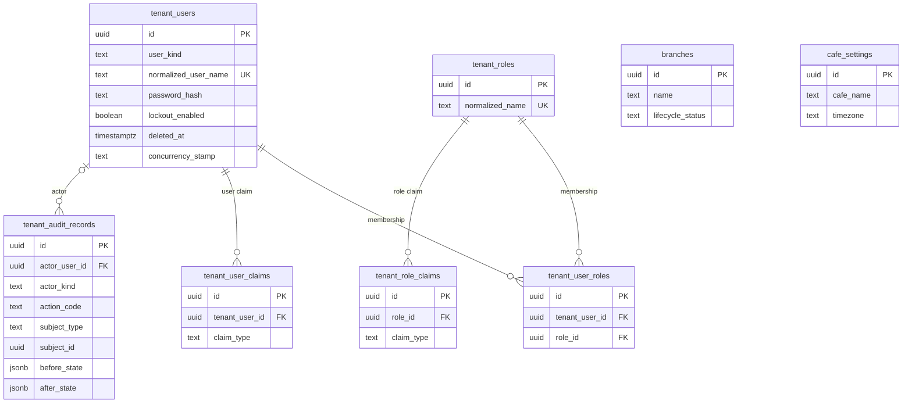

# Tenant Database ERD

Entity-relationship design for the per-cafe Tenant database at the baseline scope of `CFMD-254` (owner decision, 2026-10-21): owner and staff identity, the cafe profile, branches, and tenant audit. Modules outside this scope are designed later with their own stories (see `Explicitly out of scope (later stories)` below).

Derived from the decisions recorded in `architecture/database-conventions.md`, `architecture/database-schema-decisions.md`, `architecture/architecture-decisions.md`, and `architecture/erd-master.md`, cited through PRD requirement identifiers (the PRD v1.1 text stays untracked). Every naming, type, and deletion rule here follows `architecture/database-conventions.md`: logical deletion (PRD section 9, rule 23), no tenant discriminator column (one database per cafe), UUIDv7 keys, snake_case naming, `timestamptz` UTC timestamps, and text + CHECK status labels. Items marked **Proposed** await owner confirmation. `CFMD-74` consumes this ERD for entity classes and migrations; no entity, migration, or DbContext change is made in this story.

Note: the Mermaid diagram shows the tables and relationships with key columns only; the dictionary below is the complete column list (pervasive `created_at`/`updated_at` audit boilerplate is omitted from the diagram, and is stated per table in the dictionary). Every foreign key constraint receives a `fk_<table>_<column>` name and every index a `uq_` or `ix_` name through the mapping work for each table (CFMD-74); the dictionary names the ones whose definition is not obvious.

**Proposed, pending owner confirmation (diagram conventions):** the diagram omits every table's audit columns (`created_at`, `updated_at`, `created_by`, `updated_by`) for readability; the dictionary states them per table. Cardinality markers follow the FK optionality in the dictionary: a non-null child FK draws the parent side as exactly-one, a nullable child FK draws it as zero-or-one, and a unique child FK caps the other side at zero-or-one. `branches` draws no relationship line because all of its current foreign keys are audit actor columns, which the note above omits.

## Tenant scoping and cross-database references

- Every table belongs to exactly one cafe: the connection itself establishes the tenant boundary (one Tenant DB per cafe, PRD section 9 rule 2), so **no tenant identifier column exists anywhere in this design** (`architecture/database-schema-decisions.md`); tenant-scoped work reaches the database only through the validated, fail-closed tenant context (FR-PLT-002, PRD section 10.2).
- No foreign key may cross to the Master database or any other tenant database (conventions): platform-side knowledge — the tenant's slug, subscription and plan versions, entitlement values, and lifecycle decisions — reaches the Tenant Application only through the provisioning path and validated platform metadata, never as a schema FK. Entitlement limits (FR-PLT-004) are enforced by the application from that delivered configuration; nothing in these tables encodes the retired 3-branch/15-table quotas (PRD section 9 rule 3). `What provisioning seeds into a new Tenant database` below documents the initial delivery.
- Customer-facing URL and QR identifier decisions (including the `t/{slug}` prefix and the QR resolution source) belong to the later stories that introduce those flows; this ERD imposes nothing about them.
- All references a tenant row holds stay inside this database, so every FK in this design is resolvable locally and never orphaned by another database.

## Identity model documentation

- Mechanism (**Proposed, pending owner confirmation**; consistent with the confirmed Master mechanism): ASP.NET Core Identity with explicitly customized GUID-keyed entities for owner and staff identity. "Customized" means the key type (UUID), snake_case table and column names, and the repository's explicit EF configuration; account behavior — password hashing through the framework's hasher, lockout enabled from creation, and the stamps — stays the framework's default. No custom password-hashing or authentication behavior is introduced (PRD section 11.1).
- Included for owner/staff authentication needs: users (`tenant_users`), roles (`tenant_roles`), user-role memberships (`tenant_user_roles`), per-user claims (`tenant_user_claims`), per-role claims (`tenant_role_claims`). The MVP role example set (e.g. `Owner`, `Manager`, `Captain`, `Barista`) is Proposed and grows as the later stories define roles (FR-IAM-002).
- Intentionally excluded because the MVP does not use them: external-login storage (no external login provider is approved; no `user_logins` table) and default token storage (the password-based flows persist no tokens; no `user_tokens` table — token issuance belongs to later Auth work and is added explicitly then). These exclusions are design statements only — no entity or migration change is made here.
- Staff lifecycle (FR-IAM-003): creation, role assignment, activation, deactivation, and credential management happen through approved workflows; deactivation uses the generic `deleted_at`/`deleted_by` marker and every authorization check treats a deactivated user as unauthorized, so an access change takes effect in authorization checks immediately; identity and role changes — including join-row removals under the documented assignment-state exception — are audited in `tenant_audit_records`.
- Deactivated users are never physically deleted, so every FK that references them — the audit actor and the provisioning/`created_by` references — stays historically resolvable.

## What provisioning seeds into a new Tenant database

Provisioning creates the database, applies migrations, and seeds required data (FR-ONB-006). Seed steps must stay safe under provisioning retries (FR-ONB-007): a resumed attempt must not duplicate seeded rows or reset owner-configured state. The seeds and the source of each row:

- `cafe_settings` — the singleton profile row: `cafe_name` and the contact data are copied from the approved onboarding request's registration data as delivered by the provisioning pipeline; `timezone` receives the provisioning default (**Proposed** — the value and its derivation await owner confirmation); logo and colors start NULL and are configured by the owner afterwards (FR-CAF-001); the row exists from seed with `created_by` NULL (no acting user).
- `tenant_roles` — the seeded Owner role (Proposed name `Owner`), so the owner's permissions are carried through role claims from the first login (FR-IAM-002); further roles are configured later.
- `tenant_users` — the seeded Owner user copied from the approved onboarding request's registration data, including the password hash created during public registration; the hash is verified only through the mechanism's hasher (PRD section 11.1); `user_kind` is `'Owner'`; lockout starts enabled (the Identity default).
- `tenant_user_roles` — the membership row linking the seeded Owner user to the seeded Owner role, so the first login is authorized without manual setup.
- `tenant_audit_records` — the first audit record, written by the system (`actor_kind = 'System'`, `actor_user_id` NULL), capturing that the database was provisioned and seeded.

Nothing links back to the Master database: no foreign key crosses databases (conventions), so all seed values are copies in this database's own rows. The Master/Registry database keeps its own copy of the registration data — its onboarding request (FR-ONB-001 through FR-ONB-005) — together with its platform-owned references; the Tenant database never reads them through schema references.

## Table dictionary

### tenant_users

Purpose: owner and staff authentication and authorization subjects in this cafe's database (FR-IAM-001, FR-IAM-002); the lifecycle behaviors and included/excluded Identity tables are documented under `Identity model documentation` above.

- `id uuid NOT NULL` — entity identity; `pk_tenant_users` (Identity keyed by GUID; the default string key is intentionally not used because all identities are UUIDv7).
- `user_kind text NOT NULL` — `ck_tenant_users_kind` over `('Owner', 'Staff')` (Proposed): the seeded cafe owner versus staff accounts; role claims stay the authoritative authorization input (FR-IAM-002). Owner versus staff matters for audit derivation (see `tenant_audit_records`); it is not duplicated into audit rows.
- `user_name text NOT NULL` (CHECK length 1..256, `ck_tenant_users_user_name_length`); `normalized_user_name text NOT NULL` (CHECK length 1..256) with `uq_tenant_users_normalized_user_name` — the mechanism's own case-normalized column and the uniqueness enforcement.
- `email text NULL` (CHECK length 1..320) and `normalized_email text NULL` (CHECK length 1..320) — `ix_tenant_users_normalized_email`, not unique: staff addresses are not identity-critical in the MVP; the normalization style follows the mechanism.
- `email_confirmed boolean NOT NULL` default `false`; `phone_number text NULL` (CHECK length 1..64), `phone_number_confirmed boolean NOT NULL` default `false`.
- `password_hash text NOT NULL` (CHECK length 1..512) — set and verified only by the mechanism's hasher (PRD section 11.1); the seeded owner's hash arrives with the provisioning copy (see the seeding section above).
- `two_factor_enabled boolean NOT NULL` default `false` (persisting second-factor data needs the excluded token tables and is designed explicitly when enabled).
- `lockout_enabled boolean NOT NULL` default `true` — the Identity default, so lockout protection against password guessing is active from creation (PRD section 11.1); `lockout_end_at timestamptz NULL`; `access_failed_count integer NOT NULL` default `0`.
- `security_stamp text NOT NULL` (CHECK length 1..64) and `concurrency_stamp text NOT NULL` (CHECK length 1..64) — mechanism columns; the mechanism's stamp-based concurrency intentionally replaces the general `xmin` rule here (the documented exception).
- `deleted_at timestamptz NULL`, `deleted_by uuid NULL FK tenant_users.id` — the logical-deletion marker: a deactivated staff account keeps the row (FKs of history stay resolvable) while every authorization check treats a non-null `deleted_at` as unauthorized (FR-IAM-003 acceptance criteria).
- `created_at timestamptz NOT NULL`, `updated_at timestamptz NOT NULL`, `created_by uuid NULL FK tenant_users.id`, `updated_by uuid NULL FK tenant_users.id` (the seeded owner account is bootstrapped outside a user action; `created_by` is NULL there).

### tenant_roles

Purpose: role catalog for owner/staff authorization (FR-IAM-002); the MVP role example values are Proposed (see `Identity model documentation` above) until the later staff story confirms the actual role values. The seeded value is the Owner role.

- `id uuid NOT NULL` — `pk_tenant_roles`.
- `name text NOT NULL` (CHECK length 1..256); `normalized_name text NOT NULL` (CHECK length 1..256) with `uq_tenant_roles_normalized_name`.
- `concurrency_stamp text NOT NULL` (CHECK length 1..64) — mechanism column as above.
- `created_at timestamptz NOT NULL`, `updated_at timestamptz NOT NULL`, `created_by uuid NULL FK tenant_users.id`, `updated_by uuid NULL FK tenant_users.id` (the seeded Owner role is bootstrapped by provisioning with NULL actor).

### tenant_user_roles

Purpose: membership join between a user and a role; the mechanism's user-role table with snake_case naming and a surrogate key. Rows are current assignment state, not history — removable as the documented exception, and every removal is audited in `tenant_audit_records` (FR-IAM-003 acceptance criteria). The seeded membership (Owner user ↔ Owner role) is the first row.

- `id uuid NOT NULL` — `pk_tenant_user_roles`.
- `tenant_user_id uuid NOT NULL FK tenant_users.id`; `role_id uuid NOT NULL FK tenant_roles.id`; `uq_tenant_user_roles_user_role ON (tenant_user_id, role_id)`.
- `created_at timestamptz NOT NULL`.

### tenant_user_claims

Purpose: extra claims attached directly to a user (mechanism-shaped; future-proofing for granular permissions). Same assignment-state treatment as membership rows.

- `id uuid NOT NULL` — `pk_tenant_user_claims`; `tenant_user_id uuid NOT NULL FK tenant_users.id`; `claim_type text NOT NULL` (CHECK length 1..512); `claim_value text NULL` (CHECK length 0..1024 when present).
- `created_at timestamptz NOT NULL`.

### tenant_role_claims

Purpose: claims granted to every holder of a role. Same assignment-state treatment.

- `id uuid NOT NULL` — `pk_tenant_role_claims`; `role_id uuid NOT NULL FK tenant_roles.id`; `claim_type text NOT NULL` (CHECK length 1..512); `claim_value text NULL` (CHECK length 0..1024 when present).
- `created_at timestamptz NOT NULL`.

### branches

Purpose: the cafe's branch(es) — branch state, opening hours, contact/address fields, and operational status are managed data, with no hard-coded quota (FR-CAF-002).

- `id uuid NOT NULL` — `pk_branches`.
- `name text NOT NULL` (CHECK length 1..256).
- `lifecycle_status text NOT NULL` — `ck_branches_lifecycle_status` over `('Active', 'Suspended', 'Retired')` (Proposed): operational status is a managed column; transitions are application-validated; a branch is never physically deleted (logical-deletion policy).
- `address text NULL` (CHECK length 1..512 when present), `contact_phone text NULL` (CHECK length 1..32 when present) — contact/address fields are recorded only where configured.
- `opening_hours_summary text NULL` (CHECK length 0..512) — freeform summary of configured opening hours; structured per-day hours are not PRD-mandated and are deferred until an approved shape exists (Proposed).
- `created_at timestamptz NOT NULL`, `updated_at timestamptz NOT NULL`, `created_by uuid NULL FK tenant_users.id`, `updated_by uuid NULL FK tenant_users.id`.

### cafe_settings

Purpose: the cafe's profile and branding configuration (FR-CAF-001) and the timezone used for explicit daily/hourly interpretations (PRD section 13 peak-hours precondition). A singleton row: created once by provisioning (see the seeding section above) with no acting user.

- `id uuid NOT NULL` — `pk_cafe_settings`. Singleton guarantee **(Proposed)**: `uq_cafe_settings_singleton` — a unique index over a constant expression (`CREATE UNIQUE INDEX uq_cafe_settings_singleton ON cafe_settings ((true))`), which PostgreSQL enforces as at most one row.
- `cafe_name text NOT NULL` (CHECK length 1..256) — seeded from the approved onboarding request's registration data (see the seeding section above).
- `logo_media_reference text NULL` — neutral media reference (CHECK length 1..512 when present); the blob-storage backing is not decided and no TBD number exists for it; only the reference lives here, never the binary.
- `primary_color text NULL`, `secondary_color text NULL`, `accent_color text NULL` (each CHECK `^#[0-9a-fA-F]{6}$` when present, `ck_cafe_settings_color_format`) — approved standard-template colors (FR-PLT-003, FR-CAF-001).
- `contact_phone text NULL` (CHECK length 1..32 when present), `contact_email text NULL` (CHECK length 1..320 when present), `contact_address text NULL` (CHECK length 1..512 when present) — contact data is seeded from the approved onboarding request where present.
- `timezone text NOT NULL` (CHECK length 1..64, `ck_cafe_settings_timezone`) — an IANA zone name; PG validity is application-validated (reporting hour/day grouping is explicit, PRD section 13); seeded with the Proposed provisioning default (see the seeding section above).
- `created_at timestamptz NOT NULL`, `updated_at timestamptz NOT NULL`, `created_by uuid NULL FK tenant_users.id` (NULL at provisioning seed), `updated_by uuid NULL FK tenant_users.id`.

### tenant_audit_records

Purpose: append-only record of sensitive tenant actions (FR-IAM-005, FR-AUD-001): actor, action, target, timestamp, and where applicable before/after values. Within the current scope of this database, the minimum audited subjects are staff identity and role/claim changes (FR-IAM-003) and sensitive settings/configuration changes (branches, `cafe_settings`); the PRD's other minimum subjects (FR-AUD-001) belong to modules designed in later stories and will use this same record shape there. The first record is the provisioning seed record (see the seeding section above).

- `id uuid NOT NULL` — `pk_tenant_audit_records`.
- `recorded_at timestamptz NOT NULL` — the UTC timestamp of the event (append-only; no `updated_at`).
- `actor_user_id uuid NULL FK tenant_users.id` — set when an authenticated person acts; NULL for system writes. `actor_kind text NOT NULL` — `ck_tenant_audit_records_kind` over `('User', 'System')` (Proposed): `'System'` for automated/system writes (actor NULL, such as the provisioning seed), `'User'` when an authenticated human acts. Owner versus staff is not stored redundantly — it is derived through `actor_user_id` and `tenant_users.user_kind`.
- `action_code text NOT NULL` (CHECK length 1..128) — a stable code following the `<Module>.<Reason>` style (Proposed).
- `subject_type text NOT NULL` (CHECK length 1..64) and `subject_id uuid NULL` — generic target pointer retained without a foreign key (append-only, Proposed).
- `before_state jsonb NULL`, `after_state jsonb NULL` — structured old/new snapshots where applicable (FR-AUD-001); `jsonb` without filtering/queries by content.
- Append-only: rows are inserted once and ordinary application workflows can neither update nor delete them (`architecture/database-conventions.md`); retention duration and tamper-resistance follow TBD-20.

## Explicitly out of scope (later stories)

- Staff assignment extras — station catalogs and per-user branch limits (FR-IAM-002 configured branch/station restrictions) arrive with the staff management story; this ERD keeps only the seeded role membership.
- Cafe tables and QR codes — physical tables, their QR references and reprint flows, and the customer table QR journeys (FR-CAF-003, FR-CAF-004).
- Menu management — categories, products, sizes, add-ons, per-branch availability, OCR-assisted import, and promotional banners (FR-MENU-001 through FR-MENU-006).
- Ordering — guest QR ordering, assisted ordering, submissions and their state (FR-ORD-001 through FR-ORD-010). Customer identity stays absent by design (FR-IAM-004; guest data minimization TBD-10).
- Bills, payments, and receipts — settlement, cash confirmation, online payments, and digital receipts (FR-PAY-001 through FR-PAY-006, FR-REC-001, FR-REC-002; provider decisions TBD-02, TBD-05; refund handling TBD-06).
- Paid WiFi — packages, purchases, and tokens (FR-WIFI-001 through FR-WIFI-006; token/redemption rules TBD-07; router/platform integration TBD-08).
- Attendance — daily QR windows and check-in/check-out records (FR-ATT-001 through FR-ATT-004).
- Printing — local print jobs and connector targets (FR-PRN-001 through FR-PRN-005; the PRD marks the hardware/protocol matrix TBD without a TBD number).
- Inventory — items, batches, movements, and alerts (FR-INV-001 through FR-INV-007; rule 18 keeps automatic deduction out).
- Reporting and analytics — read-model queries over the later operational tables (FR-ANL-001 through FR-ANL-004; revenue definitions TBD-16).
- AI insights — insight structures and their persistence (FR-AI-001, FR-AI-002; provider decisions TBD-22).
- Notifications — tenant-borne event delivery and its traceable attempts (FR-NOT-001, FR-NOT-002; TBD-09).
- Google Review — external final journey step; nothing hosted here (PRD section 9 rule 22).
- Tax eReceipt/eInvoice integration (TBD-14) — printing is not tax compliance (rule 16).
- Backup retention/frequency specifics (TBD-19) — per-database backups are operational work, not schema.
- Structured per-day opening-hours tables (FR-CAF-002 keeps a summary column until an approved shape exists).

## TBD register

| PRD ID | Neutral title |
|---|---|
| TBD-20 | Audit log retention and tamper-resistance requirements |
| — | Media object storage provider and cleanup policy (references only are modeled — the `cafe_settings` logo; no PRD TBD number exists; physical media deletion is the approved exception, rule 23) |

`CFMD-74` consumes this ERD for entity classes and migrations.
